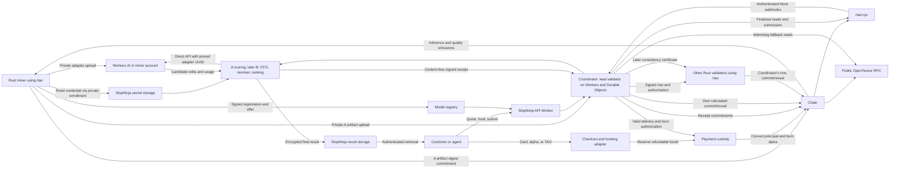

# Draft Cloudflare subnet design

Draft 0.41, November 11, 2026. Implementation design notes accompanying
[whitepaper draft 0.65](../whitepaper/main.tex). Both describe a proposal;
neither establishes a deployed or qualified subnet.

The [implementation plan](subnet-implementation-plan.md) defines the build
sequence, acceptance criteria, and upstream rtao improvements.

SlopNinja's main objective is *B*: transforming authorized writing to sound
natural and match the author's intended voice while preserving meaning,
readability, and tone. *A* supplies supporting detection and attribution signals
for revision search and evaluation. The intended training is adversarial:
*B* learns against public *A* detectors, while authorized *B* revisions supply
challenging examples for future *A* training after evaluation retirement.
Fresh held-out evaluation must establish any improvement in either mechanism.
*A* launches first as the initial evaluator
and detection service; launch order does not change the main product objective.

The subnet has three logical mechanisms: *A* for AI detection through origin
and author attribution, *B* for transformation, and *C* for shared
contributions to the native grammar (CFG) that later *B* work uses. *A* reads
raw text and does not use the CFG. Launch includes *A* alone; *B* and *C*
require separate activation. SlopNinja operates the customer
API and executes *A* artifacts in its own account. The proposed later *B* service
uses private LoRA adapters in miner-owned Cloudflare accounts, with miners
paying those inference bills and our runtime controlling the document workflow.
Paid inference opens when the coordinator judges measured quality sufficient.
Customers pay for bounded jobs using a card, subnet alpha, or TAO, with
Coinbase Onramp selected for card-to-native-TAO funding of those jobs, subject to integration
qualification. A paid job's principal buys and burns alpha. Before mainnet,
the detection product's revenue (advertising on the site's content pages, never
on the detection page itself, and a paid detection API once the served package
is published, paid through a merchant-of-record card processor or directly in
TAO) goes into a public pot instead of being burned job by job. The pot pays
the mainnet registration, then buys alpha, half burned and half distributed to
testnet miners whose winning models earned that revenue
([Revenue before mainnet](#revenue-before-mainnet-the-detection-page-and-the-public-pot)).
Pricing multipliers and any inference
share of emissions remain separately calibrated hyperparameters.

Miner and validator software is entirely Rust, built on
[`rtao`](https://github.com/sam0x17/rtao), with
`rtao-rpc` (private repository) providing our RPC service at no
charge. The coordinator is the operator's lead validator, implemented
entirely on Cloudflare Workers with serverless storage and scheduling. It
publishes signed assignments and scoring records and performs its own validator
signing, submission, and recovery there. Miners and other validators run native
Rust applications and hold their own chain keys. All application logic is Rust;
production inference and challenge generation, execution, and scoring also run
serverlessly. A challenge is a coordinator-internal evaluation task (generating
cohort documents or running an admitted artifact on them); none is sent to a
miner or validator. Participants update automatically with ordered, recoverable state
migrations. The only dependence on other validators is timely submission of
the coordinator's signed weight rows on chain. Validators commit the row the
coordinator signs and publishes off-chain, using native commit/reveal in
parallel, without a coordinator finality prerequisite.
Their acknowledgments, software versions, availability, or stake never gate
cohort advancement, scoring, service, upgrades, or recovery.

Launch evaluates English documents, with document-level scores and AI span
localization. Multilingual detection rewards and broader length classes each
need qualified data and workload profiles. For later *B*, *C* may improve
parsing of informal English and embedded foreign or technical material. *A*
reads raw text, so grammar coverage does not change its detection capabilities. The later cleanup product follows an authorized writer's brief
and preserves meaning; a lower detector score never changes production history.

The privacy requirement is that miners cannot retrieve customer prompts or
responses. Usage metadata, including token counts, timing, and cost, is
acceptable. Private *B* weights must not be downloadable by the general public.
Cloudflare and SlopNinja are trusted with text and may technically access
weights. We minimize that access through the serving design, without claiming
cryptographic protection from either operator.

## Launch scope and scoring authority

Launch starts with *A* alone. It reports estimated AI-written/rewritten share
and confidence in any AI involvement as separate document-level percentages.
Origin detection supplies the production-history probabilities behind confidence;
controlled rewrites supply fractional supervision for share.
Human writers have recurring habits of expression; language models can also
exhibit characteristic vocabulary, syntax, rhythm, and document structure.
The proposed model learns these writing signatures to help detect AI involvement.
Signatures can overlap and vary with prompting and editing, so their usefulness
must be measured on unseen writers, generators, and workflows.

Each *A* entrant supplies
one text model that produces AI-origin detection, share, AI spans, and author
attribution from a shared learned document encoding in one invocation. All heads consume that
encoding and may add task-specific layers. This requires one learned encoding
interface; useful feature sharing still needs measurement. Admission checks the published
computation graph, one manifest, and one input/output contract; two independent
predictors behind one API do not qualify. This is a structural requirement,
not a claim that training history can be verified from weights.
The shared encoder is intended to let the tasks improve each other: learning
writer and generator patterns can help detect model involvement, while
production-history supervision can help attribution separate a writer's habits
from patterns introduced by generation or editing. Measure both directions
against origin-only and attribution-only controls with matched capacity, data,
and training budgets. Shared structure alone does not establish this benefit,
and neither output substitutes for the other.
The shared encoder is a deliberate requirement for a common representation
across these tasks, including later author-fit feedback to *B*. Graph inspection
cannot establish positive transfer or rule out heads using disjoint features.
Measured harm would inform an explicit revision of the design before launch;
it does not silently exempt individual entrants from the shared-encoder rule.
Known AI models occupy predefined
author profiles alongside human writers. AI-involvement Brier is the only reward
quantity; share, attribution, and span outputs are qualification gates.
A detector miner commits its artifact's digest on chain and uploads the artifact
privately and directly to the coordinator's object store, which publishes it
when the cohort's scoring starts. The
miner does not need a miner-owned Cloudflare account, private LoRA, or delegated
inference credential.
SlopNinja pays for production
*A* execution.

SlopNinja is the **operator**; the **subnet owner** is the account recognized
on chain. SlopNinja may operate through ownership or a lease. A lease must
secure an owner-authorized execution path for required hyperparameter changes,
including enabling commit/reveal, and any owner-only burn operations. Service
operation alone grants neither these powers nor owner emissions.

One lead validator, operated by SlopNinja, serves as **the coordinator**.
**The coordinator is the serverless service**, including all lead-validator
duties. It runs the frozen evaluations, derives the native weight row from
quantized scores, and publishes the quantized results and its signed row.
Every other validator verifies that signed row and commits it in the same
target window using its own key, nonce, and journal; it may check models in
its own way and publish its own scores, but those are advisory and never
change its row. The coordinator performs its signing, submission, and recovery
in Workers and Durable Objects, and later certifies its finalized row as
consistency evidence. No validator waits for that certificate or another
validator's submission. Held-out data, exact scores, and receipts stay inside
the coordinator; other validators cannot reproduce hidden scoring. This trusts
the coordinator's evaluation and row; anyone can recompute the row from the
public quantized results, which checks reward arithmetic, not model predictions
or linguistic judgments. Native consensus still determines actual payouts.

*A*, *B*, and *C* name logical workstreams. The current
[native mechanism documentation](https://www.bittensor.com/docs/guides/subnets#mechanisms)
supports two mechanisms. *A* alone uses one native mechanism; a second can
carry *B* or *C*. *C* may activate before *B*, so *B*'s activation plan chooses
a mapping that also places *C*'s credit. No third native mechanism is assumed.

A proposed *C* miner contributes public, reusable grammar or lexical
improvements to the shared grammar used by later *B* work. Accepted
contributions earn credit once; continued use does not earn recurring credit.
The admissible contribution format, correctness tests, attribution, and award
sizes remain to be defined. Grammar size by itself is not a proposed quality
measure.

The detailed *B* hosting, rewrite benchmarks, mandatory *A*-to-*B* service, and
private-result rules below remain later-phase proposals. They are not launch
requirements. Their evaluation and review authority needs a decision before
*B* activates, with no validator approval dependency. The detection cost scenario applies to
the proposed initial service; the revision scenario applies to that later phase.
Neither the *A* training-request duty nor the *B* availability/recovery gate
applies before *B* activates. Absent duties must not require a positive ticket
count or fabricated service successes for *A* eligibility.
The launch input contract is raw text and the reward rule is `reward-v2` with
score quantization `quant-v1`; gate
thresholds still await qualification. The grammar version policy belongs to
later *B* and *C* activation.
*C*'s contribution contract and allocation must be settled before its later
activation. Paid-use credit for centrally hosted *A* would reward the model
contributor; SlopNinja pays serving costs. Its inclusion and rate remain open.

The coordinator decides when *A* is good enough to sell. Qualification for
benchmark rewards does not automatically open checkout. Record the evaluated
artifact/profile, quality evidence, permitted workloads, and effective date of
the coordinator's commercial activation decision. The coordinator may restrict
or suspend new sales as quality or service conditions change; accepted jobs
retain their quoted delivery/refund terms. This decision does not change frozen
benchmark scores retroactively.

Opening paid inference and introducing paid-use emissions are separate choices.
Sales can operate with quality-only emissions (`f = 0`). Any nonzero `f`
requires model-credit attribution, self-purchase controls, caps, and unused-pool
handling before activation. *C* starts inactive (`c = 0`); no activation date or
live reward share is selected for it.

### One A model for AI detection and attribution

The proposed output contract contains:

- `origin`: calibrated probabilities for `human_only`, `model_only`, and `mixed`,
  summing to one.
- `ai_probability`: `P(model_only) + P(mixed)`, estimating model involvement under
  the frozen production-history labelling policy.
- `ai_confidence_percent`: `100 * ai_probability`, confidence that AI contributed.
- `ai_share_percent`: 100 times the expected fraction of final words in
  model-written or model-rewritten spans under the declared provenance rule.
- `attribution`: conditional results for both human and AI-model roles. Each
  reports supported named profiles or its fallback, `other_human` displayed as
  "Other human" or `other_ai` displayed as "Other AI". Return each result with
  its role's involvement probability: `P(human_only) + P(mixed)` for the human
  role and `ai_probability` for the AI role.
- `spans`: AI spans with exact character offsets into the canonical text and a
  confidence per span, decoded from per-token AI probabilities. Optional until a
  cohort manifest enforces the span gate.
- `sentences`: per-sentence AI share and AI-involvement confidence derived from
  the same token probabilities.

Binary training labels are zero for documented human-only work and one for
model-only or mixed work. The model learns a probability from those labels;
the percentage is not a hard decision reformatted as a score. Documented
three-way histories additionally supervise the origin components. Every
completed inference returns numeric share and confidence scores, with calibration and workload
profile frozen for the comparison. An execution failure remains an explicit
failure, never a zero score. Thresholds remain useful for benchmark operating
points but are not required public outputs.

Both percentages are required document-level outputs. Confidence estimates the
probability of any AI involvement. Share estimates the expected fraction of
final words in model-produced spans. Require `0 <= 100 * P(model_only) <=
ai_share_percent <= ai_confidence_percent <= 100`: human-only work has zero
share and model-only work has unit share under this convention. One implementation
estimates share as `P(model_only) + P(mixed) * expected_share_given_mixed`,
with the conditional expectation in `[0, 1]` for the document. All learned
outputs consume the shared encoder.
A result can be 20% estimated AI share with 99% confidence that AI contributed;
confidence does not certify that the share estimate is exact.

Binary labels supervise confidence. Controlled partial rewrites provide
fractional share labels: final words in recorded model-produced replacements
divided by all final-document words under a fixed counting convention.
A complete rewrite of a human source can have 100% replacement-span share while
retaining mixed production history. The
[controlled replacement-span experiment](cfg-vector-viability.md#controlled-replacement-span-experiment)
defines that design and its limits, and the
[spliced-rewrite span data](a-spans-data.md) supply *A*'s current share and span
supervision. Both scores need workload-specific
qualification. Confidence Brier is the reward; share accuracy is a
qualification gate with no reward weight.

Conditional attribution asks which contributor fits if that role contributed.
A named match or fallback does not itself assert presence. Both role results
are always returned; no involvement-probability cutoff suppresses either.
The two role probabilities can sum above one because mixed work includes both
roles, and they are not text shares. Both fallbacks can appear in mixed work;
multiple contributors need not be forced into one named identity. Supported
named-model matches remain visible at low AI probability without changing it.

Use the role's fallback when no named profile satisfies the frozen matching
rule. Neither fallback is an enrolled profile, asserts that the identity is
absent from the gallery, or proves authorship. A listed writer or model can
also be unidentifiable from the text. A completed result has no separate
unknown or attribution-abstention label; execution failure remains separate.

These outputs belong to one model and artifact. All heads consume the
shared learned encoding and may add task-specific layers. Two independent
predictors behind one API do not satisfy the architecture. Profile references
and their versioned gallery are bound to the artifact's inference contract.

The main intended human-attribution use is a customer supplying independent
examples of their own writing. Trusted preprocessing represents each sample by
the *A* encoder's output and stylometric features (function-word frequencies
and character n-grams), then pools them into one private writer profile under a
qualified, versioned pooling contract. A normalized weighted mean is the
proposed starting point; the pooling rule, per-work weights, missing-feature
masks, feature definitions, and encoder version are versioned and qualified.
The proposed profile has no CFG component (on top of encoder plus stylometry,
CFG added +0.0015 verification AUC; below). CFG writer-style features remain a
candidate *B* revision input, qualified separately. The matcher
consumes the profile instead of raw reference prose. Upstream preprocessing
still reads the samples. Test sensitivity to sample length, topic, register,
and heterogeneous writing; a single average may discard useful variation.

No profile type is yet qualified to back `provided_writer` or *B*'s author-fit
feedback. In the October 31, 2026 [writer-profile comparison](cfg-vs-encoder-results.md)
on writers neither system had seen, unlearned R0-encoder profiles beat CFG
writer vectors on verification (pooled AUC at five references 0.778 against
0.743; difference −0.034 [−0.047, −0.022]), stylometry alone reached 0.828,
and encoder plus stylometry 0.846. Fused with the encoder alone, CFG added
+0.027 [+0.022, +0.032], less than stylometry's +0.069; adding CFG to encoder
plus stylometry gained only +0.0015 [+0.0004, +0.0025] on the same writers. Even the strongest profile let
42% of impostor trials pass at 90% of genuine ones, training thresholds missed
their false-accept target on withheld writers, and every profile ranked
rewrites toward a target near chance (mean per-target AUC 0.53–0.55). The next
qualification is a learned matcher trained on fresh authors, with acceptance
thresholds measured on withheld writers and real style-transfer data. Until a
profile type passes it, neither `provided_writer` nor *B*'s author-fit feedback
is offered. The grammar's planned use is later *B* work (edit units,
writer-style guidance and grammar-level revision explanations), each qualified
on its own evidence; *C*'s contributions target that grammar.

Under the ordinary named-match rule, the customer-scoped profile can return
`provided_writer`, displayed as "Provided writer". It reports a match to the
supplied references and does not authenticate the customer's identity or prove
authorship. If no human profile qualifies, return `other_human`. The existing
role probabilities and AI share/confidence remain independent of that match.
This adds a named profile, not a third fallback. Samples and derived profiles
stay private under the job or customer scope; they enter neither a public
gallery nor training by default.

Documented public or licensed human references may also support gallery
profiles under a published enrollment policy. Record provenance, the basis for
the identity label, and permitted uses. Public availability alone establishes
neither identity nor unrestricted reuse. Personal references are the main
intended workflow; these galleries provide a secondary use.

The score is a prediction, not proof of authorship. An unseen AI model can
receive high AI confidence and "Other AI" attribution. Failing to match known
model profiles cannot establish human origin. A known human writer may also
have used AI assistance; matching that writer does not override the origin
output. Human/model edits retain their recorded mixed history, and one model
rewriting another remains model-only with potentially unresolved attribution.
An unavailable prediction returns a failure status rather than zero share or confidence.

AI-involvement quality is the reward comparison; the three-way origin
probabilities remain separately measured. Known-author/model attribution and
open-set rejection are measured separately, including for previously unseen
generators. Attribution is a qualification gate only: it adds no reward weight
and breaks no ties, and there is no separate origin-only participation track.
Report "Other AI" use on withheld generators and ambiguous listed-model cases,
with fallback frequency on listed models. Report "Other human" use on withheld
writers and ambiguous listed-writer cases, with fallback frequency on listed writers.
Neither fallback earns credit for a correct named identity.

Open-set rejection measures completed attribution decisions that accept no
named match for the evaluated writer or generator role. `other_human` and
`other_ai` are the corresponding fallback outcomes. Evaluate each documented
contributor role, including both in mixed work, regardless of its predicted
involvement probability. Credit successful rejection only when the ground-truth
identity is absent from the gallery and the corresponding fallback accepts no
named match for that role. A wrong named match is an attribution error, and
fallback on a listed identity is not successful open-set rejection. Missing
role results and execution failures remain in the assigned population and earn
no rejection credit. Do not score conditional identities for roles absent from
the documented history: a fallback there is not itself a false assignment.
Evaluate mistaken involvement probabilities separately through origin
calibration and false-positive measurements.

Role-level open-set rejection covers a single contributor or a role whose
contributors are all withheld. A role containing known and withheld contributors
needs a frozen set-valued metric before rejection credit; retain those cases
in coverage and report them separately.

### AI span localization and later explanations

The goal is AI span localization; sentences are one view of it. A token-level
head on the shared encoder returns an AI probability per token. Those
probabilities decode into AI spans with exact character offsets and a confidence
per span, and they give per-sentence AI share and confidence. Document-level
outputs keep their meanings, and the runtime's emission makes the spans agree
with them by construction: a word's probability is the mean of its token
probabilities, and a share tilt shifts every word's logit by one bias so that
the mean word probability equals the emitted document share. Sentence shares
are means of tilted word probabilities, so they aggregate to the document share
by final-word weights over complete, nonoverlapping partitions. Document
involvement confidence cannot be assembled that way, since correlated sentences
do not justify averaging confidences or multiplying their complements; it stays
the document head's calibrated output, and sentence and span confidences are
capped at it.

Training labels already exist: the retained exact model-produced spans for mixed
documents, all-AI labels for model-only documents, and all-human labels for
human-only documents. Qualification measures token-level Brier, character-span
IoU and F1 against the retained spans, boundary error, and sentence-level
calibration. Each cohort reports them as a qualification gate whose thresholds
are fixed after measurement; spans earn no reward, and document involvement
Brier remains the reward. Agreement with the document outputs needs no gate,
because the emission guarantees it; the pre-tilt gap between mean word
probability and document share is reported as a diagnostic, since the tilt
costs word-level accuracy wherever the document share is the less accurate
estimate. The span gate includes the false-positive rate of
human sentences inside mixed documents, reported separately from the
pure-human document gate and with reward weight 0, because identical human
words score higher next to AI text than alone (context bleed, measured on a
smoke-test head).

The release package ships with such a head: `R_0` (seed 17) plus the S0+
token head, trained on the frozen seed-17 fit with the spliced-rewrite cohort,
so every document output stays bit-identical to `R_0`'s
([span results](a-spans-results.md#shipped-configuration)). Its decoder was
chosen under a limit of spans on at most 22 of 570 Dev-iter humans, met with
zero slack. On the 823 held-out spliced `span_report` documents (scored once
after the decoder and CAL maps were frozen; their parents were Dev-iter humans,
so somewhat optimistic) it reaches word Brier 0.128, character F1 0.410
(precision 0.862 over the 477 documents with a decoded span, recall 0.402) and
span F1 0.245, and decodes no span in 42% of them. Span metrics are per-document
means; F1 and recall count a document without a decoded span as zero. Clause and single-sentence edits are mostly
missed (character F1 0.051 and 0.167). Retrospectively on the consumed Test,
156 of 6,132 humans (2.5%) carry a decoded span, and base-model text is almost
never found (character F1 0.021). The head adds 0.14 s at 2,048 tokens to a
CPU request of about 27 s. The joint fine-tune S1+ found more spans (0.560)
but scored humans clearly worse before calibration (human-only Brier 0.061 to
0.093) and flagged 6 Test humans at its 0.1% point against none, so it was not
adopted.

S2c ([span results](a-spans-results.md#follow-up-arm-s2)) is the span head of
SlopNinja's first span package (adopted November 1, 2026). S2c
keeps the encoder and document heads frozen and feeds the token head through a
trained copy of encoder layers 18–21 and the final norm (about 20M
parameters). Its document outputs are byte-identical to `R_0`'s at every seed,
so confidence, share and reward scoring do not change. Its primary span
metric beats the shipped recipe's (S0+ minus S2c +0.0118 [+0.0104, +0.0131])
but not the joint fine-tune's, so the pre-registered outcome is partial. Its
own decoder (an extended grid point) puts spans on 21 of 570 Dev-iter humans at
seed 17, within the limit (seeds 29 and 41: 22 and 27). On `span_report`
(re-read, evaluated once after both freezes) seed 17 with identity span maps
reaches character F1 0.519 and span F1 0.485, against 0.410 and 0.241 for the
shipped head on that basis (0.245 with its calibration maps); on the consumed
Test, mixed character F1 is 0.535 against 0.478, but 210 of 6,132 humans
(3.4%) carry a span against 156 (2.5%) for the calibrated heads. R1 passes (token probability
within 4.4e-6, offsets equal). The tower adds 18–20% of encoder CPU time (5.3 s
at 2,048 tokens on one thread); artifact spec v3 admits its graph as the tower
class, with its own 173.5M parameter bound.
Its Dev-iter human gates are optimistic (those humans were seen by the
baseline's early stopping and the earlier decoder limit). Since November 9,
SlopNinja's span-serving package is span package d24
([reference packages](testnet/reference-packages.md)): S2c's seed-17 weights
with the 24-word decoder and a span confidence map refitted on the Calibration
split under the floor. On the same CPU class its document outputs are `R_0`'s
bit for bit, and the f32 Container scorer serves its spans.

Spec v1 refuses the span class (`graph_class_not_served`), and specs v1 and v2
refuse a tower graph by its length (`graph_size`); spec v2 and later admit the
span class, and spec v3 and later the tower class
([artifact spec](testnet/artifact-spec.md)). The span gate
compares each entrant with a fixed anchor, SlopNinja's first span package, on
the same cohort batch under the 24-word floor: over mixed documents whose
model-produced span has at least 24 words, the entrant's mean character F1 may
be at most a fixed margin below the anchor's and its in-context false-positive
rate at most a fixed margin above it, and over human-only documents the number
on which it decodes a span may exceed the anchor's by at most a fixed margin.
The margins are fixed after measurement on the sealed batches of closed testnet
cohorts, and the manifest binds them with the anchor's identity. If the anchor
fails to emit spans or to separate from trivial heads on a cohort's batch, or
the cohort's population differs from the one measured, the measured
conditions decide no entrant in that cohort; the operator may also void them
for one cohort, with a recorded reason, before its packaging starts. Before
any manifest enforces the gate, it runs in report mode on at least three live
cohorts: a cohort whose template names the gate requests spans for every
document, adds an anchor job when the anchor is not the reference, and signs a
separate per-entrant record of the outcome, failing no one. Report mode and
artifact spec v5, which refuses an artifact without a token-level head or with
a decoder minimum under 24 words, are built but not yet deployed, so no cohort
has yet evaluated spans. Until a manifest enforces the gate, the token-level
head is optional and a document-heads-only entrant like `R_0` is admissible;
from that manifest on, every entrant must provide it. Enforcing the gate does
not itself change the reference; reference changes follow the rules under
"Reward rules" below.

A further extension could highlight words and constructions that materially
influence a score. Map explanations to source spans; test controlled changes and
measure score responses with meaning and context controls. Check stability
across harmless formatting. Grammar-level explanations, mapped to CFG
productions, belong to later *B* revision guidance.
Attention weights or generated explanations alone do not establish faithfulness.
Such highlights explain a model calculation and do not prove that particular
words were produced by AI. This extension is not an initial launch requirement.

### Launch input contract

The *A* input contract is raw text. Miner artifacts are text models: an ONNX
graph, a fixed tokenizer, heads, and calibration. The cohort input profile is
canonical text, not CFG vectors. The launch model, `Faux` (recipe `E1aux`) seed
17, is a text-only ModernBERT-base fine-tuned from V6 on raw tokens
([release candidate](a-baseline-release.md)).

*A* does not use CFG-derived inputs. A CFG-only detector failed its first
real-data test: on 102 Test documents, CFG-only shared models had
involvement Brier 0.126–0.134 against 0.096 for mapped Pangram, with human
false-positive rates at 0.5 of 67–87% ([viability experiment](cfg-vector-viability.md)).
Adding CFG to frozen text features gave only a small, uncertain Development
gain, 0.048–0.057 against 0.052–0.058 for text alone
([fusion pilot](a-v6-cfg-fusion.md)). Those inputs were pooled grammatical-leaf
counts; ordered and tree-aware CFG representations remain untested. CFG writer
vectors also scored below the encoder as writer profiles (above), so private
writer profiles do not rest on CFG. The grammar work continues for later *B*
(edit units, writer-style guidance, revision) and *C*'s contributions.

No CFG input profile is planned for *A*. Any proposal would be a new frozen
comparison against raw-text models on the same documents and splits, counting
grammar-development sources as training exposure and keeping parse failures in
the evaluation; the
[viability note](cfg-vector-viability.md#measurements-and-decision) lists the
measurements such a comparison needs.

### Training data and qualification

Keep three linked records: independent works and their author/reference roles;
production histories with generator versions, parent links, assistance order,
and label strength; and later *B* sources, briefs, revisions, and editorial
judgments. Authors, source works, translations, excerpts, and every generated
descendant stay within their declared split. Reference and query works are
independent. Match topics, genre, length, and assignment format across origins,
and hold out generator and prompt families. A publication date, detector
agreement, or requested authorial style cannot establish an origin or identity
label. Keep weak historical-human proxies identifiable in every report.

Split before vocabulary or feature fitting. Retain exact text, prompts where
known, and collaboration/editing records; distinguish original writers from
translators, coauthors, and quoted sources. Earlier references and later queries
are required when claiming chronological transfer. Apply the same source-family
and exposure controls to *C*'s held-out contribution tests.

The shared input profile fixes identity redaction and OOV handling before
lexical features are constructed. Explicit author IDs, miner UIDs, assignment
metadata, hidden labels, and source/candidate-role flags are excluded from
learned inputs. Reference-profile IDs identify outputs and gallery entries;
they are not query features. Names, handles, and other identity-bearing text
need a declared policy and leakage controls. The reference-gallery interface
should support enrolling a new human author using independent samples without
training a separate identity classifier. Gallery construction, pooling, version
binding, and open-set rejection belong to qualification of the single *A* model.
Personal-profile evaluation uses independent query works, including withheld
writers, sparse samples, mixed registers, and references with uncertain identity.
Do not fit a profile on the document it is being asked to attribute.

Miner submissions and reference weights are licensed CC BY-SA 4.0; project
code and documentation are MIT OR Apache-2.0, except files and datasets that
carry their own licence or notice. Published entrant artifacts are free to
obtain and run locally, and later *B* development is expected to train against
them. SlopNinja publishes its own references (`R_0` and any later reference it
trains) on the same CC BY-SA 4.0 terms. A public reference package carries no
evaluation text: it is re-exported with synthetic replay cases instead of the
Dev-iter replay cases, and it passes a package-corpus scan before release.
`R_0` is published once its package has been re-exported this way. Miners can
also start from the public training recipe (`docs/testnet/training-guide.md`): it
fine-tunes ModernBERT-base on about 4,200 Train rows from five redistributable
dataset snapshots and packs and checks an admissible artifact with the miner
client. It reproduces `R_0`'s pipeline and artifact format, not its V6 starting
point, data or weights, and is not a strong detector. Miners may keep training recipes and
datasets private.
An executable's license does not grant rights to its training texts. Existing
Blog Authorship Corpus experiments retain their research-only restrictions;
commercial starter material needs the corresponding use rights. Project policy
permits publishing Pangram row-level results, hosted and open-weight model
outputs, and fifteen Creative Commons-licensed collections, each with its
licence notice; FineWeb page text, Reddit, Amazon reviews,
Ubuntu IRC, RAID and SBCSAE text are not published, and Common Crawl text is
never redistributed. Hidden/live
evaluation material and other entrants' candidates have no general training
release. Retirement and authorization precede reuse. Customer documents,
references, and outputs require separate opt-in for any training or benchmark.

Qualification includes paired formatting controls, identity/topic leakage,
targeted triggers, exact and near-copy submissions, chosen-input failures, and
cross-runtime numerical boundary cases. The paper's exposed-Train leading-space
probe found a formatting shortcut in V6; it establishes no held-out robustness.
Canonicalizing one benchmark representation does not replace those controls.
The scorer has no network access, online learning, cross-job prompt cache, or
undeclared mutable state. Admission allows the three allow-listed graph
classes, each with matching operators and shapes: the reference's
ModernBERT-base architecture, the same architecture exposing its final-norm
token states to a token-level span head, and the tower class that adds trained
copies of encoder layers 18–21 and the final norm for that head. Each class has
a parameter bound derived from its structure: 160M for the first two and
173.5M for the tower class. The tokenizer
must match the allow-listed tokenizer byte for byte; calibration, contract and
other declared files must validate against fixed schemas for their roles (for
example a monotone piecewise-linear calibration map whose knot count the schema
bounds); a file without a declared role is rejected. These rules bound the
total at about 700 MB, so no separate byte cap applies. Where a limit is
needed it derives from structure (allow-lists, schemas, measured bounds) and is
versioned in the manifest, never hard-wired, because a fixed limit that later
models outgrow can strand a subnet. The allow-list widens only by a versioned
manifest. The cap bounds learned capacity (an estimated 40–72 MB: 160M
parameters at the measured 2–3.6 bits per parameter, and up to about 78 MB in
the tower class) available for memorizing
human text, and an embedded text index or lookup table fails
admission. Upstream preprocessing, and for later *B* parsing and resolution,
still sees the text and needs its own fixed policy and contamination checks.

The paper's proposed 50-writer acquisition pilot and larger 500-writer cohort
remain possible ways to obtain stronger labels and multiple independent works.
They are unfunded targets, not collected data or prerequisites already satisfied.
The [CFG viability note](cfg-vector-viability.md#available-evidence-and-its-limits)
records the writer data available on its date.

### The A cohort round and `reward-v2`

A cohort round runs as follows. This is the selected `reward-v2` design with
score quantization rule `quant-v1`, which the shared
[protocol crate](../subnet/crates/protocol/README.md)
implements as exact computation; its gate thresholds and correction authority
remain to be fixed before live rewards.

1. **Freeze the manifest.** It binds the raw-text input profile and output
   contract, the reference models `R_k` and `R_{k-1}`, the batch design (`n`,
   mix, domain × origin strata, sealed batch digest), the human pool manifest,
   its stratum share caps and the SHA-256 of its secret sampling key, gates,
   the artifact cap and compute limits, the admission and transition minimums,
   retry rules, the cohort length `K`, the reward-intent renew-by hint
   distance, the published-artifact index and fingerprint probe versions in
   use, and the `reward-v2` and `quant-v1` parameters (noise budget, grid
   rule and bit budget). Evaluation completion has no expiry. A new input
   profile begins a new comparison.
2. **Admit private artifacts.** A miner commits on chain only a
   domain-separated digest binding the chain and subnet, the cohort, its hotkey
   and registration generation, the inference-content digest, and a fresh
   secret nonce, using the chain's commitment call. The commitment binds the
   inference content, not the object's bytes. The artifact object is a
   length-prefixed header (at most 1 MiB) listing each file's path, role,
   SHA-256 and length, followed by the files in path order. Graph, weights,
   tokenizer, calibration and output schema form the inference content;
   reference test vectors, owner metadata and publisher signatures do not, so
   renaming or re-signing creates no new content. The cap allows the three
   allow-listed graph classes (the reference's ModernBERT-base architecture,
   the same architecture with the token span head, and the tower class, each
   with matching operators and shapes) within their parameter bounds, 160M for
   the first two and 173.5M for the tower class, with the allow-listed
   tokenizer byte for byte and every other file valid under its role's fixed
   schema; `R_0`'s package has 150.3M parameters and a 610.6 MB artifact
   object, whose graph file is 601 MB, and the first span package has 170.6M.
   The allow-list widens only through a versioned manifest. The
   [artifact spec](testnet/artifact-spec.md) fixes the roster at `R_0`'s 33
   AI profiles and an empty human roster, and its contract pins the AI roster
   rule text, which describes how `R_0`'s roster was derived; an artifact that
   keeps that fixed roster therefore carries a rule text that misdescribes its
   own roster. A later spec version could pin a fixed-roster text instead. The
   miner opens an admission session with its opening and, before the cutoff,
   uploads the artifact's header and each file straight to the coordinator's
   private admission bucket, one presigned R2 `PutObject` per object. Each URL
   binds the derived key, the committed length, the committed SHA-256 and
   create-only; R2 verifies each object against its SHA-256 as it arrives and
   stores nothing on a mismatch. The miner's pack-time hash is therefore the
   only hash over model bytes, admission compares R2's stored checksums and
   sizes with the header, and no upload byte passes through a SlopNinja
   Worker. TLS and the private bucket are the privacy boundary until scoring
   starts; there is no encryption layer, since R2 can verify only the digest
   of the bytes it receives. The coordinator checks that the upload opens a finalized
   commitment for this cohort on this chain, made by the hotkey and
   registration generation the opening names and registered no later than the
   commitment block, and that the artifact qualifies. That commitment's
   finalized block and extrinsic index fix admission order. Artifacts stay
   private until the cohort's scoring starts, when every admitted artifact is
   published (header and files, each named by its SHA-256, copied inside R2
   or by a stream R2 verifies). Training methods and permitted data stay at
   the miner's discretion.
3. **Build a fresh batch.** About 1,000 paired cases on testnet and 4,000 on
   mainnet (floor 2,000), 20% `human_only`, 55% `mixed`, 25% `model_only`,
   self-weighting by domain × origin, sampling whole source groups. Fresh
   AI-side text is generated each cohort on serverless services (Workers AI or
   hosted APIs) by parallel generation lanes under a per-cohort budget. See
   "Batch design and human stock" below.
4. **Score in pairs.** The coordinator executes every qualified artifact, `R_k`,
   and `R_{k-1}` on the same batch under the same limits in parallel scoring
   lanes and retains all predictions and failures. Every executed entrant also
   runs once on the private fingerprint probe. Aggregate binary involvement
   Brier utility `S_i` and `q_i = (S_i - S_Rk) / (1 - S_Rk)`. Involvement
   probabilities enter in parts per billion, utilities are exact in units of
   1e-18, and `S` is the floor of the batch mean on that grid. Share,
   attribution, span, and pure-human false-positive outputs are gates only.
5. **Derive credits** from quantized scores by the rules below. Sign a private
   score package (exact scores, failed gates and reason codes, near-copy
   statistics, cluster assignments, quantization draws, parameters, and exact
   credits), which never leaves the coordinator, and a public quantized result
   (each executed entrant's quantized score or withheld, band, gate and
   public-copy bits, cluster membership and units, the references' quantized
   scores, and the cohort's bit budget). Publish the result's values and the
   commitment openings when the cohort ends (the artifacts were published when
   scoring started). The coordinator derives the canonical row from the result
   and signs it; other validators commit that row. Before the close, after the
   seal, each executed entrant's quantized score or withheld outcome is shown,
   marked pre-finalized, as soon as it is fixed, computed by the same code and
   draw as the result; the references' quantized scores, and the margin cutoff
   that follows from `R_k`'s, appear the same way. A testnet cohort may also
   release a few `live-v1` segment readings during scoring, under their own
   privacy parameter and counted in the bit budget, and the operator can stop
   and resume them. Neither enters a cutoff, band, credit, gate, cluster,
   promotion or row, and no rank, band, cutoff mode, gate, public-copy, cluster
   or unit value is released before the close. Both are built but not yet
   deployed, and they change nothing until a cohort template names them
   ([rewards rules](agents/rewards.md)).
6. **Pay with a lag.** `T_N` activates at the first eligible tempo boundary
   after its package and receipts are durable, and validators commit the
   coordinator's signed row for it each tempo (below).

#### Batch design and human stock

The design is self-weighting, so the mix is part of the estimand: under
20/55/25 human-only documents carry about 21% of the reference's Brier loss
(43% under 40/40/20), so the human share sets the reward's weight on human
false positives. Holding a class-balanced estimand fixed at this human share
would raise the paired standard error by 17–21%. Headroom figures name their
estimand: 0.0518 is `R_0`'s balanced involvement Brier on the sealed Test
under its own pre-registered document weights; about 0.053 weights documents
equally within each domain × origin cell at the Test's origin mass (about
34/34/32); about 0.062 is the self-weighting launch-batch estimand, under
20/55/25 as under 40/40/20. The seed-pair standard error of `q` under
20/55/25 is 3.50% of headroom at 1k, 2.47% at 2k and 1.72% at 4k. One
1,000-case batch holds about 200 human-only documents, which measure the human
false-positive rate at the frozen 1% operating point only to about ±1.6
points, so the separate pure-human false-positive gate has two tiers: a loose
per-entrant threshold on the entrant's own cohort humans, and a strict
threshold for promotion to reference, measured on the thousands of humans in
the lookup canary's fresh Common Crawl draw, which runs for every promotion
candidate anyway. Testnet has no Common Crawl stock and no canary anchors, so
there the strict tier is measured on the canary's first audit draw (draw A):
separate humans drawn from the same pools as the cohort's, at least as many as
its human-only documents, and at that size no more precise than the loose
tier. Rates pooled over seven cohorts (about ±0.6 points at 1k, ±0.3 at 4k)
are reported for monitoring. Both thresholds are fixed with the
other gate thresholds before live rewards.

A passage of fresh stock is scored as a pure-human negative at most once. It may also
serve as a rewrite source, in its own cohort or later ones, at most four times
with uses at least seven cohorts apart, with a fresh generator, seed, voice and
operation each time; a use in its own cohort counts toward the four, and mixed
items repeat its unreplaced words verbatim. A rewrite ledger records each use's
generator, voice and operation (testnet: six voices and six operations), and a
reused passage avoids its earlier ones where others are available. The signed
manifest binds the use limit (`max_uses` 4), the gap (`min_gap` 7), its unit
(cohorts that drew human text, not operator cohort numbers) and the
voice/operation set. In
steady state only pure-human negatives consume the stock, about `0.2n` per
cohort (73,000 a year at 1k, 292,000 at 4k); before then, sources come from
fresh stock or the same cohort's negatives. Scoring is stateless per document,
and qualification requires batch invariance (a document scored alone or within
its batch gives identical outputs), so no artifact can link a passage to its
other appearances, and reuse adds negligible cross-cohort dependence
(within-group correlation about −0.03). Human spans
inside mixed documents cannot replace pure-human negatives because of context
bleed (see the evidence table); their in-context false-positive rate is a
separate span gate with reward weight 0.

**Mainnet stock: pre-cutoff Common Crawl.** Pages from crawls CC-MAIN-2013-20
to CC-MAIN-2022-49 captured before 2022-11-30 are the main mainnet human
stock, a historical-human proxy stratum: the estimand is historical human
writing against current model output. A frozen quarterly pool manifest governs
each draw. A secret 256-bit key ranks WET files, source groups and the passage
taken from each page; the manifest records its SHA-256, and the key is revealed
when the pool retires. Random WET files fill every domain, approximating
uniform sampling over unique documents (crawls weighted by new URLs, repeated
captures down-weighted). Domains come from versioned rules
(`cc_human_domain_rules_pilot_v3`); a fresh 450-document hand-labelled draw
under them found 72% [64, 79] usable at the launch shares, with no domain at
90%. Measured precision is a stated limit that sizes the pool (about 0.67 TB of
WET a year to supply twice the human negatives mainnet batches consume as
usable documents, against 0.56 TB for nominal counts; the canary's audit draws
are sized separately below), not a launch requirement. Launch shares of
parents (`cc_launch_shares_v5`) put every stratum under its density-rule cap on
the rules-v3 frames, with the freed points going to essays: essays 51.25%, news
26.5%, forums 7.8%, reviews 4.16%, legal 3.11%, technical 2.39%, speech 2.3%,
fiction 1.8%, email 0.688% (press releases 0.65%, list mail 0.0384%). A larger
business-prose share needs its own measured frame outside guessable press
hosts. Screens: the date gate, rights exclusions, quality rules and versioned
machine-text markers, with new rules for translated web novels, caption
transcripts, stitched scrapes and per-host SEO templates. No detector filters
individual documents: at least 10% of each quarterly pool is scored with `R_0`,
V6 and E0, and a domain × era cell is capped or excluded when the upper 95%
bound of its later-crawl excess flag rate exceeds 2 points on two of the three
detectors or on the screen counts.

Era and format mitigations: uniform-unique sampling (44% of mass in
2020–2022), mirror prompts conditioned on the parent's topic and capture date,
and the cohort generation profile `cc_cohort_profile_v1`. That profile runs a
parent-conditioned normaliser (the parent's quote, dash, range and ellipsis
conventions and paragraph structure) and a form screen inside the acceptance
path, and applies one final-document length window of 150–450 words
(`cc_final_length_window_v1`, the human excerpt bound) to every class. The
gates (`cc_era_gate_defs_v2`) are an era-only adversary and a
layout-and-typography adversary, each ≤ 5% of headroom, passing on the point
estimate with the bootstrap upper bound reported. Character-class features
(case, digits, non-ASCII, symbols, emoji, punctuation density) and the era
probe's AUC are reported diagnostics. On the October 31 CC-parented mock
cohort (local generators) the era-only gate measured 2.9% [1.5, 5.04] and the
layout gate 1.6% [0.3, 4.1]. The era gate is accepted on its point estimate for
the testnet phase and re-measured before mainnet live rewards on normalised,
length-matched positives from the next training round, with a cohort large
enough that the upper bound falls below 5%; until then the bound is a stated
limit. `sigma`, `delta`, `w` and the headroom are re-derived on CC-parented
batches. CC text is evaluated privately and never redistributed; as project
policy it may be sent to hosted model APIs for mixed rewrites.

**Testnet stock: public, testnet only.** Testnet cohorts use the unassigned
remainder of the sealed Test's evaluation reservations: about 240,000 expected
dated public documents (Wikipedia and PLOS articles to forum and blog text),
all historical-human proxies. At 1k it lasts about three years ignoring
domains, but seven of the Test's 18 domains retain under 350 documents each,
so domains bind first. A domain that cannot fill its share is reweighted or
retired by a later manifest with the changed estimand recorded, and `sigma`,
`delta` and `w` are re-derived. If a stock cannot fill a batch (or the mainnet
floor), no cohort opens and the last target stays live, paying the same
clusters, until new stock arrives. Every public text can be recognized; this
exposure is a stated testnet pilot limit. It reaches mainnet's scoring only
through the reference testnet hands on (see **Mainnet reference**), and it
also reaches the revenue pot's distribution, which credits testnet promotions
([Revenue before mainnet](#revenue-before-mainnet-the-detection-page-and-the-public-pot)).

**Testnet: no fresh stock without a working outside entrant.** A testnet cohort
whose roster has no admitted outside entrant with a working artifact (for
example a rehearsal with operator or synthetic entrants only) draws human
documents only from already-exposed pools: testnet pool v1 (570 Dev-iter
humans), the public-candidate refill (4,593 humans whose every earlier role was
consumed Test, held or diagnostic) and any document an earlier testnet cohort
drew. These may be scored again as pure-human negatives without limit
(never-drawn rows first, never twice in one cohort), while rewrite-source uses
keep the use limit and gap unless the cohort's plan runs the exposed-pool reuse
rule. Under the four-use limit and seven-cohort gap the standing template's
draws would stop within seven consecutive cohorts, so that versioned
testnet-only rule lifts the use limit and the gap for exposed pools: a passage
first seen in an earlier cohort may parent again, at most once in a cohort,
after the cohort's own negatives and never-parented stock, least recently
parented first, and the 570 Dev-iter humans join as parents only. The gate
policy that the manifest binds names the rule, and the coordinator refuses it
off testnet or beside a fresh pool. As of November 10 the rule is built but
not yet deployed.
Fresh stock (the reserved public stock above) is drawn only
for a cohort with such an entrant. The coordinator enforces this: it draws only
from pools in its `EXPOSED_POOLS` list, refuses at queue time any plan naming
another pool and faults the draw (`fresh_stock_refused`). Every testnet cohort
so far has drawn exposed documents only, including the first cohorts with an
outside entrant, because testnet's standing cohort template names only an
exposed pool. A score on reused documents shows that an artifact runs and is
scored, not its quality on unseen text.

**Lookup exposure.** The human side is existing text, and mixed documents keep
their source's unreplaced text byte for byte, so an artifact that memorized
human text could look a passage up and diff it against the query without
detecting AI involvement. Its gain is the covered documents' share of the
reference's loss. Admission excludes an explicit text index; an artifact later
found to carry one has invalid scores, and their signed correction must also
address any promotion. Recognition stored in the parameters, including
pretraining exposure, cannot be excluded: lookup is reduced, never prevented.
On testnet the whole public stock fits a 4.1 MB sentence Bloom filter (raw text
327 MB), and recognizing one domain such as Wikipedia gains about 12% of
headroom on a 40/40/20 batch, above the 1k margin. On mainnet the frame is
about 64 billion first-seen URLs, and an artifact at the cap holds an estimated
40–72 MB of learned capacity (160M parameters at the 2–3.6 bits per parameter
measured for language models). Estimated gains are ≤ 0.09% of headroom under
uniform-unique sampling, 0.31–0.46% capture-proportional and 2.3–3.4% with
equal domain shares; the share caps hold the total to about 0.5% against
partial coverage and about 1.1% for an attacker who completes a capped
stratum. These can understate coverage up to 1.44×, and the frame size is
known to within a factor of 2. Defences: the artifact cap, breadth, keyed
secret passage choice (pages average 5.5 valid passages, multiplying an
attacker's keys), share caps for small or guessable domains, text first
published after a manifest freezes as an option (counts as unseen once only),
and a lookup canary. A first red team found no membership signal in the
masked-LM loss of two small encoders pretrained on CC-containing data, and a
linear membership head on R0's encoder recovered 8.5–14.7% of trained members
at 0.1% FPR, below the ideal index the caps price; the ModernBERT-base exposure
test, the narrow strata at full size and a stronger attacker are still owed.

**Lookup canary.** About 1,000 freshly written anchor documents a year (paid
writers on a keystroke-logged editor, one source group per writer, private,
reused across audits, never scored in a cohort), plus about $1,000 a year of
PACER filings not already in free public archives: about $8,900 a year, within
a human-data budget under $10,000 a year. Every reference-promotion candidate
is audited: its mean paired utility difference against a frozen `R_0` on a
fresh 20,000-document CC draw, minus the same on the anchors and their
rewrites, is flagged above an honest-model offset plus 3.09 standard errors. A
first flag triggers an immediate re-audit in the same cohort on a fresh,
independent CC draw. A cohort's candidates share one draw, so only a re-audit
adds a second. At one audit a day the draws take about 7.3 million fresh
documents a year (25 times the human negatives of 4k batches; about 7.0 TB of
WET nominal, 8.4 TB at measured precision, 1.0–1.2% of the frame), and scoring
one model on a draw costs about $0.70. Testnet still scores every executed
entrant on its audit draws; scoring them for promotion candidates alone is not
implemented. One flag alone is only reported in the signed package.
Two flags block the candidate's promotion, with no automatic reward penalty:
the next retained cluster head in rank order that passes the canary and every
other promotion condition is promoted
instead, and credits pay normally. A signed
operator review may later clear a blocked candidate; clearing does not
retroactively change a past promotion. The
canary has little power (with 1,000 anchors a close fine-tune needs about
20–23% of headroom of lookup gain for 80% detection; a very different model's
lookup is undetectable), and honest models are falsely flagged in about
0.3–0.6% of audits, so prevention does most of the work.

#### Reward rules

`reward-v2` ports Umi (SN78)'s band mechanism
([`competition_cohort_model_award.py:284-380`, `competition_geometric_rewards.py:71-122` at `04406d72`](https://github.com/Umi-BitSign/umi/blob/04406d726d9499a920c39a4886022d3f94263a1b/src/umi/competition_geometric_rewards.py))
with these principal departures: private artifacts until scoring starts, rewards
computed from quantized scores, a
margin over the reference instead of SN78's 0.99 grace below the incumbent, a
fallback cutoff with no SN78 counterpart, no credit for copies of published
artifacts, equal splits within near-duplicate clusters and among equal quantized
scores, no near-equal drop, and the absence of runtime versions:

- **Quantized scores (`quant-v1`).** Exact scores `S` stay inside the
  coordinator. Every released score is the quantized score
  `w_g floor((S + eta + o) / w_g)`, clamped to `[0, 1]`. The grid width `w_g`
  is the larger of twice `R_k`'s standard error measured on the cohort's batch
  and the noise scale, rounded up on a versioned ladder. `eta` is exact
  discrete-Laplace noise and `o` a secret uniform offset in `[0, w_g)`, both
  drawn from the private cohort seed, the manifest digest and the subject's
  inference content, so identical copies under several hotkeys share one draw.
  The noise gives `epsilon = 2` per cohort (versioned), split equally over
  every executed entrant's quantized score and the references'. A withheld
  entrant's score is drawn and charged but never released, so the split and
  the noise scale do not depend on which entrants are withheld. Given the grid
  width and the withheld set (both unnoised outcomes), replacing any one batch
  document changes the released scores' joint distribution by at most a factor
  `e^2`. Epsilon adds across cohorts, and across documents that reuse
  one passage, so the reuse limits bound a passage's total. Public records name the quantized score `q`; it is distinct
  from the headroom gain `q_i` above. Wherever the rules below order or pay
  entrants (cutoff, clusters, bands, credit and row), every score is its
  quantized value: thresholds and band edges are rounded up onto the grid, rank
  ties break by roster (admission) order, clusters whose heads have equal
  quantized scores share their positions' credit equally, and equal remainders
  in the row go in roster order. Two decisions read exact scores privately and
  release only their outcome: promotion's margin test and the public-copy
  gate's score clause. Gates release one bit each; an entrant that fails the
  minimum-success gate is released as withheld, with no score, band or cluster.
  Gate, copy, withheld, cluster and promotion outcomes and the grid width are
  deterministic functions of exact scores and hidden data, released without
  noise and outside the epsilon accounting. A versioned per-cohort bit budget
  counts them at full face value with every other released value and is checked
  when the plan is validated, at the seal and at publication; a cohort over
  budget is held, never published or skipped. The bit budget caps what is
  released; it is not a differential-privacy guarantee. At testnet's full roster the
  mechanism noise is about three times the sampling standard error, and at
  mainnet's planned scale rewards would be mostly noise, so the budget, `n` or
  the split must be revisited before mainnet (stated limits).

- **Reference baseline.** The baseline is the current reference model
  `R_k`, starting at `R_0`, the seed-17 document model of the *A* baseline
  release candidate (published like every reference), and re-run on
  each cohort's batch. When a cohort's top eligible entrant (the head of its top
  cluster) passes the margin and the strict false-positive tier and is not
  blocked by the lookup canary, it becomes `R_{k+1}` when the cohort ends (its
  artifact is public from scoring start); when it fails either check, the next
  retained cluster head in rank order that passes every promotion condition is
  promoted instead. Otherwise the reference does not change.
- **Testnet reference.** Testnet opens a fresh chain record of cohorts and
  references with `R_0` as the first reference and no predecessor. It may
  replace `R_0` once, by the next reference SlopNinja trains (retrained and
  recalibrated on normalised, length-matched positives), only if that model
  passes every required gate; the status page announces this in advance. The
  replacement takes `R_0`'s position with no predecessor, appears in the next
  signed manifest, and moves no earned credit, because credit is bound to its
  own cohort's package and target; it sets the margin for later cohorts and,
  while the launch burn lasts, the bar that ends it. Before the first cohort
  that enforces the span gate, one signed span-equivalent reference decision
  passes `R_0`'s position to span package d24, whose document outputs are
  `R_0`'s and whose probe predictions match `R_0`'s within the measured
  difference between scorer hosts, so no reward input changes; d24 first runs
  once as an ordinary entry, so its artifact is published, indexed and
  fingerprinted. That decision is not the one replacement, which stays
  available.
- **Mainnet reference.** Mainnet opens its own fresh chain record whose first
  reference is the one testnet holds at that time, with no predecessor and no
  separate one-time replacement. A testnet promotion can rest partly on lookup
  (recognizable stock, strict tier from the same pools, no canary anchors), but
  mainnet scores that reference only on its own batches, so its testnet record
  does not carry into mainnet's first bar: an inflated record leaves the bar
  lower than the record suggests, and the launch burn can end, and the first
  promotion occur, against a weaker model, which once displaced anchors the
  fallback cutoffs until the next promotion. Before mainnet, a carried reference
  other than `R_0` gets the same anchor measurements as `R_0`, a Common
  Crawl-parented batch score and a canary audit, all reported.
- **Promotion statistics.** With ten
  entrants equal to `R_k` that differ from it as seed retrains do, one passes
  the margin test alone about 14% of the time (independent differences would
  give 21%); since its released score must also reach the margin cutoff, about
  6% of such cohorts promote (the Cutoff bullet below).
  A structurally different model has a much larger paired SE against `R_k`:
  those of the other two measured recipes and of V6 against `R_0` are about
  13–19% of headroom at 1,000 cases, 3.7 to 5.4 times `sigma`. Those models are
  much weaker than `R_0`, so they supply only this scale and the figures are
  illustrative. At its midpoint, about 4.6 `sigma` (normal approximation), an
  equally good entrant passes alone about a third of the time (0.29–0.36 across
  the range) under the pooled `sigma`, and ten such entrants promote one in
  about 80% of cohorts if their differences share `R_k`'s noise as seed
  retrains' do, or about 98% if they share none. Which kind of roster arrives is not
  yet measured; once independently trained equal models compete, promotion is
  the expected case and the reference changes hands among equally good models. The same noise can promote a worse model: at the
  same paired SE, a structurally different entrant half a margin below `R_k`
  clears the margin alone in about a quarter of cohorts, a full margin below in
  about a fifth, two margins below in about a tenth; the strict tier and the
  canary bound human false positives and lookup, not quality. No rule bounds the
  resulting drift, but four properties limit it: the promoted model is the
  top-ranked entrant passing every promotion condition, so a worse one wins only
  by outscoring every better qualifying entrant on that batch; each cohort
  re-runs the reference on a fresh batch, so a winning draw does not carry
  forward; a worse reference is easier to pass (against one a full margin below
  the model it displaced, a structurally different entrant as good as that model
  clears the margin about half the time rather than a third); and the displaced
  model becomes `R_{k-1}`, so a fallback cohort pays only entrants that outscore
  it. False promotion and drift are stated limits of the shared margin, measured
  on simulated rosters before launch.
- **Public-copy gate.** Every admitted entrant artifact is published when its
  cohort's scoring starts, and a copy of a published artifact earns nothing. An entrant whose inference
  content equals that of any published artifact fails at admission and is
  never executed. An executed entrant within the near-copy distance of `R_k`
  or `R_{k-1}` on the batch, or of any fingerprinted published artifact on the
  private probe, fails unless it scores more than `w/2` above it. A miner earns
  again only with a model that differs measurably from everything published
  (an independent retrain, or a weight soup of published models), or that improves
  on its source by half the promotion margin (while `2 sigma >= 0.01`).
- **Near-copy distance.** `A_sym(X,Y) = min(A(X|Y), A(Y|X)) <= d`, where `A(X|Y)`
  is the RMS of X minus the best non-decreasing function of Y (isotonic
  regression) over the documents on which both returned a prediction, and X
  does not score more than `w/2` above Y. Any rank-preserving recalibration is
  at distance 0. Two models with no common prediction are not near. The
  manifest freezes `d = 0.025`; on 2,000 random 1,024-document 40/40/20 batches
  of the consumed Test, independent seed pairs never came closer than 0.034,
  and launch-recipe seeds never closer than 0.059.
- **Eligibility.** Artifact qualification, the public-copy gate, the share and
  attribution gates, the per-entrant pure-human false-positive tier, the span gate once a
  manifest enforces it, and `q >= delta`, where `delta = max(1%, 2 sigma)` and
  `sigma` is the pooled paired standard error of `q` at the manifest's batch
  size, frozen in the manifest: about 3.5% of headroom at 1k and 1.7% at 4k under
  20/55/25, so `delta` and the band width before rounding are about 7% and 3.4%.
  The cutoff rounds up onto the grid like the band edges. At testnet's full
  roster the grid is 0.03, so the margin cutoff is one grid step above `R_k`'s
  quantized score, about a fifth of testnet's headroom and well above `delta`:
  eligibility then needs a quantized score at least one step above `R_k`'s.
  Promotion applies the same `delta` to exact scores, with no larger promotion
  margin, and tests only retained cluster heads, which have already met the
  cutoff.
  One frozen `sigma` is used, not each entrant's own paired standard error,
  because it also sets the cohort's single band width and fixes every entrant's
  bar before any score is seen, rather than letting the bar depend on how
  closely an entrant tracks `R_k`'s predictions.
- **Parameters**, frozen and signed in the manifest:

  | Parameter | SN78 | `reward-v2` |
  | --- | --- | --- |
  | Band width `w` | 2.5 points of score | `2 sigma (1 - S_Rk)` in score units, rounded up to whole grid steps: before rounding, 7% of headroom at 1k (about 0.0044 at the 0.062 launch-batch headroom) and 3.4% at 4k; at testnet's full roster the 0.03 grid sets it at one grid step, coarser than SN78's 2.5 points |
  | Near-equal tolerance `epsilon` | 1 bp, `w/250` | none: distinct quantized scores differ by at least a grid step, and equal ones share credit |
  | Decay `r` (across and within bands) | 0.85 | 0.85 |
  | Eligibility | `S >= 0.99 S_incumbent` | gated and `q >= delta` |
  | Duplicates | identical content credited to the first acceptance | copies of published artifacts earn nothing; near-duplicate entrants share one credit equally |
  | Near-copy distance `d` | – | 0.025 after isotonic recalibration, with the `w/2` exception |
  | Row | largest-remainder split of 65,535 | the same |

  SN78's literal 2.5-point band would cover about 40–48% of our headroom,
  depending on the estimand (0.062 or 0.0518), so the mechanism and its
  parameter ratios are ported with the band width set by the measured standard
  error. The quantization grid can only widen it: at testnet's full roster it is
  one 0.03 grid step, coarser than SN78's 2.5 points.
- **Cutoff.** With any gated `q >= delta`, `T = S_Rk + delta (1 - S_Rk)`.
  Otherwise, if `R_{k-1}` exists and a gated entrant scores strictly above
  `S(R_{k-1})` (the predecessor reference re-run on this batch), use
  `C_N = S(R_{k-1}) + 0.15 (max_N - S(R_{k-1}))`, with `max_N` the top gated
  score; the reference does not advance. This cuts the bottom 15% of the
  would-be scoring range. The anchor is `R_{k-1}`, not `R_k`, because no entrant
  has passed `R_k` by the margin: a cutoff at `S(R_k)` would admit or exclude
  entrants equal to it by batch noise, while the predecessor lets independent
  models as good as `R_k`, including new models from `R_k`'s author, earn in a
  fallback cohort; copies of `R_k` fail the public-copy gate. An entrant earns
  in a margin cohort when its released score reaches the margin cutoff, and in
  a fallback cohort when it reaches `C_N`. At every roster given here the
  margin cutoff is one grid step above `R_k`'s quantized score, and every
  released score carries its own secret offset and noise, so an entrant equal
  to `R_k` reaches it by the draws alone: about a sixth of the time when it
  enters alone on a 0.02 grid, which while the launch burn lasts is enough to
  end it, about a quarter with ten entrants on that grid, and about 35% at
  testnet's full roster. A simulation of `quant-v1` as specified (`R_k`'s exact
  score at a uniform position on the grid, 0.062 headroom) gives the cohort
  outcomes for rosters of entrants equal to `R_k`. With ten that differ from it
  as its seed retrains do, about a third of cohorts have no entrant at the
  margin cutoff and fall back where a predecessor allows, about 61% are margin
  cohorts without a promotion, and about 6% promote; with forty, about 7%, 78%
  and 15%. With ten to forty structurally different equal entrants, three
  quarters to nine tenths of cohorts promote. The usual outcome for a roster of
  seed retrains is therefore a margin cohort that pays the entrants whose draws
  lifted them to the cutoff and keeps `R_k`, and an equally good entrant earns
  in a quarter to a third of cohorts, chosen by its draw. These rates leave out
  the strict tier and the canary, which can only lower promotion. A copy of a
  published artifact earns nothing, so each artifact takes that draw once. In
  every other case (no predecessor while `R_0` is the reference, nobody above
  `S(R_{k-1})`, or `S_Rk = 1`, where the band width is zero) the previous
  target stays live, and if none exists the row sends 65,535 to the owner
  hotkey's UID (burn). At launch, therefore, the whole miner pool burns until
  an entrant first beats `R_0` by the margin, and the subnet receives no
  TAO-side emission meanwhile, though validators and the owner still receive
  participant-side alpha (below).
- **Clusters.** Walk the gated entrants at or above the cutoff in rank order
  (quantized score, then roster order, which is finalized commitment block and
  extrinsic index). The first unassigned entrant heads a cluster with every later
  unassigned entrant whose inference content is identical or which is within
  the near-copy distance of the head on the batch; no chaining. A sybil
  variant therefore costs as much to separate as a public copy. Under
  `reward-v2`, which testnet's current record runs, a cluster is thus placed
  by its highest-ranked member, so a party entering several near copies with
  different content takes the best of their independent noise draws toward the
  cutoff. Its successor rule walks every gated entrant in roster order instead:
  the earliest-admitted unassigned entrant heads each cluster, judged by
  distance alone, and its quantized score places the whole cluster, so extra
  near copies add no draw. Copies farther apart than the near-copy distance
  still draw independently. As a reward-rule change it takes effect only
  through a fresh record (operator decisions, below), and mainnet's first
  record opens under it; it is not yet implemented.
- **Ties.** Clusters whose heads have equal quantized scores lie in one band
  and split the credit of the positions they occupy equally, so the roster
  order that lays out positions within a tie changes no tied cluster's credit.
  Among equal quantized scores, roster order still decides two things: which
  entrant heads a cluster, and so which later entrants join it (membership is
  measured against the head), and the order in which promotion tests tied
  heads, so the earliest admitted head that passes is promoted even when a
  later tied head has a higher exact score. There is no near-equal drop: distinct
  quantized scores differ by at least a grid step, far more than SN78's
  `w/250`, so a drop could act only on exact ties, which share credit instead.
  The content check, the public-copy gate and clustering remove copies first.
- **Bands and credit.** Band `b = min(floor(S / w), ceil(1 / w) - 1)` on the
  absolute score grid. Rank occupied bands `kappa` from the top and clusters
  `mu` within each band; a cluster earns
  `r^kappa / sum_{j<B} r^j * r^mu / sum_{j<n_kappa} r^j`. With `r = 17/20`
  each credit is already in lowest terms; the private package records every
  retained cluster's exact credit, and the public result releases band ranks
  and units.
- **Equal split.** Each of a cluster's `m` members gets `c / m`.
- **Row.** Apportion 65,535 units by largest remainder, equal remainders in
  roster order. Each tempo, map hotkey and registration generation to the
  current UID in a finalized registration snapshot (the coordinator's when it
  derives the row, and each validator's own when it commits it); a hotkey no
  longer registered
  under that generation sends its units to the UID the snapshot's owner hotkey
  holds, which burns them. The row records that owner hotkey, so an
  owner-hotkey rotation moves the burn destination at the next tempo without
  a new target. If units must burn and the owner hotkey holds no UID, that
  tempo's row is deferred; no other UID receives them. The chain (and rtao)
  store a row max-upscaled so its largest entry is 65,535, so validators commit
  and compare reveals in that form (`WeightRowV2::chain_values`, exact, ties
  half to even); the canonical row and its digest stay the audited record.
- **Failures.** A model failure scores zero utility. A Container crash or OOM
  is an infrastructure error until it reproduces on a fresh instance, in
  single-document isolation, under the frozen limits; a reproduced crash
  scores zero on those documents for that entrant only. A task whose every
  attempt is an infrastructure error blocks the package; the cohort pauses and
  `T_{N-1}` stays live. A missing prediction from `R_k` or `R_{k-1}` holds the
  package for a signed correction. A failed gate earns nothing, with its reason
  code recorded; a gate with no recorded failure passed, and an entrant that
  fails artifact qualification is never executed and has no score.

All arithmetic uses exact integers and rationals over the fixed-point quantized
scores in the public result, so anyone can recompute the coordinator's row from
it byte for byte. With
`r = 0.85`, a lone cluster takes the whole pool; two clusters with different
quantized scores take 54.1% and 45.9% (35,424 and 30,111 of the 65,535 row
units). The grid is at least twice `R_k`'s own SE, wider than the unrounded band
at every batch size and roster given here, so a band is one grid step and the
clusters in a band tie: two in the top band and one below take 27.0%, 27.0% and
45.9%. A ranked split within a band would need a band wider than one step. A roster
holds at most 256 entrants, and at most 250 retained clusters fit in one band.

**Non-monotone across bands (stated limit).** A band's share depends on its
rank among occupied bands, not its occupancy, so a cluster alone in the lower
of two occupied bands takes 45.9% however many clusters share the band above
(2.55 times each of three there, 4.25 times each of five); alone in the third
of three it takes 28.1%. SN78's 2.5-point bands seldom divide a roster, so its
experience does not cover this case; one-step bands often do, because each
released score carries its own secret offset, uniform over a grid step, and its
own noise, and the grid is fixed in absolute score. A difference below the noise can
reverse the order of pay. The split is kept from the ported mechanism, and
what it buys is the same property: a band's share does not shrink as other
bands fill, so a crowd of entries in one band (for example variants just beyond
the near-copy distance) cannot dilute or push down entrants in other bands, as
it would under a geometric split by rank alone.

**The copier's price (stated limit).** The near-copy distance removes exact and
recalibrated copies and sets a minimum price on a perturbed copy; it neither
prevents one nor bounds what one earns. The
floor is about `d² − g ≈ 2.6e-4`, where `g ≈ 3.7e-4` is `R_0`'s free
recalibration gain. The cheapest escape found adds rank-space noise after the
best recalibration. Pooling the implementer's and an independent verifier's
measurements (128 noise realizations each, 200 batches per realization and
size, 40/40/20 batches), it clears the batch and probe comparisons together
in about 89–99% of 1,000-case cohorts for about 3.5e-4 to 4.8e-4 of expected
score: 0.6–0.8% of headroom, 0.07–0.10 of a band at that measurement's
`sigma = 0.040`, about a tenth of a band. At 4,000 cases the probe
comparison with `R_k`'s fingerprint binds; clearing both in about 99% of
cohorts costs about 4.7e-4, about a fifth of a band. That cheapest copy earns
like an entrant equal to the reference: in a margin cohort when its draws lift
it to the cutoff (about a third of the time at the full roster), or in a
fallback cohort when it reaches the fallback cutoff; it must be rebuilt each
cohort because its own artifact is published. Pricing an escape at a full band
would need a tolerance near 0.07, the distance between independent retrains,
so no prediction tolerance can price it. An honest cluster sharing a band with
one such copy ties with it and receives half of the band's share.

**Degraded entries (stated limit).** More noise escapes just as surely and
lowers a copy's score by any chosen amount, and a lower score can pay more. A
fallback cohort admits scores down to `C_N`, 85% of the way from the top score
to `S(R_{k-1})`; when `R_k` genuinely improved on `R_{k-1}` by the margin (about
a band in score units), that range reaches most of a band below the entrants
near `S(R_k)`. A copy of `R_k` degraded into it can land alone in a lower band
and take 45.9% of the pool (28.1% if the entrants above occupy two bands). In a
promotion cohort, an entrant clearing the margin by more than a band can add a
weaker variant under a second hotkey, and any entrant can submit less than its
best. Such an entry aims blind (batch, grid position, secret offset, noise and
cutoff are unknown at commitment; a miss earns nothing below the cutoff or an
equal part of a crowded band's share). Its expected
credit against realistic rosters is not yet measured; the launch checks
simulate it under the frozen rule.

**Weight soups are legitimate.** A weight soup of published artifacts that is
not within the near-copy distance of one is a new model and earns normally,
like further training of a published model; nothing looks for soups. A
submission must be one allow-listed graph, so an average of two separate
encoders' outputs cannot be submitted. That output average is the only blend
measured: 50/50 averages of two published seeds' outputs scored 0.19–0.29 of a
band above `R_0` at 1k and cleared the gate against both sources, on the batch
and the probe, in every batch measured; weight soups were not measured. A soup
that beats `R_k` by the margin can be promoted.

**Published artifacts and the fingerprint probe.** Exact copies are found by
inference-content digest against every artifact ever published; an entrant
fails it exactly when its digest equals a published artifact's. Near copies of `R_k` and
`R_{k-1}` are measured on the batch and on the probe against their
fingerprints; near copies of every earlier artifact on a fixed private probe of
1,024 documents drawn and generated like a batch. A near copy of `R_k` is
recorded before one of `R_{k-1}`, and either before a probe match. Every
executed entrant runs on the probe once, whatever its score and gates; its
probe predictions are compared with every earlier fingerprint, both
references' included, and become its own fingerprint when its artifact is
published. When identical inference contents return different probe
predictions, the earliest-committed entrant's become the fingerprint. An
artifact never executed carries no fingerprint and keeps digest protection
only. The probe carries no reward weight; its human texts are withdrawn from
the stock and never scored. The probe and fingerprints stay private, and each
manifest binds at least one probe version (at most 65,536 documents) by
version and digest. A new version is drawn when the batch design changes
materially or the probe may have been disclosed; a replaced version stays in
use while it holds the fingerprint of any artifact not fingerprinted again on
a later one, both references are fingerprinted on every version in use, and a
disclosed version leaves use at once. The probe adds 1,024 inferences per
executed entrant and version, roughly doubling an entrant's scoring at 1k and
adding a quarter at 4k. Each package reports, as integers, the smallest
distance between two cluster heads, between `R_k` and any gated entrant on the
batch, and between any gated entrant and any fingerprinted artifact on the
probe, so a later manifest can lower `d` before independent models approach
it.

Once the coordinator opens paid service, *A* jobs invoke a published, qualified
artifact in our account; `R_0` is such an artifact once its public package is
published. Receipts bind the actual model/profile, outcome, and
content-free job identity. Checkout, delivery, conversion, and burn remain
separate durable states. Any reward for paid use requires a defined canonical
submitting UID, ensemble attribution, and limits on self-purchased traffic
before it enters the weight calculation.

### Daily cohorts and coordinator outages

A cohort is a frozen roster of model versions scored on one fresh hidden batch.
It lasts at least `K` tempos, frozen in the manifest; `K = 20`. The subnet tempo
stays at 360 blocks, so at about 12 seconds per block a cohort takes about
24 hours and there is one cohort per day. On mainnet, batch model APIs could
generate a 4,000-case batch more cheaply, but they queue requests with no
stated completion time; until an authorized phase for generating ahead exists
(a remaining implementation choice), a cohort that uses them may run longer
than a day, and generating at standard prices instead costs about $1.55 rather
than $0.87 per 1,000 cases. Rehearsal manifests may use `K = 4`.
Raising the tempo instead would delay every native reveal by at least a full
epoch and stretch the owner's hyperparameter rate limit.

Each phase advances at a tempo boundary once its work is durable. Admission and
the transition also have frozen minimums, and the cohort cannot end before `K`
tempos; generation, scoring and publication have no minimum, advance on
completion in order, and may share a boundary. If work takes longer,
keep the same cohort and advance at a later eligible boundary; overruns never
skip a cohort. Detect boundaries as finalized increments of the chain's epoch
index, not block number modulo 360, because epochs can slip. No handler must run
at an exact block. After a delayed or lost delivery, reconcile from the saved
checkpoint at the next block delivery or watchdog tick. A wall-clock timer alone
cannot advance the cohort.

| Phase | Nominal tempos | Permitted work | Advancement |
| --- | --- | --- | --- |
| Admission | 0–1 | Accept finalized digest commitments and private uploads; freeze the roster. | At least one tempo. |
| Generation | 1–3 | Draw human texts under the frozen pool manifest, generate fresh AI-side text in parallel lanes, seal the batch and roster digests. | On completion. |
| Scoring | 3–15 | Publish every admitted artifact as scoring starts; paired scoring of entrants, `R_k`, and `R_{k-1}` in parallel lanes, then each executed entrant's probe run; work sized to at most half of the window. | On completion. |
| Publication | 15–16 | Bundle receipts; seal and sign the private score package and receipt index and the public quantized result. | On completion. |
| Transition | 16–20 | No new challenges. Validators process chain obligations independently. At the closing boundary, publish the openings and the quantized result's values. | At least two tempos and the `K`-tempo minimum. No validator's chain delivery is a condition. |
| Paused, from any phase | – | Retain the checkpoint and receive results from already dispatched work; issue no new challenges or cohort advancement. | The coordinator recovers, reconciles the checkpoint and chain, and authorizes resumption of the same cohort. |

A package finished by tempo 18 (block 6,480 of the cohort) keeps the daily
cadence; a later one moves the next cohort back by whole tempos. The signed
cohort closure records the epochs at which admission closed, publication
completed and the cohort closed; the coordinator checks them against the
manifest's frozen admission, transition and cohort minimums before the target
activates, and the publisher checks them again before it lists the cohort.
Every manifest, rehearsals included, freezes an admission minimum
of at least one tempo and a transition minimum of at least two, together no
more than `K`, and a reward-intent renew-by hint of at least `2K` tempos.

**Lagged payout.** Cohort N's signed target `T_N` activates at the first
eligible tempo boundary after its package and receipts are durable: the
boundary that closes cohort N and publishes its openings, nominally the start
of N+1, at its signed epoch index. From then on the coordinator derives
`T_N`'s row against a fresh finalized registration snapshot once a tempo and
signs a new row record when the paid entries change, and every validator
commits the signed row each tempo, with commit/reveal on, under a per-tempo
operation identity: 20 commitments a day, well inside the current rate limit.
There is no per-validator activation gate or coverage proof. During coordinator
silence validators keep committing the last signed row, since no authorization
expires, and cohorts never skip. A new miner's first payout arrives about 25–49 hours after its
commitment, so the immunity period must exceed that. This is necessary, not
sufficient: when pruning a non-immune neuron would leave too few non-immune
UIDs (`MinNonImmuneUids`), the chain prunes the lowest-emission immune neuron,
and under the burn row every miner's emission is zero. On testnet subnet 601 that
means raising it to 21,600 blocks, an owner hyperparameter change. A *cohort
target* is the new target a package produces; a package without one carries
forward the target already active. Until a cohort target activates, that is the
burn row (65,535 to the owner hotkey's UID). A manifest-free launch
authorization can authorize only the burn row and lets validators commit it
from the first tempo of cohort 1, before any manifest is sealed. Like every
authorization it never expires, and it is accepted only while the burn row is
the active target. While it is, each package
without a cohort target also authorizes the burn row, as the target already active, and the
launch authorization covers the tempos between publication of the package that
produces the first cohort target and that target's activation. From that
activation every validator refuses the launch authorization, at each tempo's
commitment as well as when checking it, so it is never accepted again, and
later packages without a cohort target carry forward the activated target.
rtao holds a row whose only positive entries are the owner's or the
validator's own UID unless the work opts in to submitting owner rows. A native
validator opts in only for a burn row (the launch row under a valid launch
authorization, or a verified target whose row pays only the owner UID), journaled with the
work so restart and recovery commit and reveal the same row; every other row
keeps the default, and a row rtao would still hold (one paying the validator's
own UID) defers that tempo (`row_would_be_held`, exit 75) and leaves its
previous weights on chain. A validator that is not the owner commits the
one-entry burn row only while the subnet's effective `MinAllowedWeights` is 1
and it holds a validator permit, and lists only the owner UID under a
`MaxWeightsLimit` below 65535; otherwise it defers the tempo, with an alert,
rather than queue a row the chain would refuse. The chain checks the length,
permit and stake again when it reveals a timelocked commit and drops a
failing row without an error, so these limits must stay compatible from
commit through reveal; a dropped row surfaces as a reveal mismatch. Native
commitment of the burn row is a launch requirement: once every credited miner
has left, weights left on chain can still pay a UID's new occupant, which the
no-transfer rule forbids. On November 3, 2026 a native validator that is not
the owner committed and revealed it on testnet subnet 601 at this pin.
Each validator, the coordinator included, keeps its own durable record of the
target it holds active (native: `<journal>.held-target.json`; coordinator:
`sign_held_target`), written only forward from checked closures; a bundle must
carry that target or its successor. A target is committed for as long as it
stays active under its authorization, with no end epoch; a renewal only
refreshes a non-binding renew-by hint, and the coordinator issues none. The launch
burn has no bounded duration and pays no miner, so once UID slots are full a new
registration can replace any miner past immunity; credit for its entries still
awaiting payout then burns, and re-registering starts a new generation.

Keep the different time limits separate:

| Limit | Effect when reached |
| --- | --- |
| Coordinator-owned scheduling window, including evaluation/transition tempo targets | Preserve its remaining active-time budget during coordinator silence; use a later eligible boundary after required coordinator work completes. Validator adoption never extends the transition. |
| Coordinator work authorization or task-claim lease | Stop authorizing new coordinator work; reconcile before renewal or reassignment. Expiry does not prove an invocation failed. Validators' reward-intent authorizations have no such limit: they never expire. |
| Per-attempt compute budget | Apply the frozen outcome rule to an established limit violation. Queue delay, operator suspension, and unresolved infrastructure failures are not measured model compute. |
| Coordinator-owned intake or admission cutoff | Extend automatically during coordinator silence under the same active-time rule. Accepted evaluation work never expires merely because time passed. |
| Customer delivery/refund, credential expiry, or native chain deadline | Apply its external contract; the coordinator cannot extend it by pausing. It does not expire an accepted evaluation cohort. |

Persist the remaining budgets and active-time checkpoints. An unobserved interval
during coordinator silence consumes no scheduling budget; recovery never charges
missed intervals retroactively. Resume from the reconciled checkpoint and use a
future eligible tempo boundary, without replaying missed tempos. Another
validator's silence does not stop this clock. Work-authorization expiry remains
a separate safety fence that stops new coordinator work during coordinator
silence; it never stops validators' commitments.

Routine load overruns extend scheduling without changing model inputs, task
denominators, or per-attempt budgets. Documents outside the input profile never
enter the batch, so every model and reference receives the same inputs.
Infrastructure failures remain distinguishable from model failures; an operator
outage cannot manufacture a poor miner score. The shared-failure weights and
minimum usable-coverage gate must be fixed before the comparison.

Submissions may queue for a future cohort, but cannot replace an artifact in the
frozen roster. One submitted version per miner participates in a cohort. Its
score binds that version, the input profile, gallery, cohort batch, and credited
hotkey and registration generation. The next cohort starts at an eligible tempo
boundary only after the current transition completes.

Coordinator liveness is required for progress. Workers check a signed
coordinator authorization bound to the cohort, phase, and checkpoint
generation, with a bounded validity in finalized block heights. Validators use
a reward-intent authorization instead: a separate record signed under the
authorization key and published with each package, naming the cohort's
manifest and package and the target active after it. That is the package's
new target, whose predecessor must be the target active at publication, or,
when the cohort produced none, the target already active. Until the first
cohort target activates, the launch authorization covers the burn row. No
authorization expires: it yields commitments from its issue epoch for as long
as its target is the validator's active target, and stops only when another
target activates or a signed revocation withdraws it, so validators keep
committing the last signed row through a coordinator outage of any length. Its
renew-by hint, frozen in the manifest at no less than `2K` tempos, never
refuses or pauses anything. Validators verify the authorization, the
coordinator's row under it and the revocation set under the authorization key,
check that the row names the authorization and a target that is their active
one or activates later, and journal every revocation before it takes effect.
A journaled entry that no longer decodes or matches its digest is treated as a
revocation still in force: it withdraws its recorded target's authorizations
issued at or before its recorded epoch, or, when that target does not parse,
every authorization issued at or before that epoch, whatever its target. It
is alerted in every case and stays in force until the operator restores or
removes it, since resuming commitments that a revocation may have stopped is
the unsafe direction; commitments already signed, and their reveals, stay
with recovery. A
revocation journal that cannot be read at all keeps the revocations last
loaded, and a validator with none loaded refuses to start. At every tempo a new
commitment also requires the authorized target to be the validator's active
target and the epoch to be at or after the authorization's issue. When a work
authorization expires, or the authoritative checkpoint cannot be verified,
workers stop starting work and advancing the protocol. Detection is bounded by that
authorization interval; an unreachable coordinator need not write a pause record
for the pause to take effect. Already dispatched work may finish and persist its
result. Its completion cannot independently start another challenge or cohort.
If a fresh finalized-chain view cannot be obtained, stop new dispatch and chain
submission. A cached block height cannot keep an authorization alive indefinitely.

Persist the cohort ID, phase, manifest, roster and artifact bindings, task IDs,
completed and outstanding work, remaining active scheduling budgets, scores, and
weight-submission receipts before dependent actions. Keep the data and model
artifacts needed to resume, and for later *B* work its selected parses and
nondeterministic resolver outputs. Incomplete-cohort records
have no automatic cleanup or expiry based on elapsed tempos. Backups and a
restart rehearsal must demonstrate recovery of this state; a local process's
memory or an unverified "sent" flag is insufficient.

A coordinator outage suspends cohort deadlines and progress. It cannot expire
the cohort, remove unfinished tasks from the denominator, assign miner failures
for operator downtime, or start a replacement cohort. Per-attempt compute limits
and failures already established before the outage remain recorded. On recovery,
reconcile in-flight work and late results first, then resume only outstanding
tasks under the same manifest. Preserve original attempt identities and apply
the declared retry rule; do not reroll challenges or select a more favorable
answer. Late arrival may complete its original outstanding item under the
original limits; it cannot reopen a finalized score or reset an attempt budget.
If required evidence cannot be recovered, remain paused with the gap recorded
until it is resolved.

Recovery publishes the saved cohort/phase and revised tempo boundaries, with a
fresh authorization. One authoritative checkpoint generation must prevent an
old coordinator process, duplicate queue event, or retry from advancing twice.
Each validator reconciles its finalized chain receipts before resubmitting a
weight transaction. Coordinator recovery does not await those validators or
their acknowledgments. If the outage occurred after final scoring,
resume the transition without rescoring. The pause may last indefinitely;
elapsed time alone never abandons or skips the cohort.

**Operator decisions.** Only an explicit operator decision ends, declines or
restarts, and no precondition in the evaluation service, the coordinator, the
publisher or a validator may lock the operator out: each has a journaled
operator path past it, so the operator can always start a new cohort, change
the references, install or pause a cohort template, or restart the record
without first changing code. The operator may abandon any cohort that has not
closed (its number is never reused); refuse to pay a finished cohort by
declining its closure, abandoning it late, or naming it in a switch to burn;
start over by switching the coordinator to burn, which sets a restart floor,
names every cohort that opened before it without being handled, and is followed
by a fresh record whose first manifest names its first reference, `R_0` or,
once the span-equivalent decision has passed `R_0`'s position to span package
d24, that package; change the reward rule only
through such a fresh record; set the current and previous references by a
reference decision with a recorded reason; and rotate the authorization key
when the subnet is registered again. Each decision is journaled before it takes
effect and leaves a signed, content-free public record of its reason. Decisions
that decline a result, change reward inputs or restart the record are also
signed with a separate operator-decision key, kept offline and verified only by
the coordinator and the evaluation service; validators keep verifying rows,
authorizations and revocations under the pinned authorization key alone. An
abandonment from scoring on needs that key, since pre-finalized scores may
already be public, while a cohort stopped by a fault can still be abandoned for
that fault without it. The paths stay available on mainnet, no outage triggers
one, a decision changes only future work and payment, and rewards already paid
are never reassigned. Most of them, with the key's verification, are built but
not yet deployed; the record restart and the abandonment of a faulted cohort
already run in their earlier, deployed form without the key. The
[coordinator rules](agents/coordinator.md) list each path and what is not built
yet.

The transition minimum is two tempos; one would also work under lagged payout.
It does not wait for any validator to finish. Keep immutable cohort results,
durable weight-revision publication, and per-validator delivery as separate
records. At the eligible boundary the coordinator may start the next cohort
regardless of acknowledgments, adopting stake, or participant software versions.
There is no validator quorum or adoption threshold for advancement. Evaluation
and transition do not overlap; independent submission recovery may
continue during later cohorts. A fresh coordinator start record remains required.

Anyone, a validator included, can recompute the row from the public quantized
result and compare it with the signed row and the revealed weights. That checks
the coordinator's reward arithmetic, not hidden scoring, and its result is
advisory: it never changes the row a validator commits. The operator prefers to
keep native commit/reveal enabled, viewing its use as a positive signal within
Bittensor and accepting the reveal delay. It adds no copy protection, since the
signed row is published off-chain as soon as it is signed, before any reveal;
the enabled-mode guard
enforces the configured submission policy.

The recognized subnet owner must set
[`commit_reveal_weights_enabled = true`](https://www.bittensor.com/docs/hyperparameters/commit-reveal-weights-enabled)
through the agreed owner-authorized execution path under a lease. The operator
verifies the effective setting before live submission. Check the enabled flag against finalized state at startup
and fresh submission state before signing. An unexpectedly disabled flag pauses
affected new commitments with the mismatch recorded; never silently fall back to
direct submission. Model-artifact commitment and reveal admission rules remain
separate. Parallel commitments avoid sequential reveal stages between validators,
but inclusion, native reveal timing, finality, package retrieval, and rate
limits prevent any guarantee of a same-tempo or atomic switch.

The coordinator signs a private, content-free score package containing each
miner's exact score, failed gates with reason codes, cluster assignment,
commitment block and extrinsic index, public-copy result with exact near-copy
statistics against `R_k` and `R_{k-1}` on the batch and against their probe
fingerprints, the matched artifact of any copy failure, the statistics behind
each distance-based cluster membership, the reference scores `S(R_k)` and
`S(R_{k-1})`, the standard-error sums and quantization draws, the `reward-v2`
and `quant-v1` parameters and cutoff mode, each retained cluster's exact credit
and every member's units, the published-artifact index root and count, the
distance monitor, mechanism and cohort identities, result revision, artifact
digests, and hotkey/registration bindings. It never leaves the coordinator. The
coordinator also signs a public quantized result: the chain, cohort, label and
manifest digest, the rules and their public parameters, the batch size, grid
and band widths, the cutoff mode and cutoff, each reference's identity and
quantized score, per roster entry its identity and artifact (all public before
scoring) and outcome (not executed, withheld, or its quantized score, gate and
public-copy bits and cluster), band rank and units, and the bit budget's counted
terms. Only the result's allow-listed values are published, when the cohort
closes; the artifacts are published when scoring starts, and the commitment
openings after the cohort closes. The records fix the calculation version,
arithmetic precision, operation order, tie handling, normalization, rounding,
UID ordering, and native weight encoding together with the finalized
registration bindings. No chain runtime version enters the package, the result
or the calculation. Include the R2 receipt-package manifest digest, count, and
commitment root in the package. The result must suffice to derive the reward
row without documents, held-out labels, per-example predictions, exact scores,
customer text, or private model weights, within the cohort's bit budget.
Qualification must establish that the released values preserve this privacy
boundary; hide content-bearing details in the evaluation service.

Other validators commit the coordinator's signed row. Once a tempo, and when a
target is installed, the coordinator derives the active target's row from its
own finalized registration snapshot, independently of its own commitment, and
signs a new row record under the authorization key when the paid entries
change: the chain binding, the reward rule, the cohort's number, label and
manifest digest, the target and authorization digests, the activation, issue
and commit epochs, the finalized block it was derived at, the owner hotkey,
and per paid UID its hotkey, registration block and integer weight. The record
carries no score. It is published off-chain beside its authorization and the
signed revocation set as soon as it is signed, before the coordinator's own
hotkey signs anything; the coordinator's commitment is never waited for. Every
other validator verifies the
authorization and the row under its pinned keys, checks that the row names that
authorization and a target that is its held one or activates later, journals
the revocations, and commits the entries through its own journaled commit/reveal
at every tempo. Its only change to the row uses no score: the units of a
registration its own finalized snapshot no longer holds burn through the owner
hotkey's UID, and the tempo is deferred when that hotkey holds no UID. It
receives no score package, receipt, document, label or exact score,
recomputes nothing in order to commit, and downloads no model. A validator may
recompute the row from the public quantized result, check published models in
its own way and publish its own scores; those checks are advisory and never
change its row. There is no discretionary entry selection, reweighting, or numerical
jitter. The validator journals the row it commits and uses its own key and
nonce in the shared target window. It never waits for a coordinator's finalized
row or a peer's acknowledgment. The scores, gates and row remain trusted
coordinator assertions, and no zero-knowledge proof is required.

Before it signs, the coordinator checks the package against the manifest, the
target and receipts against the package, the outcome recomputed from the
package, and every quantization draw replayed from the private seed. It takes
the published-artifact index a bundle carries, checked against the manifest
binding (and a carrier's against the carried cohort's), and does not yet
rebuild it from every closed cohort's packages; each active-target bundle embeds
the whole index, which outgrows the coordinator's single stored value at about
5,000 published artifacts (about 130 full testnet cohorts) until it is bound by
digest. The publisher checks the closure's openings and phase epochs and the
quantized result against the manifest before it lists a cohort, and checks each
published artifact copy, hashing nothing: by R2's stored checksum, or by size and
entity-tag equality with the admission object whose SHA-256 R2 verified at
upload.

The deployment's signed configuration names the coordinator hotkey and authority
generation. After its row finalizes, the coordinator issues a consistency certificate
binding the score-manifest digest, chain/subnet/mechanism, cohort and revision,
weight version, calculated canonical row, registration identities, receipt-package
root/count, and finalized evidence of its effective row. Validators compare that
evidence through `rtao-rpc`; pending submissions do not establish an effective row.
The certificate authenticates the published row and supplies no independent
proof that hidden evaluation was honest. It is never a prerequisite for another
validator's commitment or reveal. A timelocked commitment can reveal automatically
before this audit completes; the application cannot promise to withhold it pending
coordinator verification.

The coordinator publishes a signed calculation target. A newly published score
alone does not supersede the current target: a successor activates only when
the complete signed score package and retained receipt package are available,
and then at its activation boundary. No coordinator finality condition applies.
Only a superseding target or an explicit signed revocation stops new
commitments to the previous target; nothing expires, and a registration that no
longer holds burns its units. This preserves a usable row through publication
without extending receipt retention. The signed row is published off-chain as
soon as it is signed, before any reveal, and follows from the public quantized
result, so commit/reveal
neither prevents copying nor proves that a validator checked anything.

A missing, unverifiable or conflicting row record or incompatible authority
pauses only the affected validator's new commitments. A reused UID pauses nothing: the
credit of a hotkey no longer registered under its generation burns.
A missing or mismatched row from any validator is recorded for correction and recovery;
it does not block a validator with valid local inputs and authority. Validators
never infer a replacement target from peer agreement. Coordinator rotation requires
an authorized configuration generation and reconciliation of its submitted
obligations. Coordinator progress and service remain independent of other
validators' verification and delivery, and of its own chain delivery.
Incomplete chain delivery stays visible in its own ledger.

Each validator journals the row it commits, its commitment, inclusion, reveal,
and finalized outcome. A missed window or late verification preserves the cohort
result and records delayed local delivery. After reconciling outstanding work,
use the current authorized target at a later eligible native window. A returning
validator reconciles every submitted or uncertain operation before new signing.
Obsolete revisions never submitted may be explicitly superseded with their
history retained; a newer target cannot erase a pending commitment. Recover that
commitment under its original identity and reveal rules, and prevent stale
recovery from overwriting a newer row. Other validators' updates, migrations, and
recovery pause only their own affected actions. Coordinator recovery can pause
the shared service, but its pending chain delivery alone is not a cohort gate.

The sole dependence on other validators is their timely on-chain delivery of
the coordinator's signed rows. Their own checks grant them no
approval authority over evaluation, publication, admissions, customer service,
or cohort progress. Report observed adopting stake and realized emissions
separately from published scores. Native consensus still uses the validators'
actual rows; refusal or delay can affect rewards, even while new cohorts proceed.
The application cannot make those rows switch atomically or guarantee payment
from an unpublished or unadopted row.

Coordinator outages stop cohort advancement. Validator nonadoption does not.
Subtensor continues producing blocks, processing
native transactions and consensus, distributing emissions, and applying its native
activity and registration rules. An off-chain pause cannot freeze those effects
or retract weights already submitted. Validators must not invent a replacement
score, pay a partial cohort, or silently transfer an old UID's credit to a new
occupant. Bind entries to the original hotkey and registration generation, and
retain the identity and evidence through deregistration or UID reuse. At each
tempo, the units of a hotkey no longer registered under that generation go to
the owner hotkey's UID and burn; there is no reassignment to another miner.
Previously distributed native rewards are not replayed or reassigned on recovery.
The handling of stale on-chain weights and validator activity during a long
outage needs deployment testing; no zero-weight or emission-stop behavior
is assumed. Cohort preservation retains work and scoring state for recovery.
It grants no suspension of native emissions or retroactive payment entitlement.

New customer reservations and coordinator-authorized invocations also require
live authorization. Existing customer jobs retain their quoted delivery,
refund, and content-retention terms; pausing the evaluation cohort does not
extend a customer's deadline. Reconcile their in-flight calls and payments
separately before resuming service.

### Certified R2 inference receipts

Every inference attempt has a content-free R2 receipt, including benchmark and
paid-service calls, retries, failures, and uncertain outcomes. Outage probes
are a named exception. While a cohort is paused by a generation or scorer
outage, the coordinator probes the failed platform at most once per probe
interval with one bounded call on fixed control text, never cohort text and
never an entrant's job. A probe writes no receipt and is not bound into the
score package; its runs, failures, time and spend are recorded with the cohort
and appear in its status. Operator pre-flight probes and admission runs of an
entrant's artifact on the control document are named exceptions too: they
run only on fixed control text, never feed a score, and write no receipt.
Every attempt on cohort or held-out text keeps its receipt. Bind deployment,
invocation and attempt IDs, model/version, status, usage, and private-content
commitments. Exclude prompts, responses, held-out labels, parsed features, and
commitment openings. Receipts are coordinator-private audit evidence: they are
never published or sent to validators, because an attempt's outcome class can
depend on hidden documents that an entrant's artifact can probe. Receipts are
written in bounded chunk objects. The package manifest fixes its cutoff and
indexes each chunk's object identity and digest and each receipt's position,
with a count and commitment root bound into the coordinator's signed score
package and the later coordinator row certificate. Packaging verifies every
bundled receipt against the index and the package, and the coordinator installs
a cohort's target only when its signed receipt index authenticates against that
root and count and its chunk map is present.
The receipts remain operator assertions, not proof of honest hidden execution.

Evaluation receipts belong to the evaluated cohort. Paid-service records enter
the next open certification package under a fixed cutoff rule. Retain explicit
pending status for uncertain calls. Later outcomes append receipt revisions in
a later package under the original invocation identity; they cannot alter sealed
evidence or earn duplicate credit. Pending paid records cannot excuse missing
assigned evaluation outcomes.

Delete cohort N's detailed R2 receipts and index after cohorts N+1 and N+2 have
completed and `T_N` has been superseded. Count the coordinator's durable
completion records, independently of any validator's adoption. Missed tempos and
coordinator silence do not advance the retention window, and a target kept live
through cohorts that produce no new target keeps its receipts. Published entrant
artifacts stay public, except for a recorded legal removal: an operator action
on legal grounds with a content-free public record of the removal and its
legal basis, which changes no score, row or payment; the published-artifact
index keeps the artifact's content digest, and the public records keep its
header digest. Their admission-bucket copies are
deleted once the cohort closes and publication is recorded, and the artifacts
of `R_k` and `R_{k-1}` stay hosted for evaluation while they are references.
Probe fingerprints are private
evaluation records retained with the probe while their version is in use; the
published-artifact index of content digests is retained indefinitely. A durable
serverless cleanup task removes eligible objects
and managed replicas/caches, invalidates access, and records deletion. Do not
keep an indefinite detailed-receipt archive. Copies already downloaded by a
recipient cannot be recalled by deleting the hosted objects. Deletion is
resumable: each step removes at most one listing page, and the cohort is marked
deleted only once its objects and rows are gone.

Two completed successors are a deliberate pilot retention choice: they keep
recent audit evidence available while limiting the number of completed cohorts
whose detailed metadata remains hosted. They guarantee neither a minimum audit
duration nor a byte limit, particularly during a coordinator pause. Roots and
counts cannot reconstruct deleted receipts, which limits later investigations.
With daily cohorts, two completed successors make cohort N's receipts eligible
for deletion at least about 48 hours after N completes. This is not a fixed
retention guarantee; block timing, overruns, pauses, and a target that stays
live change it.

Keep compact signed score inputs and arithmetic records, certificates, package
roots/counts, calculated rows, cohort completion records, and chain/accounting
recovery state. Returning validators use the current signed row for new
commitments and their existing journals to resolve prior submitted obligations;
neither needs receipts. Missing or corrupt receipts within the window stop only
the coordinator from installing that cohort's target; validators keep committing
the last signed row.
Customer content, delivery availability, and refund obligations keep their own
retention terms. This receipt window creates no extra right to retain content.

### Finney upgrades and coordinator repairs

Freeze evaluation meaning separately from operational software. Model weights,
the cohort batch, labels, scoring rules, and numerical tolerances define the
comparison. Chain runtime versions, RPC connections, and coordinator builds are
recorded execution facts; equality with their values at cohort creation is not
a condition for finishing that cohort.

No component gates on a runtime spec or transaction version, and nothing is
certified for a runtime. Validators and the coordinator keep running through
every upgrade: block ingestion, journaling, recovery, finalized reconciliation,
scoring and package verification continue. Use finalized observations for
cohort decisions and reconciliation. Before submission, refresh current runtime
metadata and signing parameters, and read submission constraints and epoch
state at one fresh best-head snapshot. Resolve each call, storage item, signed
extension and runtime API by name in that live metadata, so moved pallet or
call indices need no code change, and type-check the supplied values against
the live types. A mechanically safe difference, such as a wider integer or a
new trailing optional argument set to `None`, is encoded adaptively and
recorded. An operation with no type-correct encoding (a removed call, or a
renamed or reinterpreted argument) is deferred alone, with a durable diagnostic
and a status alert, and re-evaluated on every new block or metadata change;
every other operation continues. Never submit a payload that does not
type-check against live metadata. Finality can lag an upgrade, so the check
repeats at the signing boundary. Recompute future boundaries from current epoch
state and reconcile existing operations against their actual inclusion and
finalization history. Pending commitments require their original reveal
evidence. A spec version may be recorded as an observation, such as the spec at
which a transaction was included; it is never compared for acceptance.

The native adapter in this repository pins rtao `fa83052d` (the immutable tag
`snapshot-2026-11-05.2`), which has no fixed spec-number refusal; the adapter
resolves every signed operation by name against live metadata. That revision's
weight scheduler composes its call through a compiled descriptor while the live
shape matches and by name otherwise, and its scheduler and reveal watcher read
their storage the same way, so only an item neither path can read stops their
finalized observation and recovery; the adapter records that as a deferral with
an alert (see the [native adapter](../subnet/README.md)). It follows the stored
commit-reveal tag under any runtime code; after an unexplained missed reveal it
keeps committing, at most once per subnet epoch, instead of pausing.

Treat a chain operation as a durable intent with separately recorded signed
attempts. Persist its cohort/result revision, hotkey, registration binding,
intended effect, nonce, observed runtime, and transaction hash before submission.
Weight intents carry the tempo's epoch index in their operation identity, so
the per-tempo re-commits of one target are distinct operations.
Preserve every pending commitment's identity and reveal material.
A disconnect or submission timeout gives an unknown
outcome. Reconcile finalized execution, pending transactions, nonce state, and
pending commit/reveal state before signing another attempt. A changed
runtime, nonce, or mortal transaction lifetime may require new bytes for the same intent; that
does not create another reward or justify repeating an effect already applied.
Decode historical evidence with the metadata appropriate to its execution.

The selected `rtao` revision now provides an
[`OperationJournal` and persistent weight/reveal scheduling](https://github.com/sam0x17/rtao/blob/fa83052d37b39f002f7a4d3cc5c04f25503e1d11/docs/recovery/durable-work.md).
The native adapter must attach the journal explicitly, bind stable application
operation IDs, reinstall the semantic guard on restart, and reconcile before
new submission. `WeightScheduler::new` alone still creates an in-memory
scheduler. A successful recovery call can leave unresolved work; inspect the
retained outcomes and pending reveal progress before deciding that recovery
is complete.
Preserve both validator submission records and the coordinator's result manifest.
Native timelocked commitments may reveal while our protocol is paused; journal
recovery must discover those outcomes. The coordinator's active-time budgets do
not stop the chain's reveal schedule or erase already submitted obligations.

Automatic updating is selected for the pilot. Whether participants may opt out
or defer installation, and how releases are staggered across installations,
remain deployment-policy decisions to settle before launch. If local deferral
is permitted, it cannot bypass signing compatibility or pending-obligation
recovery; rollout sequencing cannot require other validators' acknowledgments
or gate cohort progress on their adoption.

Native miner and validator installations use a separate Rust supervisor to follow an
authorized signed release channel. Verify the manifest, artifact digest, target
platform, compatibility, and storage headroom before staging a release. One
supervisor owns the update lock and one participant process owns the signing
journal. Drain or checkpoint work, stop new signing, then switch and health-check
the binary. No node waits for other validators to install or acknowledge it.

Each release retains the ordered migration path from every released persistent schema.
A node that missed several releases can install the current binary and apply
each required schema step in sequence. Persist migration intent and completion;
each step is transactional or resumable, validates its result, and preserves
wallets, journals, task/attempt identities, pending work, and evidence. Unknown
or corrupt schemas pause the affected node with its original state retained.
Migrations must handle interruptions without restarting external operations.

After migration, reconcile chain attempts, nonces, and pending commitments
and reveals before resuming signing. Preserve every unfinished cohort's frozen model,
scoring, and evidence contracts across operational upgrades. Auto-updating a
miner must not replace its enrolled model. Roll back only to a binary compatible
with the resulting schema; never restore an old journal and broadcast without
reconciling subsequent chain effects. An incompatible rollback needs forward
repair or a local pause, not a network-wide halt.

Version serverless records and queue messages so compatible old and new
deployments can coexist. Apply bounded, recoverable data migrations without
resetting phase clocks or losing dispatches. The coordinator's validator journal,
finalized cursor, pending commitments, and signing fence migrate with those
records; reconcile external effects before a new deployment resumes signing.
These are implementation and
qualification requirements; the current native adapter does not yet provide
the production updater or coordinator deployment system.

The journal's native file backend has exclusive local ownership and a 64 MiB
image limit. Retained operation identities cannot be deleted to make room for
more work. Capacity monitoring and a qualified storage migration are required
before exhaustion. Completed reveal diagnostics retain only the latest 256
outcomes, so the application must archive evidence needed for cohort decisions.
This synchronous local backend does not implement the Workers coordinator's
Durable Object storage.

Journaled MEV-shield dispatch remains refused at the pinned and repinned
revisions. Explicit or required shielded execution is refused; removing the
journal is not an allowed workaround. Ordinary weight commit/reveal is supported
by the upstream recovery path; the pilot still requires downstream testing of
parallel submission, canonical calculation, and recovery. At the repinned
revision rtao's weight scheduler composes through compiled call descriptors and
refuses a moved index or changed argument shape; the native adapter defers that
operation with an upstream diagnostic until rtao composes by name.

Coordinator fixes and storage migrations may preserve the current cohort when
they preserve its evaluation semantics. Record the code/schema revision, retain
the prior state, and verify the migration before permitting new writes. Fence
old instances from mutating the new generation. Retain original evidence when
issuing a signed correction; never edit a published result in place. A change
to evaluation semantics belongs in a future comparison. If a bug has invalidated
the current result, pause for an explicit correction decision that accounts for
any weights already submitted. Missing evidence is a recovery problem, never
permission to silently declare a cohort complete.

### Later C contribution rounds

An optional *C* round would accept bounded public data patches against a fixed
parent grammar, the grammar that later *B* uses for edit units and writer-style
guidance, with lexical/form changes, reusable structural productions, and
authorized examples. The coordinator would review the linguistic claims,
measure transfer to held-out documents, replay affected prior interpretations,
and check interactions when patches are combined. A changed old parse is a
review question, not an automatic regression. Informal constructions and
misspellings need accurate analysis rather than rejection as bad English.

Contribution credit should distinguish newly correct coverage from improved
analysis of already parseable text. Bare acceptance, catch-all productions,
added bytes, and rule count cannot establish either. The main coverage statistic
remains the fraction of complete documents with accepted analyses; partial gains
and reduced ambiguity are separate evidence. Freeze resource limits and measure
cost so an apparent gain cannot come solely from removing parser limits.

Accepted *C* patches would enter a subsequent shared profile. Each accepted
contribution receives credit once, recorded by contribution identity and credited
recipient, and becomes ineligible for new credit after settlement. Continued
use, re-submission, or re-release in a later grammar version earns no second
award. Before live *C* rewards, choose how overlapping proposals share credit,
how regressions and interaction failures are adjudicated, and the settlement
epoch and award calculation. An unremunerated scored pilot can test that rule
before activating a second native mechanism. No live *C* allocation is selected
here. `K_i` below includes only previously uncredited accepted contributions
assigned to that settlement epoch.

If *C* later activates, a candidate mapping is native mechanism 0 for
*A* quality and any paid-use credit, and native mechanism 1 for *C*. Under Yuma
Consensus the UID limit times the mechanism count may not exceed 256, so a
second mechanism halves the subnet's UID slots to 128. *C* may activate before
*B*; *B*'s revised mapping must then also place *C*'s credit. Let `c` be
the fraction of total miner emissions assigned to *C* and `f` the total fraction
assigned to paid *A* use, with `c + f <= 1`. With separately normalized quality,
usage, and grammar-credit distributions `Q_i`, `I_i`, and `K_i`, the intended
allocations before reward caps and the handling of zero-work usage pools are:

```text
A allocation_i = (1 - c - f) * Q_i + f * I_i
C allocation_i = c * K_i
```

The native *A* share is `1 - c`, so its submitted distribution divides the first
line by `1 - c`; this mapping requires `c < 1`. Launch sets `c = 0`. This does
not select `f` or a later `c`, a cap, or a fallback, and native consensus still
determines the final payouts. Adding *B* requires a revised mapping before activation.

## Ownership and execution

| Component | Owner and operator | Responsibility |
| --- | --- | --- |
| Training and model development | Miner | Training data, training compute, experiments, and model improvements. |
| Private LoRA and Workers AI account | Miner; execution by Cloudflare | Upload the adapter, keep it private, maintain billing and capacity, grant SlopNinja Workers AI Read access. |
| Customer API and MCP interface | SlopNinja Workers | Authentication, quotes, reservations, submission, status, and result retrieval. |
| Public *A* models | SlopNinja runtime on Cloudflare | Run admitted raw-text artifacts for evaluation and detection jobs. |
| Later *B*: CFG parser and resolver, private *B* ranker, edit search | SlopNinja runtime on Cloudflare | Parse sources into edit units, propose and assess edits, enforce bounds, select the final document. |
| Job state, credentials, encrypted documents, receipt signer | SlopNinja Workers, Durable Objects, and private storage | Durable processing, restricted content access, delivery, and accounting. |
| Benchmark evaluation and lead validator | SlopNinja Workers coordinator; other Rust validators commit its signed row | Hidden evaluation, exact scores, and receipts stay in the coordinator. Other validators verify the signed row and commit it in parallel; the coordinator signs, submits, and recovers its own chain work serverlessly and later certifies its finalized row. Later *B* review authority remains to be chosen. |
| Registry, burn records, and emissions | Subtensor and proposed coordination components | Bind identities and offers, anchor receipts and burns, apply qualified native emission rules. |



The miner has no role in the request or response transport. Production accepts
Cloudflare account and model identifiers, never a miner endpoint, Worker,
callback, logging destination, or executable plugin. The customer receives no
miner credential or adapter download URL.

Workers AI is the language-model serving service, not a host for arbitrary
uploaded neural architectures, and it cannot host the *A* encoder. *A* text
models, miner artifacts and references alike, run as ONNX graphs on CPU in a
qualified SlopNinja-controlled Cloudflare Container
([measurement](a-container-serving.md)). Small numeric *B* rankers run as
bounded data-driven models in our Rust/Wasm runtime; Workers are their initial
target, and a component that exceeds their measured limits can also use a
Container. Registration admits only supported
architectures and operators. Miner-supplied executable code is excluded.
Container use is limited to bounded computation. Cohort control,
scheduling, admission, and accounting remain in Workers and Durable Objects.

### Rust participants and serverless coordination

Miners and other validators are native Rust applications using `rtao` for chain
access, wallet/signing integration, metagraph tracking, and participant
authentication. Neither production runtime depends on Python, `btcli`, or a
Python sidecar. Existing research scripts do not become runtime dependencies.
The coordinator is the lead validator and runs all of its duties serverlessly,
including hidden evaluation and its own chain signing, submission, and recovery.
It, challenge generation and evaluation, inference orchestration, and automatic
updaters use Rust application logic. Cloudflare's Rust
toolchain may generate JavaScript bindings; those are platform glue.
Support Linux and macOS with explicitly tested platform combinations.

The miner registers its hotkey, commits its *A* artifact's digest on chain,
uploads the artifact's header and files privately and directly to the
coordinator's R2 bucket through presigned URLs, and tracks admission and
results. Later *B*
enrollment also manages its private adapter and delegated credential. Miner
control endpoints never receive customer text. Other validators verify the
coordinator's signed row and its authorization and commit that row through
journaled commit/reveal in parallel. Native participants use
`rtao`; the coordinator needs the qualified Workers path described below. It later
certifies its finalized row without gating the other validators. Other validators
receive no held-out data and perform no independent hidden scoring. Each
validator holds its own hotkey: native participants locally, the coordinator
within its serverless service. Its receipt and authorization keys have separate
roles from its validator hotkey; its private chain journal is not public evidence.

The adapter in this repository pins `rtao`
[`fa83052d`](https://github.com/sam0x17/rtao/tree/fa83052d37b39f002f7a4d3cc5c04f25503e1d11)
(tag `snapshot-2026-11-05.2`, November 5, 2026). It provides miner/validator runtimes,
finalized metagraph and epoch reads, on-chain commitment calls, direct or
timelocked weight submission, durable submission/reveal recovery, semantic
compatibility hooks, and persistent pause controls. The
[native integration](../subnet/README.md) records downstream usage and
remaining gaps. SlopNinja still implements the model registry, manifests,
eligibility, cohort protocol, and scoring. Pin and qualify a revision for
deployment; the available chain primitives do not establish our application
behavior.

The pinned rtao journal uses schema 3 and migrates schema 1 and 2 journals on
open, or refuses them with the original bytes retained. Its compatibility record
declares no validated runtime range; that is informational, and no SlopNinja
component requires one. Production journaled shield dispatch is still refused.
At this pin the native validator's live commitments, per-tempo
re-commitments and fault drills passed on testnet subnet 601 on October 30,
2026, and the coordinator's own commit/reveal ran live there through the
Workers chain path.

Use the `rtao-rpc` service for participant and coordinator chain access. This
selects the hosted provider as well as the Rust tooling; the service repository
is distinct from the RPC client crate within `rtao`. SlopNinja's RPC service
fee is zero under the agreed arrangement. Chain transaction fees and our own
Workers execution remain separate costs.
The service documents HTTP JSON-RPC at `https://finney.rtao.io/` and WebSocket
access at `wss://finney.rtao.io/` in its
Worker specification (`docs/specs/worker.md` in the private `sam0x17/rtao-rpc` repository).
The coordinator can call it directly from Workers. Resolve and pin finalized
block hashes for protocol decisions; the service's default latest-state view
does not establish finality.

`rtao-rpc` operates live, unbilled block webhook services: a Finney pilot and a
separate testnet deployment with its own subscriptions and signing keys. The
coordinator subscribes to the finalized stream, which delivers every finalized
block. That per-block delivery is its primary heartbeat and clock, with no
resident subscriber or polling server; a one-minute cron watchdog is the only
fallback. Each delivery carries an HMAC-SHA256 signature over its exact body,
and a subscription activates only after its receiver answers a signed
challenge. Delivery is at-least-once with stable delivery IDs, bounded
retries, and a seven-day provider journal. A delivery that receives any non-2xx
response is retried with backoff from 2 s to 2 h, ten times over about 5 h
49 min; the provider then pauses the subscription (`paused`, recording the last
undelivered event), and nothing more is delivered until an authenticated
resume. The provider polls its RPC source
every few seconds, and an event's `header_only` readiness does not establish
that state reads at its hash are available. Receiver
integration and qualification of this contract remain SlopNinja's work.
Each delivery is its own Worker invocation. It authenticates the exact body,
persists the delivery identity and event in the Durable Object, and acknowledges
within the provider's five-second deadline only after that commit.
An event is a notification, not proof of finality or permission to advance.
Deduplicate deliveries, keep a durable finalized height/hash cursor, and process
each required block once under idempotent state transitions. A delivery whose
height exceeds the cursor's successor triggers bounded RPC backfill of the
missing finalized headers, so a lost delivery skips no block; a gap larger than
one invocation's bound continues on later deliveries. The normal no-gap case
needs no RPC read. Verify chain identity and finalized hashes through RPC before
they authorize a protocol action. Duplicate, out-of-order, best-head, and stale
events cannot repeat signing, advance the cursor beyond reconciled finality, or
reset scheduling budgets. Publish the cursor only after the corresponding
durable effects are recorded.

After advancing the cursor, the invocation runs any scheduling work now due.
It claims each unit through a durable lease with an idempotent operation
identity, holder, and expiry. Overlapping invocations from later blocks see the
claim and skip that unit; a later block re-claims an expired claim from a
crashed invocation. Long work continues after the acknowledgment within the
platform's post-response limit, and work that cannot fit one invocation is
split into resumable steps that later block invocations continue. Later
invocations observe completion from durable state.

A [Cron Trigger](https://developers.cloudflare.com/workers/configuration/cron-triggers/)
every minute (`* * * * *`) is the watchdog and the coordinator's only timer.
Each tick reads the Durable Object's last accepted delivery time and cursor,
and is a no-op while valid deliveries arrive. If none has been accepted for a
configurable threshold (default five minutes), including when the provider
pauses a subscription after exhausting its retries, the coordinator enters
fallback mode. Each tick then reads the finalized head from the public
OpenTensor RPC and processes blocks from the cursor toward it through the same
per-block path, deduplication, and cursor as webhook deliveries. Ticks are
bounded and stay within public rate limits; the remainder carries over to the
next tick. At most once per tick, the watchdog also reads the finalized head
while deliveries arrive and flags the coordinator as behind when the cursor
lags it by more than the threshold, entering the same fallback. When valid
deliveries resume and the cursor has caught up, it returns to primary mode
automatically; overlap is safe under deduplication. Mode transitions are
recorded durably, and the status endpoint exposes the current mode and lag.
A paused subscription keeps the coordinator in fallback: the watchdog reports
the fallback state and the time since the last valid delivery for an operator
alert, and an operator resumes the subscription (from the last undelivered
event, deduplicated by the finalized cursor). Automatic resumption is not
implemented, because it needs a subscription-management credential in the
Worker or an `rtao-rpc` resume path; until then a pause lasts until an operator
acts, a stated limit.

The nominal wait is one finalized block plus delivery latency in primary mode,
or up to the threshold plus one cron tick before fallback processing begins.
Actual observation delay also includes provider polling, scheduler delay, RPC
and finality latency, and catch-up work, and outages of both paths have no hard
recovery bound. On recovery, backfill from the cursor, reconcile chain
obligations first, and retain the same cohort and remaining active-time budget.
A late delivery or tick cannot skip a cohort or turn elapsed offline time into
authorized work.

Use shared Rust crates for canonical messages, artifact identities, scoring,
and state-transition rules. Compile the applicable core to Wasm for Workers
and keep platform bindings separate. Cloudflare
[supports Rust through `workers-rs`](https://developers.cloudflare.com/workers/languages/rust/),
and the `rtao-rpc` service already uses that platform. The full native `rtao`
runtime is not assumed to compile into the coordinator. Qualify Workers-compatible
RPC transport, canonical call encoding, validator hotkey signing, nonce and
attempt journaling, finalized reconciliation, and persistent weight/reveal
recovery. Implement and qualify a Durable Object journal backend; the native
synchronous file journal is not one. These are integration gaps, not an
implemented serverless signing path. A hosted RPC service does not require
embedding its native client runtime in the coordinator. Keep all of the
coordinator's chain duties within the serverless service.

All production inference and challenges execute on provider-managed serverless
compute. Use Rust/Wasm Workers for workloads that fit their qualified resource
profile, Workers AI for supported model calls, and
[serverless Containers](https://developers.cloudflare.com/containers/) for
bounded computation requiring more memory or native dependencies, including *A*
model execution. Bulk evaluation work (challenge generation, paired scoring
and probe runs, receipt bundling and per-model summaries) runs as fan-out jobs.
The cohort's Durable Object records each lane's assignment and holds the task
leases. Each lane runs in its own Durable Object invocation and claims tasks
through the cohort's durable leases; each scoring lane drives its own
Container instance. Lanes number at least one per scored artifact, and more for
large batches. They stay within the
[Container account limits](https://developers.cloudflare.com/containers/platform/limits/)
(1,500 concurrent vCPU by default, 375 standard-4 instances), the
[Workers AI rate limits](https://developers.cloudflare.com/workers-ai/platform/limits/)
through one shared limiter, and, on testnet, the cohort budget. Lane count changes elapsed
time and per-lane start cost, never a document's outcome. Containers start on
demand and nothing runs warm at rest; scoring instances may start just in time
during the tail of generation, and cold starts are accepted. The testnet roster
is capped at 40 entrants; mainnet has no roster cap beyond the 256-UID space
and no spending cap. Containers
own no authoritative coordinator state or scheduling. Admission must qualify the
entire model and scoring path, and for later *B* the parser and resolver, in
these environments. Serving
and benchmark execution never depend on a miner's or validator's local machine
or a permanently running development-host process. Participant availability is
required for its own enrollment and chain submissions, not for hosted inference.

| Coordinator component | Responsibility |
| --- | --- |
| API Workers | Authenticated submission, status, result retrieval, and participant enrollment. |
| Block webhook Worker | The primary heartbeat. Authenticate and durably record each finalized-block delivery, deduplicate it, advance the finalized cursor, and backfill gaps through bounded RPC, then claim due work through durable leases and request permitted transitions. Delivery time alone cannot advance a tempo. The upstream services are live; receiver integration and qualification of their delivery contract remain SlopNinja's work. |
| Cron watchdog | A one-minute scheduled check of delivery freshness and cursor lag. On a stall or lag beyond the threshold, process finalized blocks from the public OpenTensor RPC through the same bounded per-block path until webhooks resume. It is the only timer. |
| SQLite-backed Durable Objects | Authoritative cohort phase/checkpoint, admission/accounting records, finalized cursor, and the coordinator's private validator journal. Give each cohort a durable identity; serialize the active-cohort pointer and phase authorization per subnet, and fence concurrent signing attempts for each hotkey. |
| Lane Durable Objects | Execute bounded fan-out lanes: claim tasks under the cohort's leases, drive one Container instance per scoring lane, persist outcomes before releasing claims, and stop their instance when done or paused. Lanes never sign. |
| Queues | Carry content-free lane wakeups (identifiers and generations), never customer content or credentials. Durable lane records reconstruct lost, duplicated or expired messages. |
| R2 | Versioned artifacts, manifests, evidence, and encrypted private job objects. Durable records bind object identities and digests before dependent work begins. |

Durable Object transactions are local to one object. Keep each balance and its
reservation mutations together, and use persisted, idempotent messages for
cross-object work. Cohort control and customer accounting have separate owners;
the coordinator does not run every inference through one global object. Heavy
scoring, and later *B* parsing, execute outside the objects that serialize decisions.
Lanes report to the cohort object through short, idempotent requests. No
invocation waits on hundreds of lanes, because each invocation can have only
[six connections waiting for response headers](https://developers.cloudflare.com/workers/platform/limits/#simultaneous-open-connections).

Persist each dispatch intent or lane assignment with its state change before
sending a queue message. Lanes must claim the recorded task and check current
authorization;
a duplicate or stale message cannot authorize another attempt. Store outcomes
before acknowledging delivery, and reconcile uncertain external calls under
the frozen retry rule. A task-claim lease is distinct from the cohort's authorization;
its expiry fences the old claimant from new actions but still allows late evidence
for its recorded attempt to be retained. Reclaiming a task requires reconciliation
but consumes no compute retry by itself. Require a remaining retry allowance
only when starting another compute attempt; recording an already durable result
must remain possible without one. Select the canonical outcome using a
predeclared attempt-order rule, never the best result
across retries. [Queues deliver at least once](https://developers.cloudflare.com/queues/reference/delivery-guarantees/)
and have [bounded retention](https://developers.cloudflare.com/queues/platform/limits/).
Their messages are disposable notifications; the durable task records must let
the coordinator reconstruct pending dispatches after an arbitrarily long pause.
Webhook retries, process memory, and queue history cannot be the only copy of work.

Retain incomplete-cohort state and referenced artifacts without lifecycle expiry.
Use durable recovery exports and rehearse restoring them; the
[Durable Object recovery window](https://developers.cloudflare.com/durable-objects/best-practices/access-durable-objects-storage/)
alone cannot cover an indefinite pause. Customer content continues to follow
its separate retention terms. Worker eviction, deployment, or disconnection
must leave enough persisted state to resume the same cohort.

Each execution step must fit its
[Workers resource limits](https://developers.cloudflare.com/workers/platform/limits/).
Parallelism comes from more lanes, each a separate invocation with its own
limits, not from more requests per invocation.
The current 128 MB isolate limit includes Wasm allocations; a successful native
run, such as of the later-*B* CFG parser, does not establish Workers compatibility. Workers code allocates only
inside a bounded memory arena, following the rtao/rtao-rpc memory work: fixed
Wasm linear memory sized from measured peaks plus versioned headroom; every
decoder and parser checks a declared length against the arena budget before
allocating (the Workers admission path always passes its budget to the artifact
checker); in-flight sizes are summed per request; inputs are derived once and
never re-read; large objects are streamed; and large one-off jobs run in their
own released scope. Measure memory, CPU,
bundle size, and latency for each admitted profile. Split bounded work where
possible and qualify any compute-only Container separately. No VM, laptop,
long-lived daemon, or Container owns coordinator state or advances cohorts.
SlopNinja pays for these coordinator and shared-storage resources under the
operator funding rules below.

## Models and version registration

An *A* artifact is a text model: an ONNX graph, a fixed tokenizer, heads,
calibration, and the execution data needed to run them. It stays private
until its cohort's scoring starts and is then published, licensed CC BY-SA 4.0.
Its weights, tokenizer, calibration, and execution data are then free to obtain
and execute independently; a published artifact is withdrawn only by a
recorded legal removal. SlopNinja
operates pilot scoring and production hosting. Other validators commit the
coordinator's signed row in parallel; the coordinator's finalized certificate is
later consistency evidence. An API subscription does not replace artifact publication.
One model provides origin, share, span, and attribution outputs.

Its execution manifest also fixes the tokenizer and canonical text profile,
serialization, reference pooling, numerical precision, rounding and tolerances,
supported operators, size and resource bounds, and reference outputs. Linux
and macOS tooling may prepare and inspect the same artifact; an additional
runtime needs numerical qualification before its results are interchangeable.
Changing weights, calibration, or inference semantics creates a new version.
Explanations tied to features and edit sites are later extensions, subject to
the faithfulness tests above. They are not required launch outputs.

Artifact registration commits on chain only a digest binding the chain and
subnet, the cohort, the authenticated registration identity, the
inference-content digest, and a fresh secret nonce. The opening goes to the
coordinator in a signed admission session; the artifact's header and files go
privately and directly to the coordinator's admission bucket through presigned
URLs, each verified by R2 against its committed SHA-256 on arrival, so model
bytes are hashed once, by the miner. The coordinator checks commitment positions
and R2's stored digests; other validators check neither. A
missing or invalid upload reserves nothing; an accepted upload still needs
qualification within the artifact cap (one of the three allow-listed graph
classes within its parameter bound: 160M for the ModernBERT-base graph with or
without the token span head, 173.5M for the tower class). Every
admitted artifact is published when the cohort's scoring starts; after the
cohort closes, every opening is published from the signed closure. Copies of
published artifacts earn nothing. Within a cohort, identical content and
predictions within the near-copy distance on the batch form one cluster that
shares one credit equally; commitment order breaks ties between equal quantized
scores, including the choice of cluster head. This
does not prove who originally trained the model. Fresh batches, with each passage
of fresh stock scored as a negative at most once, limit what per-miner scores reveal
about later batches, but coordinated probing across many UIDs remains
possible.

A detector-only job runs a published, qualified artifact in our account. Its inference
payment follows the same burn policy, while SlopNinja pays the runtime bill.
*A* miners earn quality emissions from coordinator-led pilot scoring. Any
inference credit for the model's author must use the explicit attribution policy
described below.

For *B*, the registered service is a complete pipeline. A private LoRA can
propose typed edits from text. Every candidate is parsed and projected before
the private numeric ranker selects among it and other candidates. The LoRA's
raw-text judgment does not replace the ranker or independent preservation
checks. A miner may improve the proposer, the ranker, or both within admitted
formats. Its ranker weights are uploaded privately to SlopNinja storage and
loaded only by our runtime; they are never sent to customer devices.

A later *B* version manifest binds:

- Miner hotkey and authenticated settlement identity.
- Cloudflare account, full base-model ID, private adapter UUID, and config and
  weight digests checked during enrollment.
- Private ranker digest and admitted architecture; public *A* artifact versions.
- Grammar, lexical tables, ambiguity-resolution policy, vector projection,
  prompts, edit schema, gates, search policy, and inference runtime version.
- Decoding settings, input/output limits, maximum calls and candidates, timeout,
  workload profile, and benchmark record.

The miner signs registration and privately supplies an account-scoped Workers AI
Read token. SlopNinja proves access with a synthetic request, checks the
adapter's private status and returned UUID, validates the ranker package, and
verifies artifact digests. The existing Read grant also permits adapter asset
download. Enrollment acknowledges that capability; the production request path
uses only inference. Credential identifiers and encrypted secrets stay off-chain.
A dedicated model-serving account can limit what that broad grant exposes.

Versions progress through registered, qualifying, active, draining, and retired
states, with suspension available for access, identity, or service failures.
Updates create new versions and receive new qualification. Offers and in-flight
jobs pin the old version until they finish or follow their failure terms.
Credential rotation can preserve a version if the account, artifacts, and access
checks still match. Revocation or deletion makes the service unavailable.

Every call selects the registered adapter UUID and checks the returned model
identity. This establishes the provider's response-level association with that
adapter. It does not prove permanent weight immutability or an unchanged hosted
base model. The pilot requires fresh UUIDs for updates, private asset checks at
qualification and before activation, periodic checks, and suspension on drift.
Checks around jobs can detect some changes but do not close a change-and-restore
race. Strong historical version claims require provider-backed version semantics;
until qualified, receipts state the observed identity and enrolled artifact
digests without asserting a measured-loader guarantee.

## Customer job lifecycle

1. **Quote.** The customer requests detection or revision through the API or MCP.
   Revision includes a preservation brief. Author-targeted jobs require a
   qualified profile derived from independent author references and frozen style
   calibration. Revision without these omits author-fit scoring and guarantees. Size
   and service requirements are enough for discovery; no text is sent to miners.
   Our API checks SlopNinja's serving capacity for *A*, or a miner's signed
   capacity offer for later *B*, and prices the qualified workload using its
   reference model cost and configured multiplier. Any
   customer-authorized external checks are priced separately. The quote pins
   the pipeline, cost profile, multiplier, payment currency and amount,
   conversion terms, resource limits, submission/acceptance and delivery
   cutoffs, retention period, and refund terms. The inference principal is
   committed to the burn route.
2. **Reserve funds and capacity.** An atomic reservation consumes offer capacity
   and locks the full quoted principal. No model call starts before funding and
   admission are durable. Quote expiry or later repricing cannot change a
   reservation. The payment adapter confirms funds and holds refundable custody
   before execution; delivery precedes the irreversible burn. Customer
   idempotency keys map repeats to the same job. A reservation that never reaches
   timely acceptance releases capacity and returns its principal. Retries and
   restarts do not extend either cutoff.
3. **Submit and accept.** The customer sends the document and references over
   authenticated encrypted transport to SlopNinja. The runtime validates sizes,
   supported formats, the brief, and the customer output key before acceptance.
   Bind the authenticated requester, source, references or existing private
   profile, and declared permission to submit and transform them in the private
   job record. Retain relevant license or permission records where applicable;
   a declaration does not prove ownership.
   Unsupported or oversized work is rejected under the quote's refund rule.
4. **Execute.** An *A* job tokenizes the canonical text with the selected
   published artifact's tokenizer, runs it, and returns its origin, share, span,
   and attribution outputs. A later *B* job parses the document, resolves
   material ambiguity, constructs frozen numeric bundles, and uses a fixed target-writer profile and continuous *A* author-fit
   feedback to rank successive typed edit proposals. The categorical
   "Provided writer" result alone cannot rank improvements. Freeze the profile,
   evaluator, and calibration for the job. The source prose is still required
   for editing; target references reach the learned scorer as the derived profile.
   Call the selected LoRA as needed,
   enforce edit schemas, reparse candidates, apply preservation and tone checks,
   then use the *B* ranker to select edits. The job stops at its agreed limits.
5. **Check the assembled result.** For *A*, validate the output schema,
   probability normalization, percentage-score consistency, both conditional
   attribution results, and complete
   input coverage. For later *B*, assess the whole document, including cross-
   section claims, names, terminology, and author fit. Local section success
   does not establish document success. Run Pangram only if the customer opted
   into sending it text and funded that check. Otherwise show local scores and
   the service's benchmark record without claiming a live Pangram result.
6. **Deliver and record.** Encrypt the result to the customer's key, store it
   with the agreed retention and retrieval policy, and write a signed receipt.
   The customer can retrieve it independently of the miner. Complete delivery
   before authorizing a burn or inference credit; a response hash by itself is
   insufficient.
7. **Burn, credit, and expire.** After the quoted pre-burn refund window, convert
   and burn the inference principal once. Finalized burn and delivery records
   make the job eligible for inference credit. Return excess funds, retain
   refund reserves and content-free accounting, and delete job content and
   derived artifacts on the stated schedule, including caches and backup
   retention. Reuse for training requires separate customer opt-in.

The initial offer buys a bounded computation and retrievable result, not a
promise that every reader will prefer it or that every detector will pass it.
Objective delivery and validation failures are refundable. Subjective quality
refunds, additional revision allowances, and strict detector guarantees require
separate stated terms. An unchanged result can count as delivery only when the
brief and quoted service allow it.

Before paid launch, define the exact delivery predicate: encrypted object
durably stored, customer/key and digest/length checked, retrieval available,
required validations complete, and inclusion before the deadline. The paper
did not require customer acknowledgment. Whether that remains the pilot rule,
and how delivery acceptance relates to the pre-burn refund window, must be
fixed in the customer terms and state machine; the word "delivered" alone
cannot authorize an irreversible burn.

Unresolved parsing, exhausted ambiguity-resolution budgets, and failed required
gates cannot silently produce a qualified score or revision. They yield an
explicit failure or an agreed diagnostic-only result, with the quote's matching
payment rule. A launch detector-only job tokenizes the canonical text, runs the
raw-text artifact without a parse, proposal, or ranking, and returns its
calibrated outputs; an input beyond the artifact's length limit is an explicit
unsupported-length failure.

Long jobs use the Workers/Durable Objects scheduler, with synchronous Workers AI
calls for each bounded step. Queues carry job IDs; private document state remains
in our account. Provider-side batch jobs or stored conversations are excluded because
they introduce additional owner-readable result surfaces. Sentence-level parse
caches and bounded section generation support length, while final checks cover
the assembled document. Book-length service launches only after its resource
profile and quality have been measured.

Use transactional Durable Object ledgers for capacity reservations, balances,
and job transitions under the ownership rules above. Cross-ledger reservations
must reconcile before dispatch; eventually consistent configuration storage
cannot authorize spending money.
Persist each attempt's identity and maximum budget before dispatch. A timed-out
call may have run and incurred cost. Mark that attempt indeterminate and apply
a bounded retry policy; do not claim exactly-once provider execution. Customer
charges, burn allocations, and inference credits remain idempotent even when
an attempt repeats.

## Privacy and the provider boundary

The runtime constructs the fixed direct Workers AI endpoint:

```text
POST https://api.cloudflare.com/client/v4/accounts/{account}/ai/run/{base_model}
Authorization: Bearer <internally stored Workers AI Read token>
Body: selected adapter UUID, bounded prompt, allowed generation parameters
```

It omits AI Gateway selection, including `cf-aig-gateway-id`. It follows no
redirects to miner destinations, forwards no caller-supplied headers, and
executes no model-generated tools, URLs, or callbacks. Results are untrusted
model data subject to size, time, schema, and content checks. Sanitize provider
errors before logging because an error can echo input text.

The first-party result viewer renders inert text and does not load remote images
or other resources embedded in a model response. MCP returns document data;
it does not authorize commands or outbound actions suggested by that document.

Miners can inspect account usage metadata and disable their own service. They
must not obtain prompts, completions, author references, parsed vectors, or
customer document storage. SlopNinja logs IDs, usage, state transitions, and
normalized errors. It disables content logging in Workers, traces, and support
tools. Input and output storage is private, encrypted, tenant-authorized, and
time-limited. Even parsed features can reveal content and receive the same
access controls as text.
*B*'s parsing and ambiguity resolution, including any LLM resolver, stay within the
SlopNinja and Cloudflare trust boundary. Miners receive no resolver content.

An adversarial adapter could encode prompt information in output length and
expose bits through owner-visible token counts or billed usage. Security
qualification must test this channel and assess fixed-size generation or
output-size bucketing at the provider's metering boundary. Padding after
metering cannot hide the recorded counts, and a maximum output limit alone
does not close the channel. Accepted metadata visibility does not authorize
content extraction: a demonstrated recovery path blocks paid *B* activation
until addressed. Passive metadata inference remains a stated limit.

Our runtime necessarily handles plaintext. End-to-end encryption that hides it
from SlopNinja is outside this draft. Cloudflare is the trusted inference host,
and SlopNinja is trusted to route requests and record execution honestly. A
SlopNinja signature is an operator assertion, not a Cloudflare signature or
proof of confidential hardware execution.

The [live checks](research-notes.md#cloudflare-private-lora-access-verification-2026-10-22)
found per-request metadata and no prompt or response text on the inspected
owner surfaces. The direct path remains conditional on the logging comparison
and public asset-access checks below. No customer data is needed for those tests.

A customer dispute does not grant other validators or external reviewers access to
text. Any external editorial review needs separate authorization naming the
recipient, purpose, material, and validity window; onward disclosure needs
further authorization. Limited excerpts support only a limited finding and
cannot open a whole-document commitment. Review is advisory unless the
accepted terms specify a remedy. This feature may follow launch, but record
verification never creates an automatic disclosure exception.

Before paid *B* launch, complete the independent security-review gate
across the provider boundary: coordinator code, content logging, cross-job state,
provider routing, credential storage, and result access. Weight privacy from
the public does not prevent customers learning from purchased outputs or
attempting model extraction. The pilot tests those limits without claiming
private weights guarantee a durable competitive advantage.

## Billing, burns, and inference emissions

Cloudflare bills the account addressed by each direct Workers AI call. Later
*B* miners pay their model-serving bills, including paid traffic and mandatory
evaluation. SlopNinja pays to serve public *A* models on Containers, for any
later resolver calls, parsing, and ranking, and for storage and coordination.
The principal of a paid job, a quoted and reserved workload, buys and burns
alpha; the detection product's revenue goes into the public pot below instead.
Miners receive quality emissions and, if activated,
usage-based emissions; they receive no direct share of each customer payment.
The pot's one distribution of alpha bought with testnet-era revenue, below, is
separate from emissions.
Burning the full inference principal is a deliberate policy that ties paid
service demand to an alpha supply sink. Operating costs and reserves need
separate funding. This allocation is not established as economically optimal;
its viability depends on demand, liquid emission proceeds, and funded operations.

The economic hypothesis is that paid conversion creates alpha purchase demand
and burning removes the acquired tokens from supply. Alpha-funded jobs burn
already-held tokens without a new purchase on that route. This may support
value for alpha holders, including emission recipients, but guarantees neither
price appreciation nor liquid proceeds sufficient to pay invoices. The
multiplier sizes principal destined for burning relative to reference model
cost. Its calibration must consider competitive prices and customer demand;
it creates no operator cash margin. The paper's [tokenomics section](../whitepaper/sections/06a-tokenomics.tex) develops
these stock, flow, cost-recovery, and abuse constraints with scenario graphs.

### Revenue before mainnet: the detection page and the public pot

Testnet runs for several months before the mainnet subnet is registered, and
the paper's [paid-service section](../whitepaper/sections/06-paid-inference.tex)
plans revenue during that period. The first product is a free detection page at
`/detect/`, which is not a subnet page: a visitor pastes text without an
account, the page sets no cookie and stores no text, and the text is scored by
SlopNinja's span package d24 on one scorer Container in SlopNinja's own
runtime, so it reaches no miner and is not reused for training without
consent. The headline is one of four evidence bands, set at the package's
calibrated 1% and 0.1% human false-positive points and 50%, each shown with the
rates of human and AI-involved Test documents that fell in it, followed by the
two document percentages. Human false positives were measured only on texts of
150 to 450 words, so the page scores no text under 150 words and marks longer
texts as outside the measured range; spans of at least 24 words are
highlighted only in the two strongest bands, and the page gives no human
verdict. No advertising or analytics script runs on the page that holds pasted
text. Ads run only on the site's content pages, once an advertising network has
approved them, with text-humanizing, essay-writing and detection-bypass
advertisers blocked and no ads on the pages for writers who were flagged, on
the pot's page or on policy pages; no page or post suggests that visiting, using, sharing or
clicking anything increases burns or what any miner receives, and the detection
page does not promote the pot. A paid detection API follows once the package is published; it and any
later detection product are paid through a merchant-of-record card processor
or directly in TAO and settle through the pot, not job by job, before and
after the subnet's launch.

Later, the detection products are to serve the reigning reference model
`R_k` whenever it passes serving checks published before the pot's first
deposit, so that a miner's model that has beaten the reference can earn
revenue. Promotion can rest on release noise or partly on recognizing testnet
documents, and testnet promotions run without the lookup canary, so the checks
decide what real users are served, and a credited model inherits those limits;
the checks and the attribution rule are to state what a promoted model must
show before it serves and is credited. They change no reward, promotion or
row.

Everything the detection products' advertising networks, sponsors and payment
processors pay out to SlopNinja goes into the pot, net of the fees they deduct
at source and before any of SlopNinja's own costs, which SlopNinja pays
separately and never from the pot, except the mainnet registration below. The
pot is native TAO in a published two-of-three multisignature account on the
main Bittensor chain, whose signers are distinct from every subnet and
operator key, one of them held by an independent person. Payouts are converted
to TAO each month. A public page lists gross payouts, conversions, the
balance, the registration, purchases, burns and claims, each with its
transaction, and the revenue credited to each model, together with a signed
monthly statement whose hash is recorded on chain. As of November 11, 2026 the
pot has received no money, so these rules govern all of it. The money is used
in three steps:

1. **Registration.** Once the pot holds about 1.5 times the cost of
   registering a subnet on the main chain, SlopNinja registers the mainnet
   subnet with that money, leaving money for the purchases below; the subnet's
   owner account is SlopNinja's. Until then the pot's TAO is neither staked nor
   spent, and the pot waits for this point without a deadline.
2. **Purchases for the testnet era.** Once the registered subnet launches
   (its emissions have started), the TAO left from revenue earned before the
   launch buys that subnet's alpha in daily limit-priced tranches sized to the
   subnet's pool, each bound to the registration by its network number,
   registration block and owner account; if any of them no longer matches,
   purchases stop until SlopNinja publishes what happens next. Half of the
   alpha bought is burned. The other half is distributed to testnet miners on
   mainnet through a claim contract, in proportion to the testnet-era revenue
   earned by their winning models. A model counts as winning only once it has
   beaten the reference and taken its place, so revenue earned while one of
   SlopNinja's own models is the reference is credited to no miner; if no miner's model
   was credited with any revenue, this half is burned as well. The attribution
   rule that credits each payout to the models that earned it, and the claim
   contract's rules, are published before they are used.
3. **After the launch.** All revenue from *A* and later *B* products buys and
   burns the subnet's alpha, with nothing distributed.

No pot money buys or burns testnet tokens. If SlopNinja publicly abandons
mainnet, the TAO the pot holds is burned and nothing is distributed. A change
to what the pot's money may be used for applies only to money received after
the change is published; for money already received, SlopNinja may re-plan
the timing and size of purchases by a published notice, but not these uses.
The distribution changes no score, weight row or emission, and no validator
checks it. Legal and tax advisers review the charter, these rules, the
attribution rule and the page wording before the first deposit, and the pot's
custody, monthly statement and tranche mechanics are rehearsed on testnet with
test funds first, as are its registration payment and claim contract before
they are used.

The service behind the page, the [detect Worker](../subnet/detect-worker/README.md),
is built but not yet deployed, and the page opens only after its serving
parity, abuse controls and wording are checked. The paid detection API and the
pot are not yet implemented.

### Configurable pricing and measured costs

The API markup is a versioned hyperparameter `api_cost_multiplier = M_price`.
The suggested value of about 25 is an exploratory calibration point, not a
fixed price, launch commitment, or measured requirement. Calibrate detection
and revision multipliers separately for their qualified workload profiles.
A separate `inference_emission_fraction = f` determines the target portion of
miner emissions allocated to verified customer inference. Changing one does
not silently change the other.

For each admitted model version and workload class, freeze a reference cost:

```text
C_model_ref = expected model-invocation cost per delivered job
C_total_ref = C_model_ref + expected non-model delivery costs per delivered job
API inference price in USD = M_price * C_model_ref
```

`C_model_ref` includes the complete bounded workflow: the miner's proposer
calls, centrally funded model calls for ambiguity resolution and semantic
checks, and any other learned inference needed to deliver the result. Keep
miner and operator contributions separately reported. Numeric models running
in Workers/Containers contribute their attributable runtime cost here; charge
that cost once, not again as non-model orchestration. Token or neuron usage
alone is not the dollar cost.

`C_total_ref` additionally includes later *B*'s non-model parsing, orchestration,
storage, delivery, payment/conversion expense, and expected retry/refund
overhead not already counted. Set our `rtao-rpc` service fee to $0; retain chain
transaction fees and the coordinator's RPC-call execution costs. Recompute
payment-related costs for each candidate multiplier and checkout method.
Training and mandatory benchmark research remain
separate expenses. Optional customer-authorized external detector reports have
a separately disclosed pass-through budget and do not silently change the
inference multiplier or earn extra inference credit.

Price an admitted workload using its reference cost, not whatever an individual
miner happens to spend on the live request. The version binds model choices,
maximum calls/candidates, decoding, document class, tariff assumptions, and
measurement date. Extra tokens or retries on a live job cannot increase its
accepted quote or inference credit. A more expensive registered procedure can
still raise the measured baseline; qualification must compare equivalent
workloads and set efficiency limits before admitting it. A faster completion
does not change an accepted fixed customer price.

Cost calibration precedes choosing the live multiplier:

1. Instrument every model attempt with an opaque job/attempt ID, pipeline
   version, model role and provider, billed account, input/output usage, cache
   status where applicable, latency, retry reason, outcome, and tariff version.
   Keep text out of the cost log and tag uncertain billing as unknown.
2. Measure the complete qualified pipeline on a fixed, authorized workload set:
   short text, multi-paragraph documents, longer sections, and different
   ambiguity/edit budgets. Measure cold/warm paths and realistic concurrency.
   Include every failed and retried attempt; one synthetic LoRA call does not
   measure the cost of a delivered revision.
3. Reconcile provider usage with isolated billing records or charge deltas.
   Record actual cash charges, free allowances/credits, and undiscounted tariff
   estimates separately. A free beta must not make the production reference
   cost zero. If the applicable paid tariff is unknown, retain scenario bounds
   and leave the price uncalibrated instead of inventing a rate.
4. For each workload class report count, success rate, costs by role/payer,
   latency, and cost percentiles. The cost-per-delivered-job estimate divides
   costs of all attempts by the number of delivered jobs; a cohort with no
   deliveries has no finite estimate. Keep per-attempt distributions separate
   from that failure-adjusted average.
5. Sweep candidate `M_price` and `f` values against measured costs, customer demand,
   realization price/liquidity, emission changes, low-volume self-purchases,
   refunds, and operator reserves. Compare miner and operator viability
   separately. Select a pricing policy for future offers only, then validate
   estimates against held-out workload observations.

The existing access probes establish neither production model quality nor this
cost baseline. A representative proposer, resolver policy, and ranking/search
profile must be selected before full calibration is possible. Publish the
measured costs and assumptions; no dollar rate or optimal multiplier has yet
been established.

Accepted quotes pin `M_price`, the cost-profile version, workload bounds, payment
amount, expiry, and refund terms. Recalibration applies to new quotes. Neither
actual usage overruns nor token-price changes can silently increase the price
of an already accepted job.

### Initial cost scenarios and detection price target

The initial detection price hypothesis is **$0.02 per 1,000 words**, with
$0.01-$0.03 as the first range to test. The aim is to undercut Pangram's API
pricing while meeting our independently evaluated detection requirements. No
qualified production pipeline has yet established the costs or accuracy needed
to offer those prices.

All amounts below are USD for one 1,000-word document. A launch detection job
tokenizes the canonical text and runs the raw-text *A* artifact on a Cloudflare
Container; it has no grammar parse and no language-model call. Its model cost is
the [October 29, 2026 Container measurement](a-container-serving.md#cost):
$0.23-$0.34 of busy time per 1,000 documents at the 2,048-token limit, used as
the bound for a 1,000-word document within that limit.

The bounded revision scenario for later *B*, dated October 22, 2026, parses its
source. Its model token budgets cover the combined calls in each role, including
prompts and grammar choices, rather than just the customer's text. It uses these
published
[Workers AI tariffs](https://developers.cloudflare.com/workers-ai/platform/pricing/#llm-model-pricing):

| Role | Model used for the cost calculation | Input per million tokens | Output per million tokens |
| --- | --- | --- | --- |
| Batched ambiguity resolution | `@cf/meta/llama-3.1-8b-instruct-fp8-fast` | $0.045 | $0.384 |
| Edit proposer, tariff proxy only | `@cf/mistral/mistral-7b-instruct-v0.1` | $0.110 | $0.190 |
| Independent preservation check | `@cf/meta/llama-3.3-70b-instruct-fp8-fast` | $0.293 | $2.253 |

The proposer rate is a comparison point, not a quote for the tested private
`mistral-7b-instruct-v0.2-lora`. Cloudflare describes
[LoRA inference as free during beta](https://developers.cloudflare.com/workers-ai/features/fine-tunes/loras/);
its eventual paid rate remains unknown. These tariffs establish neither model
quality for the assigned roles nor private-adapter compatibility for other bases.
Ignore free allowances and promotional credits when estimating sustained cost.

Revision budgets 8,000 input and 1,000 output tokens for batched resolution,
three proposer calls totaling 12,000 input and 4,500 output tokens, and a
preservation check using 8,000 input and 600 output tokens. It adds $0.00002 for
numeric scoring and ranking, an unmeasured allocation that predates the
Container measurement. Apply a 1.25 multiplier to each model bill, detection
included, as an assumed failure/retry allowance per delivered job.

| Service | Model cost per delivered job | Compute, storage, and delivery subtotal | API price at 25x model cost |
| --- | --- | --- | --- |
| Raw-text detection | $0.0002875-$0.0004250 | $0.0004-$0.0009 | $0.007188-$0.01063 |
| Bounded revision | $0.008289 | $0.0106-$0.0112 | $0.2072 |

Model costs and prices are displayed to four significant figures; the price
calculation uses unrounded costs, including $0.0082885 for revision.

The delivery subtotal includes the model cost and adds $0.0001-$0.0005 per
detection or $0.0002-$0.0008 per revision for orchestration, storage, and
delivery. Revision also assumes 60 seconds of non-model parsing/runtime on a
warm container using one active vCPU, 6 GiB memory, and 12 GB disk, about
$0.00215 at published
[Container resource rates](https://developers.cloudflare.com/containers/platform/pricing/).
The numeric inference allocations above are counted once, outside that
non-model runtime budget.

These subtotals exclude payment/conversion and chain fees, refund reserves,
training, evaluation, external detector checks, and low-volume fixed costs.
They are therefore below the fully loaded `C_total_ref`. An idle standard-2 to
standard-4 Container instance costs $0.057-$0.113 per hour, and a cold start bills 5-15 seconds of
awake time, so idle capacity can dominate per-job cost at low volume and needs
allocation before pricing is set. All detection expenses fall to SlopNinja. In
the revision scenario the miner's proposer bill is about $0.0027; SlopNinja's
model and delivery costs are about $0.0079-$0.0085. Burned customer payments
remain unavailable for those invoices.

The revision runtime assumption has limited historical support. An earlier,
unpublished benchmark of the native-grammar parser reparsed
1,563 sentence candidates in 237 seconds with one cache-builder worker. Assuming
40-50 candidates per 1,000 words gives roughly 6-8 seconds of warm parsing.
That was an older grammar on Apple hardware, excluding startup and model
resolution; it is not a current Cloudflare CPU measurement. Structural outliers
and the size of the resolver's dependent choices can exceed the assumed budget.
Revision cost is also sensitive to the resolver tier: a 70B resolver using
20,000 input and 2,000 output tokens at the stated tariff would cost about
$0.013 per job with the retry allowance, instead of $0.00093 for the batched
8B budget, raising revision model cost to about $0.0203 and its price to about
$0.508 at 25x. Measure escalation frequency and price difficult workloads
within explicit bounds.

The contemporary [Pangram API rates](https://www.pangram.com/solutions/api)
provide this comparison at exactly 1,000 words:

| Detection service | Customer price |
| --- | --- |
| Pangram 4 realtime | $0.50 |
| Pangram 4 bulk, with its published 20% discount | $0.40 |
| SlopNinja initial price hypothesis | $0.02 |

The hypothesis is 25x cheaper than the standalone realtime rate and 20x cheaper
than bulk. Pangram subscriptions, bundled credits, and negotiated contracts can
reduce effective prices further; this comparison does not establish an advantage
against every plan or equivalent accuracy. Pangram bills started word blocks,
so short-document comparisons must account for its
[per-item rounding](https://docs.pangram.com/api-reference/bulk-api).

At `M_price = 25`, raw-text detection prices at about $0.007-$0.011, at the
bottom of the target range; a $0.02 price implies `M_price` of about 47-70. Test
those alternatives without treating 25 as a fixed point.
Keep customer-requested Pangram checks separately priced and authorized.
These scenarios do not determine `f`; that requires paid volume, miner costs,
and the realizable value of the available emissions.

### Payment conversion and burn

A paid job's charge follows the selected payment route:

```text
USD card purchase -> TAO purchase -> alpha purchase -> alpha burn
TAO purchase -> alpha purchase -> alpha burn
alpha purchase -> alpha burn
```

For paid jobs, Coinbase Onramp is selected for card-to-native-TAO funding,
subject to qualifying SlopNinja's integration; the detection API and the
products sold beside it use a merchant-of-record card processor or direct TAO
payments, and their proceeds join the pot rather than this route. This path needs neither Ethereum nor a separate
cross-chain swap. The intended route is card payment through Coinbase, native
TAO delivery, then subnet alpha purchase and burn after valid service delivery.
Existing TAO and alpha holders skip the onramp.

For additional crypto inputs, Solana is the preferred entry network; Ethereum
mainnet is not selected. An intermediate asset such as USDC is acceptable if the
route ultimately delivers native TAO. A Solana route remains to be selected.

The provider documentation supports the following assessment:

| Candidate | Documented capability | Remaining gap |
| --- | --- | --- |
| [Coinbase Onramp through TAO.com](https://support.tao.com/support/troubleshooting-and-help/help-with-buying-tao) | TAO.com documents direct TAO delivery to its wallet, including debit card/Apple Pay where available. No Ethereum routing is required in that documented flow. | Qualify SlopNinja's own integration, permitted recipient wallet, payment methods, geography, limits, holds, and refunds. A partner's working flow does not establish our access. |
| [Stripe Crypto Onramp](https://docs.stripe.com/crypto/onramp) | Card-to-crypto purchase; provider handles identity checks and fraud/disputes for that purchase. | Approval, supported asset/network, customer-wallet requirements, merchant-payment compatibility, and refund integration. |
| [NEAR Intents](https://docs.near-intents.org/resources/chain-support) | Solana and other supported networks; automated cross-chain routing through its [1Click API](https://docs.near-intents.org/integration/distribution-channels/1click-api/about-1click-api). | Published network list does not include Bittensor/Subtensor. A native-TAO exit is unverified. |
| [TAO.com Intents](https://docs.tao.com/intents/sdk/#supported-routes) | Ethereum USDC to native TAO on Subtensor, including delivery to a Substrate coldkey. | Published routes do not include Solana. This is an Ethereum-dependent alternative, not the selected payment path. |
| [SideShift Solana USDC to TAO](https://sideshift.ai/usdcsol/tao) | Advertises delivery to a native Bittensor address and provides a swap API. | [US residents are excluded](https://help.sideshift.ai/en/articles/2874595-why-am-i-blocked-from-using-sideshift-ai), so this cannot supply a general US checkout route. |

Solana USDC through NEAR to Ethereum USDC and then TAO.com is a possible
composition, pending integration tests; it still introduces Ethereum mainnet.
Qualify the selected Coinbase-to-TAO integration and seek a US-eligible
Solana-to-native-TAO route for existing crypto balances before considering that
detour. Coinbase's documented TAO.com flow supports debit cards and Apple Pay
where available; credit-card support is still unverified. A wrapped TAO balance
on another chain is insufficient until its redemption to spendable native TAO
is qualified. Quote availability, minimum amounts, fees, and finality must be
checked for the actual checkout amounts.
An onramp may require a customer-controlled wallet; do not assume it can send
directly to an operator treasury or a short-lived swap deposit address. Bind
funding to the job and obtain any wallet authorization needed for onward swaps.

The goal is prompt automated funding without waiting for a conventional card
processor payout. Onramp delivery, each swap, inference delivery, and alpha burn
remain separate confirmed events. Identity checks, liquidity, chain finality,
and failed routes can delay completion. For example, Stripe distinguishes
[`fulfillment_processing` from `fulfillment_complete`](https://docs.stripe.com/crypto/onramp/embedded#states);
the former does not establish crypto delivery. Refresh short-lived swap quotes
after the onramp completes. Show pending states and fixed failure/refund terms;
do not promise an instantaneous or atomic cross-chain payment.

At the proposed $0.02 detection price, test minimum purchase amounts and network
fees before choosing per-call checkout. A funded balance covering multiple calls
is a candidate, not yet a selected product rule. Such a balance would need
per-job reservations, unused-balance refunds, and burn allocations that preserve
the full-principal policy below.

All of the inference principal is dedicated to that route. No miner payout or
operator margin is deducted from it. Processing, exchange, and chain fees are
funded separately by the operator so a claim to burn the full principal is not
silently reduced to a net-proceeds policy. If providers deduct fees from their
output, the operator must fund the shortfall rather than call that net amount
the full principal. A customer's own wallet transaction
fee remains its separate network expense. Any optional external-check budget
is identified separately from the inference principal and pays for that check.

A quote fixes the original-currency amount for a bounded service, using the
USD reference price and a time-limited conversion quote for TAO/alpha checkout.
Record actual conversion fills, fees, and alpha burned; the purchased alpha
quantity can differ from a pre-trade estimate. Apply slippage and spend limits,
and fund any accepted-quote shortfall from the operator's reserve. Conversion
failure follows a retry deadline or the original-currency refund rule.

Collect and reserve payment before execution, then burn only after valid,
retrievable delivery and the specified pre-burn refund window. Until then the
money or acquired alpha remains refundable custody. An onramp's contractual
fraud/dispute coverage can cover its crypto purchase; it does not fund our
failed-service refunds. Specify that allocation with the chosen provider, and
reserve funds for any remaining operator liabilities. Do not start a job on an
unsettled card receivable. The result remains retrievable for the retention
period after burning, and later service refunds remain operator liabilities.

Conversion and burn can be batched operationally, with a unique allocation of
each job's principal and final burned amount to the batch. The ledger must
reconcile total deposits, completed conversions, custodial balances, refunds,
and actual burns; no job or burn can be counted twice. Using treasury inventory
temporarily does not replace the promised purchase-and-burn accounting.

Bittensor documents a native [TAO purchase and burn](https://www.bittensor.com/docs/tx/stake-burn)
path. Burning already-held alpha removes spendable tokens without itself making
a TAO market purchase. Burn and recycle have different issuance behavior; this
proposal calls for burning. Contract/extrinsic permissions, exact balances,
slippage behavior, and finality must be checked against the deployment runtime.
The [stake-burn guide](https://guides.learnbittensor.org/concepts/stake-burn)
describes owner-only, once-per-tempo execution; the
[currently linked implementation](https://www.bittensor.com/code/pallets/subtensor/src/staking/recycle_alpha.rs)
does not show those checks in `do_add_stake_burn`. Resolve the applicable runtime
and permissions before promising a burn schedule. Fast customer funding need
not wait for a later burn batch, but work credit still requires finalized burn.
Customer burns are distinct from withholding miner emissions.
Under a subnet lease, permission to operate the service does not establish
authority to invoke an owner-only burn call. If that restriction applies,
commercial activation needs the recognized owner's committed execution path
or a separately verified authorized route, with its availability and refund
handling tested before accepting customer funds. Qualify the lease's path for
required owner-controlled hyperparameter changes separately before live weights.

### Who pays each cost

| Expense | Direct payer | Funding and recovery |
| --- | --- | --- |
| Miner training and development | Miner | Miner capital and any earned emissions; no reimbursement. |
| Later *B* customer-serving model calls in a miner's account | Miner | Variable inference emissions; the customer payment is burned. No guaranteed per-job fiat recovery. |
| Later *B* mandatory benchmark and service-test model calls | Miner | Cost of participation for potential quality emissions; no service fee or reimbursement. |
| Our model calls, later *B* CFG parsing, scoring/ranking, storage, delivery, and coordination | SlopNinja | Explicit operating treasury, potentially funded by allocated owner proceeds or capital. |
| SlopNinja RPC service access | No service charge | Provided by `rtao-rpc`; chain transaction fees and our own runtime costs remain separately budgeted. |
| Payment processing, conversion/burn fees, service refunds, and uncovered disputes | SlopNinja | Operating treasury and funded reserves; provider-covered onramp fraud/disputes follow its contract. No deduction from the inference principal. |
| Customer-authorized external detector check | SlopNinja's provider account | Separate disclosed customer pass-through budget and disclosure authorization. |
| Required reports on a miner's benchmark candidate | SlopNinja's provider account | Miner's prepaid report balance under a bounded schedule. |
| Shared evaluation sets, source baselines, authoritative *A* execution, and independent review | SlopNinja | Named operator-funded evaluation budget; no dependency on validator contributions. |
| Validator verification and native weight submissions | Each validator | Its own runtime and chain fees; no shared execution or approval obligation. |
| Customer's wallet submission fee | Customer | Separate network charge. Any card-flow wallet and gas sponsorship depend on the qualified provider integration. |
| Sale or withdrawal of a miner's emissions | Miner | Miner bears transaction, liquidity, and conversion costs. |

An operating treasury must have spendable funds before admitting liabilities.
Burned revenue is not cash available for invoices or refunds. Any owner-emission
funding requires explicit allocation and conversion; prospective emissions are
not reserves. The source and size of that operating budget remain launch
decisions. Report operating cash flow separately from tokens purchased/burned.

Native owner emissions accrue to the recognized subnet owner under the actual
ownership or lease arrangement. They do not automatically fund SlopNinja or
an investor. Any allocation to operations needs explicit terms. The paid pilot
must distinguish customer demand, burned principal, operating cash, miner
emissions, and any separately priced enterprise service.

### Inference credits and emission allocation

For an epoch let `E_miner` be its miner-emission allocation, `f` the proposed
inference share, and `u_i` a miner's verified inference work. The target is:

```text
inference_pool = f * E_miner
target_inference_reward_i = inference_pool * u_i / sum(u)
```

The remainder funds quality and, if activated, *C* under the launch allocation
above; *B* requires a later allocation decision. Actual native payouts
depend on consensus and the qualified mechanism mapping; this formula specifies
the intended allocation, not a new enforceable token debt for each API call.
Do not assume a third native mechanism is available. Qualify either the
supported mechanism allocation or a documented combination of score components,
including rounding, submission/finality delays, and their effect on the intended
shares.

Credit requires a qualified version, a completed acceptable job, the prescribed
delivery evidence, and finalized allocation of its paid principal to a burn.
Pending burns retain pending credit. Failed attempts, queue redeliveries, unpaid
traffic, mandatory evaluations, and duplicate receipts earn no customer-inference
credit. Work units come from a frozen workload schedule, with cost/length and
quality bounds; raw calls, generated tokens, and self-reported spending cannot
directly define rewards.

Assign work to the epoch containing finalized burn inclusion plus a fixed
protocol lag. Publish that lag, the applicable `f` schedule, burn deadline, and
batch-submission policy before admission. Apply the same rule to every job;
the operator cannot choose a reward epoch after observing its pool. Burns that
miss the quoted cutoff receive the published late-burn treatment, with no
retroactive credit or second principal disposition based on a local timeout.

A published *A* artifact can be hosted by our runtime without invoking its
author's account. Model-origin credit and serving-cost credit therefore need an explicit
mapping before detector-only calls enter the inference pool; the same execution
must not earn two full units. *A* quality rewards and artifact publication remain
independent of that decision.

Burning makes self-purchased traffic costly but does not prove independent
demand. Low-volume epochs can still overpay artificial usage: a sole eligible
miner receives the whole target pool under the formula above, even if its work
credit is capped. Qualification must test a cap on released rewards relative
to attributable paid burn and specify where unused allocation goes. That cap
and its native implementation remain open launch decisions; the formula gives
the allocation before any such cap. A zero-work usage pool earns no fabricated work credit.
Benchmark quality, service availability, and recovery gates remain separately
measured.

If `p` is the realizable value per alpha after sale costs, estimated inference
revenue per work unit is `f * E_miner * p / sum(u)`. Compare that with measured
miner costs. Compare the operator's separately funded receipts with its costs
as well. Buy-and-burn may support demand and token value; it does not guarantee
cost recovery or immediate liquidity. Admission and capacity offers must remain
bounded by miners' willingness to serve and the operator's funded liabilities.

### Checkout, delivery failures, and refunds

Card, alpha, and TAO are planned checkout methods once the coordinator opens
paid inference. A provider handles the card-to-crypto purchase; the operator
integrates and verifies conversion and settlement. A provider-hosted form handles
card details; billing systems receive opaque job references, never documents,
author samples, or model text.
The target is a card flow without manual wallet management, subject to provider
support and any required wallet authorization. The authenticated customer
account and output key bind the result independently of the payment wallet.

Payment events, custody, conversion, delivery, burn, and refund are separate
durable states. Authenticate provider events, confirm wallet finality, and
reserve capacity and refund liquidity before execution. A card authorization
or expected exchange fill is insufficient. Onramp completion alone does not
establish arrival at the job's funding address. Expired, partial, and excess
payments follow an explicit return or new-quote path. Duplicate webhooks and
chain observations cannot launch or credit the same job twice.

| Event | Customer treatment | Cost and credit treatment |
| --- | --- | --- |
| Rejected or cancelled before acceptance | Refund/release the principal. | No model call or inference credit. |
| Bounded retries deliver a valid result | Original fixed quote; burn once after acceptance of delivery. | Miner bears its permitted attempts; one job's work credit. |
| Miner/provider failure prevents timely delivery | Original-payment refund; no burn. | Each account holder pays its provider charges; no inference credit. |
| Operator failure prevents delivery or loses the retained result | Original-payment refund. | Operator funds its liability, including any expressly agreed capped miner incident compensation. |
| Customer cancellation after acceptance | Apply fixed terms; valid timely delivery can remain chargeable. | No duplicate work or reward; cancellation cannot fabricate a failed delivery. |
| Conversion or burn delayed | Keep burn and inference credit pending until the fixed cutoff. | No unverified burn claim; refund unburned principal if the cutoff expires. |
| Card reversal or refund after burn | Return or reconcile the original payment amount. | Operator-funded reserve covers irreversible burn; correct unfinalized work credits where applicable. Already-paid native emissions cannot be assumed recoverable. |

The proposed service-refund promise remains the original currency and amount:
USD to the card, original TAO to its
bound refund address, or original alpha to its qualified position. A promised
full refund also includes any separately prepaid check covered by the failed
job. The operator absorbs provider fees already consumed and conversion losses;
the customer's own network submission fee is separate. Never recalculate a
USD or TAO refund using the later alpha price. Before offering card checkout,
qualify a provider-supported return to the card or another explicitly agreed
USD refund route. A completed crypto purchase may not be reversible through
the onramp. A bridge refund in USDC does not itself satisfy a USD service refund;
the operator must fund and complete that remaining obligation. This integration
check is required before publishing the original-payment refund promise.

Preserve reserves in the units of those liabilities through the retention,
claim, and processor dispute periods. After a burn, refunds are new payments
from the operator's funds. Before a burn, returned custodial alpha/conversion
proceeds are reconciled against that liability; card/TAO customers do not also
receive the intermediary alpha. Reconcile chargebacks, processor refunds, and
manual refunds so the same amount is not voluntarily returned twice. Stop new
admissions when required reserves are unavailable.

### Evaluation funding

Later *B* miners absorb their bounded evaluation inference costs, including
permitted failed calls and retries. SlopNinja funds the hosted *A* evaluation
runtime. Each *B* miner funds its required candidate Pangram
reports, preserving the paper's three-report policy. SlopNinja makes the calls
with authorized benchmark text and the miner's prepaid report balance; payment
does not grant access to hidden evidence or authorize customer-text disclosure.
Mandatory training rewrites incur those charges only when their frozen ticket
requires reports. *A* requesters pay no extra *B* service price within their
assigned budget.

Account for report deposits in alpha and reserve a fixed alpha ceiling for the
authorized report count and retries before issuing work. The operator backs
that reservation with provider credits or funds and bears variance within its
accepted quote. Debit scheduled charges only for authorized provider-billed
attempts; release unused reserves and allow withdrawal of uncommitted balances.
These cost deposits are separate from public inference principal and are not
burned or awarded customer-inference credit.

The operator reserves the full authorized cost of
central execution, independent review, shared source reports, and parity
studies. Insufficient funding reduces new assignments, never evidence coverage
or the agreed miner cap. Model preparation and training remain miner expenses.
Costs are fixed before outcomes and never buy a favorable evaluation.
Validators fund their own verification and native weight submissions. Their
own runtime and chain costs are separate from the shared evaluation budget;
SlopNinja pays both for the coordinator. Other validators' budgets do not fund
or gate shared evaluation or service.

A compliant abstention earns no quality improvement or paid-inference credit.
Deduplication, qualification, bounded requalification, and suspension of
persistently unproductive versions limit wasted shared work. Unauthorized
coordinator calls beyond the agreed budget are operator liabilities. Keep
customer custody, miner report deposits, shared evaluation, and operating funds
separate. Future emissions cannot pay an invoice until actually received and,
where necessary, converted.

## Receipts, burn records, and chain coordination

The attempt ledger records the accepted job and profile, every attempt's model
identity, normalized status, usage, tariff assumptions, timing, and budget.
Provider-returned usage is evidence; generated prose is not a billing source.
Account-wide usage includes unrelated calls and cannot itself establish work
credit. Keep full document data out of operational and public receipts.

A completion receipt binds the protocol/chain domain, job and acceptance IDs,
salted input commitment, output-key identity, miner and pipeline identity,
attempt-ledger commitment, encrypted result digest/size, deadline, and signer
version. The linked payment record binds the quote and `M_price` version, original
currency/amount, conversion history, and refund state. A separate burn record
binds finalized transactions, actual destroyed alpha, and unique job allocations.
The epoch record then binds eligible work, its credit policy, `f`, any `c`
allocation, the native mechanism mapping, and intended reward weights.
Completion, burning, and native reward payment are distinct.
The certified R2 package additionally commits every inference receipt under the
[rolling retention rule](#certified-r2-inference-receipts). Detailed receipts
expire after two subsequent completed cohorts; compact financial and chain
recovery records remain under their separate policies.

Specify one versioned canonical encoding and signature suite with verification
vectors before funds depend on these records. Bind chain, subnet, deployment,
round/job, registration and assignment generations, participant identities, and
signer-key versions; define rotation and revocation at each transition. Salted
commitments need fresh secret salts and domain-separated, length-bound inputs;
public records must not expose raw document hashes, titles, or report URLs.
The exact cryptographic suite and custody/chain implementation remain choices.

Anchor content-free records on-chain, initially per bounded pilot job; batching
requires per-job inclusion proofs and reconciliation. A coordinator receipt
records the operator's assertion about execution. It is not Cloudflare-signed
evidence or a TEE proof. Result availability remains an explicitly trusted
operator service for the quoted retention period.

The custody adapter must enforce one pre-burn terminal disposition per reserved
principal: return it or commit it to burn, with replay protection and fixed
deadlines. Handle late finality using canonical finalized inclusion, never a
local timeout alone. After irreversible burn, record any operator-funded refund
as a separate liability settlement. Never describe the custody release as a
direct miner payment.

Native alpha is not assumed to be ERC-20. Qualify the actual transfer, stake,
conversion and burn routes, mapped identities, fee accounting, and reconciliation
against the deployment runtime. Returned custody for card/TAO purchases belongs
to the operator's refund process; the customer receives the original-payment
refund. Keep card references and customer billing identities off-chain.

## Benchmarking and routing

### A comparison, quality anchor, and evidence renewal

Pangram begins as the external origin-quality anchor: the reference comparator
for measured quality claims and the coordinator's paid-service activation
decision. Anchor status supplies neither a reward weight nor an automatic
activation gate. At the declared *A* comparison cadence, the coordinator measures
all admitted artifacts, the incumbent anchor, and Pangram on the same hidden
independently labelled set.
The operator funds shared provider observations once per set; admitting another
artifact does not multiply that expense. Freeze versions, repetition policy,
population/slice weights, operating points, and uncertainty analysis before
opening the set. Rotate private sources, track reuse across rounds, and delay
release until retirement under the source permissions. Use the tempo-aligned
evaluation and transition phases above; the exact number of tempos needs a
funded workload rehearsal. An outage preserves the pending comparison and its
frozen population.

The anchor-switching test requires superiority at declared human
false-positive operating points, a predeclared practical margin and slice
limits, then fresh confirmation after contender selection. Selection among
multiple contenders must be accounted for. Ties, missing observations, or
inconclusive evidence leave the incumbent in place. Publish the signed,
version-bound decision and apply it only in a future round. Continue measuring
Pangram after a subnet artifact becomes the anchor. The pilot's decision is
coordinator-led and requires no validator approval. The October 30, 2026 sealed
Test found the *A* baseline `R_0` noninferior to Pangram 4.1 but not superior, and
the pre-registered recipe verdict failed on legal opinions, so Pangram remains
the anchor under this rule.

Pangram reports a content fraction; *A* estimates document-level involvement.
Map both to independently documented labels and calibrate operating points on
separate development data. Agreement with Pangram neither supplies labels nor
earns quality credit. The reference model `R_k` (the reward baseline),
the quality anchor, and the later *B* panel leader are separate roles. Their changes cannot alter an
already issued comparison. Any reduction in later *B* Pangram checks needs its
own repeated, held-out noninferiority study; an anchor change is insufficient.

### Later B comparisons

Later *B* evaluation uses the protocol below. Its final scoring and review
authority still needs the decision stated above.
Any review process must preserve the restriction that other validators control
only their own native weight submissions, with no closure or approval veto.

Freeze the service manifest, workload profile, detector panel, task population,
budget, and evidence deadlines before evaluation. Run the same pipeline used
for paid jobs, with the same limits. Each benchmark invocation may make only
its registered internal attempts and submits one final candidate or abstention.
Persist failures and retries; the coordinator cannot rerun a task until it gets
a favorable result. Cloudflare generation may be nondeterministic. Evaluation
uses a frozen procedure and a complete attempt record; qualification measures
variability across executions.

The designated evaluation service reconstructs admitted vectors, runs the public
*A* panel, and retains authorized Pangram evidence for preservation and author-fit
review. Any independent reviewers are funded by the operator and have no
validator-role approval requirement. Apply the incremental-utility rules and
report strict success separately; the *A* anchor and the *B* detector panel
have distinct roles. Benchmark results name the tested service version and
limits. Shorter or cheaper configurations receive
their own results.

Every *B* benchmark includes independent target-author references and frozen
style calibration. Benchmarks retain both the author-fit and detector objectives
even though customers can purchase ordinary revision without author references.

The main intended author-targeted product uses the customer's private writer
profile (*A* encoder plus stylometric features under the versioned pooling
contract). *A* supplies continuous author-fit feedback as *B* proposes,
reparses, and ranks successive revisions toward that writer's voice. No profile
tested so far is a validated author-fit signal: every one ranked rewrites toward
a target near chance, and record kind moved scores more than the target voice.
The feedback waits for the learned matcher's qualification and for rewrites
conditioned on several of the target's own samples. A qualified mapping from
*A*'s fit signal to the public style distance can supply the frozen evaluator
below; it is not yet established. Keep its artifact, profile, pooling, and
calibration fixed throughout a comparison. The rank `q` remains a
calibrated distance rank rather than an authorship probability. Higher fit does
not establish meaning preservation, readability, tone, or a different production
history. Customer samples and profiles remain protected as query content and
are never disclosed to serving miners.

The utility uses a public, frozen style evaluator and exact
rank calibration: `V` is positive style improvement divided by remaining
headroom, with raw `q_candidate >= q_source` checked separately. Three distinct
Pangram source observations and three candidate observations give
`delta_P = min(source fractions) - max(candidate fractions)`. The common panel
has three qualified, distinct inference artifacts, with the prior-round origin
Brier leader plus two preselected members. `delta_S` is the median improvement
in their AI-involvement probabilities. Subject to complete evidence:

```text
E = (delta_P + delta_S) / 2
U_B = G * (V + E) / 2
```

Positive utility requires raw nonregression in style, `delta_P`, and `delta_S`.
`G = 1` requires preservation, readability, and requested-tone approval.
Clipping an intermediate value cannot hide a regression. A strict detector
pass additionally requires every candidate Pangram AI-plus-assisted fraction
below 10%, a majority panel pass, and the strongest prior-round detector's
pass at its independently calibrated threshold. Strict success and incremental
utility remain separate reports. A zero Pangram source baseline permits no
candidate increase, but style improvement can still earn utility. The exact
definitions remain in the paper's [reward](../whitepaper/sections/07-rewards.tex)
and [adjudication](../whitepaper/sections/07a-adjudication.tex) sections.

Choose binary AI-involvement Brier versus three-class origin Brier for the
later *B* panel-leader ranking before activation; changing *A*'s primary score
does not silently change this ranking or *B*'s utility weights and strict-pass
conditions. If too few competitive artifacts qualify, use separately reported,
explicitly funded bootstrap comparisons with published artifacts, not invented
competitive panel seats.

The panel, reserves, source baselines, and full source/candidate execution matrix
are fixed before candidate generation. A recovery runner executes the same
artifact; a candidate cannot choose a new judge. Miner self-scores have no
reward authority. Failed, missing, unscorable, unresolved, and scoped-void
benchmark slots keep their assigned denominator weight and earn zero, with
their actual statuses retained. One candidate's outcome does not erase
completed competitors. Shared failures need
evidence of a common cause and uniform treatment of the affected scope; a
candidate-triggered error cannot create a global exception. Semantic uncertainty
is distinct from proven failure to provide an assigned service.

Before *B* activates, specify the operator-controlled Pangram observation
policy. A prepaid budget alone does not specify whether all completed reports
or a precommitted subset determines the result. Fix report counts,
retry/repetition policy, treatment of provider drift, and evidence retention
before generation. Neither the miner nor the operator may select favorable
reports after observing their results.

### Accepted bytes and editorial validation

The paper's English benchmark profile fixes UTF-8, NFC, LF-only line endings,
permitted scripts/code points, and Unicode/security-data versions. It forbids
terminal LF, BOMs, undeclared invisible or bidi controls, and nonconforming
whitespace. Protected literal spans receive only predeclared exact-copy
exceptions; even they cannot add a terminal LF. Carry that profile into later
*B* comparisons unless a versioned replacement is explicitly adopted. Whether
the *A* customer interface uses the same restrictive profile or accepts a wider
range of original formatting remains an input-contract choice.

The runtime may finalize an uncommitted draft before scoring and signing.
Signed/committed text is never silently repaired. Receipts, reconstructed
vectors, style evaluation, reviewer displays, and authorized Pangram requests
bind the same accepted bytes. Decode Pangram's returned analyzed text and
require exact byte equality too; a changed response is unusable evidence.
The no-terminal-LF rule addresses the observed provider stripping without
claiming to describe all provider preprocessing. Test this returned-byte check
alongside whitespace, Unicode, mixed-script, and protected-span attacks.

Qualify a supported Pangram retrieval, billing, and retention path before using
reports for live rewards. The paper's successful retrieval probe used an
undocumented public dashboard endpoint; it established neither guaranteed
availability nor a provider signature. Report URLs can expose their text to
anyone who learns them and stay out of public receipts and logs.

Preservation covers claims, entities, quantities, negation, uncertainty,
attribution, citations, and argument relations. Readability and tone follow the
frozen brief, including requested informality and idiosyncrasies. Style metrics
and low detector scores cannot supply those judgments. Readers inspect the
full source and candidate before seeing numerical scores. Validate style
ranking against blinded same-register reference comparisons and human edits
where available, including adaptive attempts to maximize the public metric,
copy references, change topics, omit qualifications, or add irrelevant text.
Compare pooled profiles against richer representations of heterogeneous
references, and measure whether repeated *A*-guided revisions improve author fit
on independent judgments rather than merely exploiting the scorer.
Separate metric gains, reader judgments, preservation failures, and search cost.
An underpowered finding of no difference does not establish indistinguishability.

Hidden benchmark sources and expected answers remain with authorized evaluation
participants. Serving miners receive the same allowed metadata as for customer
calls. Generation prompts omit settlement identities and evaluation-role labels;
the model receives only the task data required by its frozen prompt contract.
Retired, authorized examples can be released for training. Customer
material never becomes a benchmark or training example by default.

Paid routing respects the customer's chosen version, quote, capacity, and
measured service record. Fallback to another miner needs prior authorization
with named eligibility and budget limits, or a fresh customer quote. It does
not silently replace a reserved model and inherit that model's advertised score.

### Mandatory service and emission eligibility

Retain the separate *A*-requester and *B*-provider service classes and the fixed
assignment order. A funded issued ticket activates the requester's duty to
submit the authorized training material by its deadline. A valid timely request
activates the provider duty after the coordinator records funded admission
against its reserved profile. Funded admission here means reserved shared
evaluation resources, any required prepaid report balance, and the miner's
accepted inference budget; no service fee is payable to the provider. The *B*
miner must maintain the registered model, credentials, account standing, and
capacity through that window. Execution and
delivery run through our coordinator; the requester receives only its authorized
training result.

Retain permanent assignment-slot consumption, registration-generation binding,
fixed decline/fallback order, and complete accounting:
`activated = successes + failures + unresolved + void`; unused reservations are
separate. Later success cannot erase an earlier failure. Unresolved validity
stops dependent attempts, and late work cannot reopen a closed obligation. UID
renumbering, new keys, and service-version changes must not reset counters or
recovery deficits. Pause new issue during migrations until those bindings and
outstanding obligations have been reconciled.

Recovery uses deterministic probation and obligations in the same failed
service class; unrelated cheap successes cannot repay a deficit. Fallback
windows must remain feasible within the frozen deadline.

The designated service authority records closure using the signed ticket, acceptance, attempt ledger,
and delivery evidence. Invalid or missing requester submissions count against
the requester. Provider-controlled revocation, deletion, exhausted billing, or
unreserved concurrent use that prevents accepted work counts against the
provider. A completed compliant abstention is service success with no quality
improvement. Shared provider/operator incidents require a scoped incident
decision under the frozen service authority and active-time deadlines; all intersecting
tickets receive the same void treatment. Uncertain cause or missing evidence
closes unresolved, never as automatic success or selective forgiveness.

Keep successes `S`, attributable failures `F`, unresolved `U`, and voids separate.
For each applicable class and in aggregate, eligibility requires `U = 0`,
`N = S + F > 0`, and `10F <= N`. Preserve the recovery deficit
`D_e = max(0, D_(e-1) + 10F - N)` and require it to clear. Voids and unresolved
tickets do not repay that deficit, and paid customer volume cannot dilute it.
Current qualification remains necessary. This preserves the paper's gates
while replacing miner-operated serving evidence with the explicitly trusted
coordinator's records and the designated service authority's attribution.

The authority for *B* service closure and incident scope is still open alongside
its benchmark authority. Select evidence access, incident deadlines, appeal and
correction rules before activation. No closure, incident decision, or review may
depend on other validators' approval or availability. Qualify the evidence
storage and delivery implementation before using these service scores for
emissions. Closed epochs cannot be reopened ad hoc, and native emissions already
distributed cannot be clawed back
by an operator record.

## Scale and rollout

The existing [evidence section](../whitepaper/sections/10-evidence.tex) remains
research context, with its dated populations and limitations:

| Evidence | What carries into this design |
| --- | --- |
| Raw-text V6 and the paired Pangram study | V6 is the earlier raw-text detector from which `R_0` was fine-tuned. Its binary gain uses the second-rewrite Test view, called R2 in the release report and unrelated to Cloudflare R2 storage, and excludes mixed work. The small clustered provider comparison establishes neither parity nor a rare false-positive guarantee. |
| *A* baseline release candidate (`R_0`) on the sealed Test, October 30, 2026 | Seed 17 against Pangram 4.1: balanced Brier 0.0518 (full primary Test) vs 0.0551, paired difference −0.0049 [−0.0103, +0.0005]; Pangram's Brier and the paired differences are Horvitz–Thompson estimates from its 2,950-document subsample, so the paired value is not the difference of the two Brier values; human FPR at each detector's CAL 1% point 1.31% (43 of 3,286) vs 2.35% (35 of 1,490); TPR 0.861 vs 0.801. Frontier slice −0.0039 [−0.0134, +0.0052] and OLMo-2 slice −0.0042 [−0.0137, +0.0041]; legal opinions are the weak slice (+0.0247 for the artifact, +0.0324 for the recipe). The pre-registered Tier C verdict is fail because the three-seed recipe missed the 0.030 legal-opinions limit; the artifact itself passed all four conditions on its own. Noninferior, not superior; human FPR at 0.5 is 6.2%, mixed share MAE 15.5 points, held-out frontier-voice attribution 0.16. |
| f32 Container serving, October 29, 2026 | [Parity](a-container-serving.md) with the release FP64 replay within 4.7e-6 on synthetic text; warm 2,048-token p50 7.9/4.7/3.2 s on standard-2/3/4; cold start to model ready median 9.4 s; $0.23–0.34 per 1,000 documents at 2,048 tokens and $0.027–0.050 at about 300 tokens. Distributional parity on evaluation-like text remains to check. |
| Span head, October 31, 2026 | [Span results](a-spans-results.md): the shipped release is `R_0` plus the S0+ token head (document outputs bit-identical to `R_0` on 227 replay requests; Rust FP64 token-probability error 6.1e-6 against a 1e-5 bound). On 823 held-out spliced `span_report` documents: word Brier 0.128, character F1 0.410 (P 0.862 / R 0.402), no span in 42%; clause 0.051, one sentence 0.167. Retrospective consumed Test: mixed character F1 0.478, base-model text 0.021, 156 of 6,132 humans with a span. The joint fine-tune S1+ (character F1 0.560) was not adopted because its uncalibrated human-only Brier rose from 0.061 to 0.093. |
| Adopted span head S2c, November 1, 2026 | [Follow-up arm S2](a-spans-results.md#follow-up-arm-s2): encoder and document heads frozen, token head fed by a trained copy of encoder layers 18–21 and the final norm (about 20M parameters); document outputs byte-identical to `R_0` at every seed. Primary span metric 0.1295 (three seeds) against 0.1412 shipped recipe and 0.1205 S1+: outcome partial. Decoder G576 puts spans on 21 of 570 Dev-iter humans (seed 17; 22 and 27 at seeds 29 and 41). `span_report` seed 17: character F1 0.519 (R 0.532), span F1 0.485, no span in 288 of 823. Consumed Test: mixed character F1 0.535 vs 0.478 shipped; 210 vs 156 of 6,132 humans with a span. R1 within 4.4e-6. Tower 18–20% of encoder CPU time; no calibrated package; Dev-iter human gates optimistic. Adopted on November 1, 2026 as the span head of the first package that serves spans; the shipped head stays S0+ until then. |
| Cohort mix and context bleed, October 30, 2026 | On the consumed Test (statistics only), the self-weighting seed-pair SE of `q` is 3.50% of headroom at 1k and 1.72% at 4k for 20/55/25, against 3.58% and 1.80% for 40/40/20; headroom is about 0.062 under both, with human-only documents carrying 21% of the reference's loss under 20/55/25 and 43% under 40/40/20. On a smoke-test span head selected and measured on an exposed Development iteration, before the shipped head existed, identical human words score a mean AI probability of 0.098 alone and 0.259 inside their mixed child (+0.161 [0.152, 0.170]); 2.5% of human sentences are flagged in pure-human documents against 16.6% in mixed ones (33% next to an AI sentence). |
| Copy policy, October 30, 2026 | On 2,000 random 40/40/20 batches at six sizes, no independent pair came within `d = 0.025` (closest 0.034 at 1,024 documents; launch-recipe seeds ≥ 0.059). Recalibrated copies sit at distance 0. The cheapest escape (rank-space noise after the best recalibration), pooled over the implementer's and a verifier's 128 realizations each, costs about 3.5e-4 to 4.8e-4 (0.07–0.10 band) at 1k and about 4.7e-4 (a fifth of a band) at 4k with the probe. 50/50 output averages of two published seeds score 0.19–0.29 band above `R_0`; such averages need two graphs and cannot be submitted. Weight soups, and the credit of copies degraded beyond the cheapest escape, were not measured. Native and wasm32 golden reports reproduce byte for byte. |
| Common Crawl human pilot, October 30, 2026 | [Pilot](../grammar/crates/grammar-cc-human/README.md): 178 WET files (24.45 GB, 8,245,186 records), no digest or parse errors, 416,492 excerpts admitted (17,031 per GB, median 204 words), 5.53 valid passages per page. `R_0` flags 3.13% [2.68, 3.65] of 4,954 sampled documents at its CAL 1% point (2.20% pool-weighted, against 1.31% of Test humans), with no crawl-year trend (z = 0.19); fiction 11.6% in every year. Of 45 flagged documents reviewed, 38 read as human and none as GPT-2/3-era prose; Pangram labelled all 302 observed human. An era probe separates 2013–2016 from 2020–2022 text at AUC 0.688; `R_0` shows no era drift (AUC 0.496). Detector sensitivity to 2019–2022 machine text is unmeasured. |
| Common Crawl stock qualification, October 31, 2026 | [Sampler follow-ups](../grammar/crates/grammar-cc-human/README.md): three fresh 450-document precision draws raised pooled usable precision (launch-share weighted) from 49% (rules v1) to 72% [64, 79] (rules v3; legal 62% to speech and email 84%; machine text 7 of 450). Mock CC cohort (400 human-only, 947 mixed, 480 model-only, local generators, cohort profile v1): era-only 2.9% [1.5, 5.04] and layout/typography 1.6% [0.3, 4.1] of headroom, both passing; diagnostics character-class 6.9%, probe AUC 0.714, mean word length 16.7%; headroom 0.112, σ 2.53 / 1.79 / 1.26% of headroom at 1k / 2k / 4k (δ 0.051 / 0.036 / 0.025). R0's mixed Brier rose from 0.089 to 0.143 on outputs that were only normalised. Twins: 698 twins against 525 frame excerpts show no R0 difference (AUC 0.464); honest-model offset τ̂ 0.0073 (systematic 0.0035), so a 10k-twin bank is being built. Red team: no masked-LM membership signal in two small CC-pretrained encoders; a linear head on R0's encoder recovers 8.5–14.7% of trained members at 0.1% FPR. |
| Testnet weight commitments, October 30, 2026 | On subnet 601 the native validator made real CRv4 commitments in epochs 7–11 and 14 under a coordinator-signed fixture package (testnet-only reward rule), each re-commitment under its own per-tempo identity; on-chain weights equalled the row after every reveal. Crash, kill-after-ack, 429, endpoint-failover and era-expiry drills all recovered from the journal without a duplicate commitment. The journal ended with 7 operations, none unresolved: 6 committed, holding 7 signed attempts (6 finalized; the withheld epoch-12 attempt expired unexecuted and the same operation was re-signed in epoch 14), and a pending epoch-15 re-commitment not yet signed. An independent verification passed. |
| `reward-v1` testnet rehearsal, October 31 to November 1, 2026 | [Runbook](../subnet/coordinator/TESTNET.md#reward-v1-rehearsal-2026-10-31-to-2026-11-01): K = 4, n = 1,000 at 20/55/25, `sigma` 0.035 (`delta` 0.07), probe v1 (1,024 documents), reuse limits `max_uses` 4 and `min_gap` 7, provisional gates, exposed pools only. Reference: `R_0` with its calibration flattened halfway to 0.5 (rank-preserving), so `R_0` could beat it; entrants were copies and variants of `R_0`. A reference-only cohort gave no target (launch burn row stayed); a seven-entrant cohort gave `Margin` with `R_0` the only head above the cutoff, blocked by a canary drill flagged twice (no promotion, whole row to its cluster); two later cohorts gave no target and carried it. Exact copies were never executed; recalibrated copies and a soup within `d` failed on the batch or probe; a noisy variant clearing the batch failed on the probe. An offline verifier and the native validator verified the packages (14,344 receipts for the seven-entrant cohort) and reproduced every reported row digest. The coordinator committed the launch row at eight epochs and the target from activation; the native validator committed the target from activation and under a carrying package; every reveal matched. Limits: no live two-UID row (max-upscaled form, promotion, fallback and canary re-audits tested only); no M2-style fault drills under `reward-v1`. |
| Earlier shared A and bounded final-block adaptation, October 26, 2026 | The [636-query frozen Test](a-encoder-adaptation.md) improved balanced Brier over the matched frozen encoder, with tradeoffs against the then-previous A; Pangram led on that Test. These results predate the baseline release candidate. |
| CFG inputs for *A* | CFG-only failed its first real-data test ([viability](cfg-vector-viability.md)) and text+CFG fusion gave a small, uncertain gain ([fusion](a-v6-cfg-fusion.md)); the launch input contract is raw text; the grammar continues as a later *B* input. |
| Writer profiles, October 31, 2026 | [Frozen comparison](cfg-vs-encoder-results.md) on 630 evaluation and 474 training writers neither system had seen, unlearned cosine profiles, five references: verification AUC CFG 0.743, R0 encoder 0.778, stylometry (203 function words, 2,000 character 3-grams) 0.828, encoder + stylometry 0.846; CFG − encoder −0.034 [−0.047, −0.022]; adding CFG to encoder + stylometry +0.0015 [+0.0004, +0.0025]. The best profile still passes 42% of impostors at 90% of genuine trials, and every profile is near chance on author fit (mean AUC 0.53–0.55). A learned matcher is untested. |
| Earlier author retrieval and transfer | These used word/spaCy features, with topic and editorial confounds. They do not validate the native CFG representation or the shared *A* model. |
| Native grammar coverage and retained selections (a later *B* input) | These establish parsing/cache behavior, not semantic correctness or detector quality. The current [80-document preparation](cfg-vector-viability.md#prepared-checkpoint) yielded 70 structural exports, with no fitted model. |
| B proposers and protocol utilities | These remain research components and checks, not a demonstrated joint editing result, deployed registry, or settled customer service. |

Keep the paper's [related-work comparison](../whitepaper/sections/related-work.tex)
for detection subnets, public-weight evaluation, and adversarial learning. Vendor
documentation establishes advertised behavior, not our measured performance.
Keyed watermark verification, linguistic origin inference, author attribution,
and prose quality remain different claims. Watermark evaluation would require
its own access and protocol. Rewrite-product comparisons belong to the later
*B* discussion.

Cloudflare handles model serving, while SlopNinja controls admission and the
document workflow. This removes the need for miners to operate GPU endpoints.
It does not remove model support, context, throughput, or cost limits. The
current [LoRA service](https://developers.cloudflare.com/workers-ai/features/fine-tunes/loras/)
supports a limited set of bases and adapter formats. A suitable base must meet
our quality requirements; this proposal does not establish that one does. The tested
[Mistral LoRA model](https://developers.cloudflare.com/workers-ai/models/mistral-7b-instruct-v0.2-lora/)
has a documented 15,000-token context; it cannot receive a book in one call.
Published [rate limits](https://developers.cloudflare.com/workers-ai/platform/limits/)
are account/model constraints rather than reserved capacity. Qualify each
offered workload and set per-miner concurrency and spending caps. Add capacity
through supported quotas and accounts, not assumed unlimited parallelism.

The *A* launch prototype needs these checks:

1. Implement `reward-v2` with `quant-v1`, private submission, and daily cohorts in the shared
   protocol code, then coordinator scoring and bounded execution of private
   text artifacts in the Workers architecture, with Rust validators committing the
   coordinator's signed rows. The native validator's testnet commitments and fault drills
   used a fixture package, and the `reward-v1` rehearsal (evidence table above)
   committed one-UID rows under `reward-v1` packages; still to do are a live row
   paying several UIDs, the fault drills under `reward-v2`,
   published-index rebuilds and binding by digest, receipt deletion, on-chain
   admission and span serving. Qualify the pinned `rtao` miner/validator
   integration, shared Rust/Wasm behavior, and Workers chain transport and
   coordinator signing.
2. Exercise durable acceptance, restart recovery, private delivery, and receipts
   for centrally served *A*. Measure generation and scoring costs, including
   failures, retries, cold starts, artifact load time, and any unpriced
   dependency. Cap the testnet roster at 40 entrants; rehearse fan-out above
   that cap (at least 64 scored artifacts in parallel lanes), measuring
   cold-start and artifact-load distributions, rate-limit behavior, lane loss
   and reconciliation, and pause and resume during scoring. Before mainnet
   live rewards, re-measure the era-only gate on normalised, length-matched
   positives from the next training round with a cohort large enough that its
   upper bound falls below 5%, score pool samples with all three detectors,
   finish the red team (including the ModernBERT-base exposure test), record
   each pool's measured domain precision, and re-derive `sigma`, `delta`, `w`
   and the headroom on a CC-parented batch.
3. Qualify Coinbase Onramp's native-TAO delivery for our integration, including
   available card methods, recipient-wallet requirements, and transfer holds.
   Prefer Solana for additional crypto entry routes. Test card, alpha, and TAO custody,
   conversion/burn, original-currency refunds, provider dispute allocation,
   and incident compensation. Exercise duplicate events, failed
   conversions, late finality, burn allocations, and any work-credit attribution
   without double refunds or rewards. Qualify the native emission mapping.
4. Sweep the pricing multiplier and any paid-use emission share against measured
   costs and demand. Test the $0.01-$0.03 detection range against current Pangram
   rates, measured Container utilization, idle time, and retries. Test self-purchased traffic
   and operator cash/reserve requirements. Select parameters only after a
   representative pipeline has usable cost estimates.
5. Run a coordinator-scored benchmark. The coordinator decides whether measured
   quality supports opening a bounded paid *A* pilot. Expand
   document sizes and capacity only after measured latency, quality, privacy,
   and operating funds support the next workload class. *C* is deferred with the
   later *B* grammar work and needs its acceptance and one-time credit rules
   before separate activation.

Before live weights, rehearse the complete reserved evaluation workload against
the chosen cadence. Verify the owner's enabled commit/reveal setting and parallel
commitments without coordinator finality dependencies. Test native normalization,
filtering, weight quantization, bonds, package retrieval, inclusion, reveal, finality, rate
limits, registration/UID changes, stale weights, and cohorts with no new target.
An unexpectedly disabled flag must pause new commitments without a direct-submission
fallback. Evict or redeploy coordinator Workers and Durable Objects during task
dispatch, result persistence, final scoring, weight submission, and transition
completion.
Exercise an outage spanning multiple tempos, validators committing the last
signed row long past its renew-by hint, late results, already-submitted weight
activation, and UID reuse. Re-commit the
active target every tempo across a whole cohort under per-tempo operation
identities. Use `K = 4` rehearsal manifests for deletion and recovery.
Verify `reward-v2` and `quant-v1` against hand-worked fixtures: margin and
promotion on exact scores, the fallback cutoff with and without `R_{k-1}`, a
cohort with no new target, with and without a previous target, a perfect
reference, the public-copy gate on the batch and the probe, the canonical
fingerprint of identical content, clusters and equal splits, tied quantized
scores sharing credit, thresholds and band edges rounded onto the grid, a lone
cluster below a crowded band, roster-order remainder ties, replayed offset and
noise draws shared by identical content, minimum-success withholding, the bit
budget at plan validation, seal and publication, a departed hotkey's burn, a
deferred burn row, a reference failure, and a promotion that passes to the next
cluster head. Exercise the launch authorization before the first
manifest, a first cohort with no target, a probe-version replacement, a signed
revocation and a later re-authorization, the per-tempo active-target check, and owner-hotkey
rotation, including to an unregistered hotkey.
Verify that no submitted artifact is retrievable before its cohort's scoring
starts, that every admitted artifact is published then, and that every opening
is published after the cohort closes. Recovery must resume the
same cohort without lost outcomes, duplicate credit, or new challenges during
transition/pause. Verify that customer deadlines and refund obligations survive.
Exercise queue expiry and redelivery, interrupted state migrations, and recovery
from durable exports. Reconstruct pending dispatches from authoritative records
without relying on a surviving queue message or an always-on process.
Qualify webhook authentication, challenge activation, and durable acknowledgment,
duplicates, reordered and best-head notifications, gaps, provider pause and
retention gaps, and a delivery outage spanning several tempos. Let a
subscription exhaust its retries and pause, and verify the watchdog fallback and
the operator alert until it is resumed. Exercise the
testnet service before registering on Finney. Measure actual tempo-boundary
observation lag with webhooks enabled, including provider polling and delivery,
and disabled, including the watchdog threshold, scheduler delay, and public RPC
catch-up. Lost deliveries must be recovered from the finalized cursor through
bounded RPC backfill, the watchdog must enter fallback after a stall or lag and
return to webhooks when they resume, and overlapping invocations must respect
work leases, all without duplicate signing or unauthorized cohort advancement.
Restart or redeploy the coordinator while its own submission is uncertain;
verify Workers signing fences, journal migration, nonce reconciliation, and
pending reveal recovery.
Run work far beyond its target tempo without exceeding its compute budget, and
stop deliveries across multiple boundaries. Upgrade the chain runtime between
cohort creation, signing, inclusion, and finality, including an upgrade that
removes or changes a signed call: work continues, and only that operation is
deferred until live metadata admits it. Restart a validator with an uncertain commitment or reveal.
Keep every external validator offline, on an old release, or refusing weights
while a healthy coordinator completes evaluation and transition and starts the
next cohort. Service, admissions, publication, and coordinator recovery must
continue without their acknowledgments. Observe stale weight rows and their
native reward effects separately; do not report successful payment from score
publication alone. Bring validators back independently and reconcile their
uncertain operations before current submissions, retaining superseded unsent history.
Test forged, missing, stale, and conflicting row records, authorizations and
revocation sets, missing receipt objects at the coordinator, UID reuse, and
authorized coordinator rotation. Verify that every validator commits the signed
row exactly, apart from burning moved registrations, and that the row recomputed
from the public quantized result equals the signed row, including rounding
boundaries, ties, zero eligible pools, and corrected revisions. Publish new
results before completing their signed package and verify that the old
authorized target stays usable within identity limits. Other validators
must commit in parallel without held-out data, scores, receipts or coordinator finality evidence. Test the later coordinator
certificate against finalized chain state, including a wrong coordinator or mismatched
row; another validator's mismatch must not stop signing with valid local inputs
and authority. Failed local row checks pause that node while the coordinator
continues. No unresolved commitment or missing validator row blocks a cohort.
Verify canonical normalization after actual finalized inclusion.
Miss the target window and recover in a later eligible window using the current
authorized target, while preserving original pending-commitment identities and
preventing stale overwrite. Exercise automatic timelock reveal before coordinator audit,
duplicate callbacks, delayed finality, and old obligations across migration.
Verify R2 receipt availability, manifest counts, and digests for successful,
failed, retried, and pending calls, without exposing content or held-out labels.
Finish cohorts N+1 and N+2, supersede `T_N`, and verify deletion of N's
detailed receipts and index, including managed copies, while retaining compact
arithmetic inputs, calculated rows, certificates, recovery state, and the
reference artifacts.
Pause the coordinator across many tempos and confirm that this does not advance
deletion. Test a validator returning after a long absence: use the current
signed row for new commitments and recover old submitted obligations without
receipt access.
Exercise signed automatic updates, a node returning after multiple schema
versions, interruption at each migration step, compatible rollback, and a
runtime upgrade that removes or changes a signed call (only that operation is
deferred, then resumes when metadata admits it). Preserve work and single journal/signing ownership without
waiting for another validator's version or migration. All production inference
and challenge paths must run within the qualified serverless deployment.
Inject stale RPC views, expiring task claims, and an old worker returning after
reassignment. Verify the same work, one canonical outcome per task, preserved
score semantics, and no duplicate chain effect. These are launch checks; the
design text alone does not demonstrate that recovery works.
Simulate a common owner receiving miner rewards and validator
dividends, including near copies, selective failures, and self-purchased traffic.
Measure, on simulated rosters of honest entrants under the frozen rule, both
resembling seed retrains and structurally different, the expected credit of a
degraded copy and of a weaker variant aimed below a crowded band, the
distribution of honest entrants' pay across cohorts, and the drift of the
reference's true quality across promotions.
Confirm the documented native cost of sending unallocated credit to the owner
hotkey's UID: the chain multiplies the subnet's TAO-side emission share by one
minus the last tempo's fraction of miner incentive sent to owner hotkeys
(recycled or burned) before normalizing and gating across subnets. A full burn,
as at launch before any target exists, leaves the subnet no TAO-side emission
and no TAO or alpha pool injection. Participant-side alpha emission continues
to accrue under the emission weight vector: the miner slot follows the row to
the owner hotkey's UID and burns, while the validator and owner slots are paid
as configured, so the burn removes miner pay and the TAO-side share, not
validator or owner alpha.

The *A* commercial pilot measures false-positive disputes, usable coverage,
integration effort, repeat use, willingness to pay, turnaround, and operator
cost per delivered job. The later *B* pilot adds accepted revisions, correction
effort, preservation/voice judgments, and miner cost recovery. The paper's
surveys and publishing-policy examples motivate customer hypotheses; they do
not establish paid demand for either service.

The later *B* prototype needs these additional checks:

1. Complete the content-privacy comparison with gateway logging enabled, a
   routed positive control, and a direct request without gateway selection.
   Check for an account-owner control that captures the direct request.
2. Verify private asset denial for unauthenticated and unrelated-account callers;
   test model update/delete behavior and record the limits of version binding.
3. Implement one registered private proposer and numeric ranker behind the
   coordinator, plus public *A* execution, using synthetic customer jobs.
4. Exercise durable acceptance, bounded calls, restart recovery, encrypted
   delivery, and receipts. Inject timeouts and duplicate queue deliveries;
   reconcile actual usage and charges by model role and billed account. Measure
   model and total costs per delivered job by workload, including failures,
   retries, and resolution/review calls. Record any unpriced beta dependency.
5. Extend checkout and emissions to miner-paid serving, and test miner cost
   recovery, self-purchased traffic, and operator reserves separately. Decide
   *B* benchmark authority and the revised native mechanism mapping before a
   benchmark and paid pilot. Requalify latency, quality, privacy, and cost for
   each offered revision workload.

Later *B* also needs the blinded reader and adaptive-metric studies above,
qualification of any automated editorial judge against independent held-out
human judgments, and transfer tests on new writers, sources, registers, and
later detectors. A small protocol pilot measures implementation and failure
handling; it cannot establish broad quality or reader indistinguishability.

Supporting provider documentation: [data handling](https://developers.cloudflare.com/workers-ai/platform/data-usage/),
[direct REST inference](https://developers.cloudflare.com/workers-ai/get-started/rest-api/),
[explicit gateway selection](https://developers.cloudflare.com/ai-gateway/usage/rest-api/),
and [Workers AI billing responsibility](https://developers.cloudflare.com/ai-gateway/configuration/manage-gateway/#configure-workers-ai-billing).
Observed access behavior and its limits are retained in the
[Cloudflare research notes](research-notes.md#cloudflare-private-lora-access-verification-2026-10-22).

## Whitepaper coverage and remaining implementation choices

The links below point to the current whitepaper, which incorporates this design.
Deferred requirements apply before their respective features activate.

| Current paper section | Coverage |
| --- | --- |
| [Purpose](../whitepaper/sections/01-purpose.tex) | A-only launch, coordinator-controlled sales, document-level AI share/confidence, AI spans with the span gate against SlopNinja's first span package, and attribution; the 150–450-word range of the evidence so far; B, C, and explanations activate later; the grammar's role in later B editing and why A uses no CFG features; testnet revenue from the detection page into the public pot. |
| [Related work](../whitepaper/sections/related-work.tex) | Research and service comparisons with limits on novelty and performance claims. |
| [Participants](../whitepaper/sections/02-participants.tex) | Rust miners and other validators using rtao; the lead validator is the serverless Workers coordinator. Free rtao-rpc access and its live block webhooks support its chain work. Other validators commit the coordinator's signed row; the coordinator's finalized certificate is later consistency evidence. |
| [Models](../whitepaper/sections/03-models.tex) | Shared-encoder text A artifact, licences and reference-package publication, AI spans under the 24-word floor and the span gate (margins against the first span package, report mode, artifact spec v5), the first span package with the S2c head as the span-serving package and its span-equivalent reference decision, conditional attribution, encoder-plus-stylometry writer profiles awaiting a learned matcher, the raw-text input contract with the dated CFG evidence, execution contracts, the three allow-listed graph classes and their parameter bounds, the object format, galleries, private submission, and clustering. |
| [Training data](../whitepaper/sections/04-training-data.tex) | Production and authorship records, controlled-rewrite share labels, permissions, source-family splits, retired-only reuse, and funded canary anchors. |
| [Rewards](../whitepaper/sections/07-rewards.tex) | The cohort batch, reuse rule and rewrite ledger, the Common Crawl stock (domain rules, share caps, cohort generation profile, era gates), the testnet stock, its no-fresh-stock rule and the testnet-only rule that lifts the reuse limits for exposed pools, lookup exposure and the canary, involvement Brier utility, the reference model, reference decisions, the span-equivalent decision, the testnet's one advance-announced replacement and the mainnet opening reference, `reward-v2` bands on quantized scores (`quant-v1`, the bit budget) and the max-upscaled committed row, pre-finalized scores and `live-v1` segment readings, the public-copy gate and fingerprint probe, clusters and their placement by the earliest-admitted member under `reward-v2`'s successor, retained-head promotion and fallback cutoff, failure rules, burns, the open mainnet emission split, and optional C/paid-use allocations. |
| [Cohorts](../whitepaper/sections/07b-cohorts.tex) | Daily 20-tempo cohorts, lagged payout with per-tempo re-commits, native abstention from all-burn rows, the launch and reward-intent authorizations, which never expire, durable active-target records, fan-out evaluation lanes, durable recovery, the operator decisions and the offline operator-decision key, receipt retention, the runtime-version rule, automatic updates/migrations, and parallel validator commit/reveal with no coordinator finality or adoption barrier. |
| [Confidentiality](../whitepaper/sections/05-confidentiality.tex) | Central A execution and proposed miner-owned Cloudflare B accounts; provider/operator trust, content isolation, private weights, and remaining logging tests. |
| [Paid inference](../whitepaper/sections/06-paid-inference.tex) | Revenue before mainnet (the free detection page with its evidence bands and advertising rules, the paid detection API, and the public pot's custody, ledger, registration payment, burns and distribution to testnet miners), operator quotes, bounded asynchronous jobs, card/TAO/alpha burns for paid jobs, private delivery, operator receipts, payer assignments, and refunds. |
| [Tokenomics](../whitepaper/sections/06a-tokenomics.tex) | Cost and price scenarios, burn hypothesis, emission allocation, liquidity, self-purchase incentives, and sensitivity graphs. |
| [Later transformation](../whitepaper/sections/07a-adjudication.tex) | The CFG as B's edit representation, author fit, preservation/readability/tone, nonregression, exact-byte evidence, and service obligations; B authority and settlement remain undecided. |
| [Grammar contributions](../whitepaper/sections/07c-grammar.tex) | Later one-time credit for accepted reusable contributions to the grammar used by later B, with correctness and overlap rules to qualify. |
| [External comparisons](../whitepaper/sections/08-pangram-audits.tex) | Independent labels, continuing Pangram comparison, anchor replacement, exact report identity, funded observations, and scoped disclosure. |
| [Trust](../whitepaper/sections/09-trust.tex) | Coordinator honesty, hidden-label curation, model isolation, provider trust, native-consensus limits, and validator refusal. |
| [Existing evidence](../whitepaper/sections/10-evidence.tex) | The baseline release candidate and its span head, the adopted S2c head, the first span package under the 24-word floor, the sealed Test against Pangram, Container serving, cohort sizing, the cohort mix and context bleed, copy-policy measurements, the public stock, the Common Crawl pilot and stock qualification, the writer-profile comparison, testnet weight commitments, the `reward-v1` testnet rehearsal, the testnet record restart and open cohorts, and implementation status at the rtao `fa83052d` pin, including what is built but not yet deployed, with their populations and limitations kept separate from launch qualification. |
| [Launch criteria](../whitepaper/sections/11-launch.tex) | A quality, including the span gate's margins measured on closed testnet cohorts and artifact spec v5's client release; recovery and chain rehearsals; mainnet's `live-v1` budget and the timing channel to close before mainnet; funded commercial activation, including the detection API's processor and a testnet rehearsal of the pot; and separate later B/C qualification. |
| [Appendix: earlier checkpoints](../whitepaper/sections/12-earlier-checkpoints.tex) | Dated research checkpoints that precede `R_0` and gate nothing at launch: the origin detector baseline, grammar and CFG-vector results, V6 and its adaptation, and earlier author experiments. |

The launch sequence, commercial activation authority, the raw-text *A* input
contract, `reward-v2` with `quant-v1`, the copy policy, validators committing
the coordinator's signed row, private submission, the artifact cap, daily
cohorts, the batch design and reuse rule, the human stocks, the lookup canary's
consequence, fan-out dispatch, and authorization without expiry are
settled, as are the shipped span head, S2c as the span head of SlopNinja's
first span package, span package d24 as the span-serving package and the span
gate's anchor, the span gate's form (margins against that anchor on the same
batch, report mode on live cohorts before any manifest enforces it, artifact
spec v5), the Common Crawl stock rules (domain rules v3, share
table v5, cohort profile v1 and gate definitions v2), the writer-profile basis,
the licences and reference-package publication, the testnet reference with the
span-equivalent decision and its one advance-announced replacement, the
mainnet opening reference, the testnet rule that
cohorts without a working outside entrant reuse exposed documents instead of
drawing fresh stock, with the testnet-only lift of their reuse limits,
pre-finalized scores and testnet `live-v1` readings, cluster placement by the
earliest-admitted member for `reward-v2`'s successor, the operator decisions,
and the detection page with the public pot's custody, registration payment,
burns and distribution to testnet miners. Whitepaper draft 0.65 incorporates the proposal with the following choices marked open; each must be
settled before the corresponding feature goes live:

1. *A*'s supported numerical architectures, identity policy, profile pooling,
   and the detailed enrollment policy for permitted public/licensed references.
   Gate thresholds for share, attribution
   and both pure-human false-positive tiers, fixed after measurement as floors
   against unusable outputs rather than improvement targets, with `R_0`'s
   measured share error (15.5 points) and attribution top-1 (0.35) among that
   evidence; the criteria of the signed review that clears a blocked
   candidate; the span gate's margins, fixed after measurement on the sealed
   batches of closed testnet cohorts, and the first manifest that enforces the
   gate, which needs artifact spec v5's miner client release; and the learned writer-profile matcher, qualified on fresh authors
   with thresholds measured on withheld writers and real style-transfer data,
   before any profile backs `provided_writer` or *B*'s author-fit feedback. The
   mainnet era-gate re-measurement precedes mainnet live rewards. Explanations
   require separate later qualification.
2. Active-time accounting, retry allowances and canonical-attempt rule,
   per-validator catch-up and supersession policy, correction authority, and
   shared-failure treatment. Mainnet batch generation through batch APIs, which
   state no completion time, may need an authorized phase before the cohort,
   which is not yet specified. Tempo targets can extend; transitions issue no new
   challenges, and paused cohorts persist indefinitely. Other validators can
   affect timely native weight adoption but cannot block any application
   progress. Qualify signed automatic updates and complete, restartable
   migration paths for supported older installations. Settle participant
   opt-out/deferral policy and staggered rollout sequencing before launch,
   without introducing a validator-cooperation barrier. Qualify the
   coordinator's Workers signing and durable journal, and the receiver for the
   live rtao-rpc webhook contract, with per-block finalized delivery as the
   primary heartbeat, RPC gap backfill, and the one-minute cron watchdog's
   public-RPC fallback. No resident chain subscriber is required. Evaluation
   semantics remain frozen across operational upgrades, and no runtime version
   gates anything. Qualify the `live-v1` budget at mainnet's batch size and
   roster together with the quantization budget, and before mainnet close the
   timing channel that slow arithmetic on chosen inputs could open in the
   published challenge counts. Calibrate numbers on development evidence rather than
   final-test results.
3. *C*'s later activation with *B*'s grammar use, and its contribution and
   correctness contract, overlap attribution, award size, settlement/weight-expiry
   rule, and `c`.
   Launch has `c = 0`; one-time credit is fixed. Optional A paid-use credit still
   needs `f`, model attribution, ensemble treatment, a reward/burn cap, and
   unused-pool handling. The mainnet owner/validator/miner emission split is not
   selected; it is the subnet's emission weight vector, which the owner may
   change at most weekly (root at any time) within chain bounds: owner at most
   33% (at least 18% for a lease-created subnet), miners at least 33%, validators at most 50% and above root stakers'
   baseline share. Testnet subnet 601 uses an operator configuration with the
   validator share just above that baseline (owner 19.08%, validators 39.80%, miners 41.12%
   on October 30, 2026); it is not a mainnet commitment.
4. For paid jobs, qualifying the selected Coinbase Onramp integration for native TAO, supported
   card methods, any additional Solana route, wallet/custody and chain-record implementation,
   signing/rotation rules, delivery acceptance and any acknowledgment requirement,
   refund/burn deadlines, burn authority under the ownership/lease agreement,
   and funded operating/reserve arrangements. A paid job's
   principal burn route is fixed. Fast automated checkout is the target;
   exact settlement latency and original-payment refunds need qualification.
   For the detection product: the detection page's serving parity, abuse
   controls and wording before it opens; the merchant-of-record processor for
   the detection API; the advisers' review of the pot's charter, rules and
   wording and a testnet rehearsal of its custody, monthly statement and
   tranche mechanics before the first deposit; the serving checks under which
   the detection products serve the reigning reference, the attribution rule
   that credits revenue to winning models, and the claim contract with its
   testnet rehearsal, each published before it is used; and the registration
   and each purchase, burn and claim checked against finalized chain state.
5. Before later *B*: model/base qualification, content-privacy controls, panel
   ranking, report selection, benchmark/service/incident authority, native
   mechanism remapping, measured workload/review capacity, and the qualified
   grammar representation for *B*'s edit units and writer-style guidance, its
   parse/resolution cost on the workload, and the grammar version policy. These choices
   must be settled together before bringing B's reward and service duties live.
